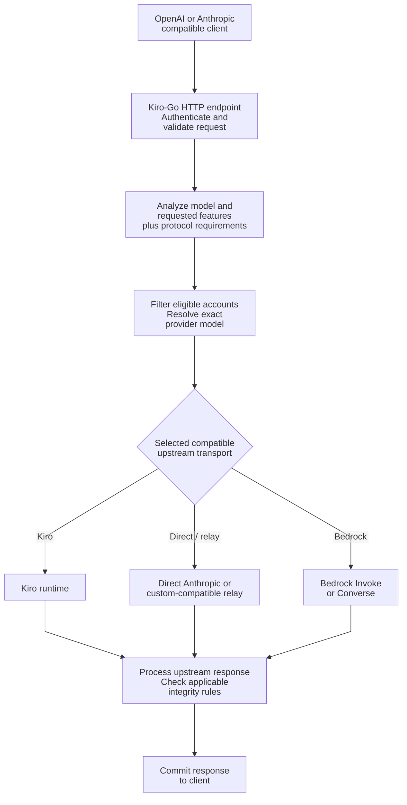
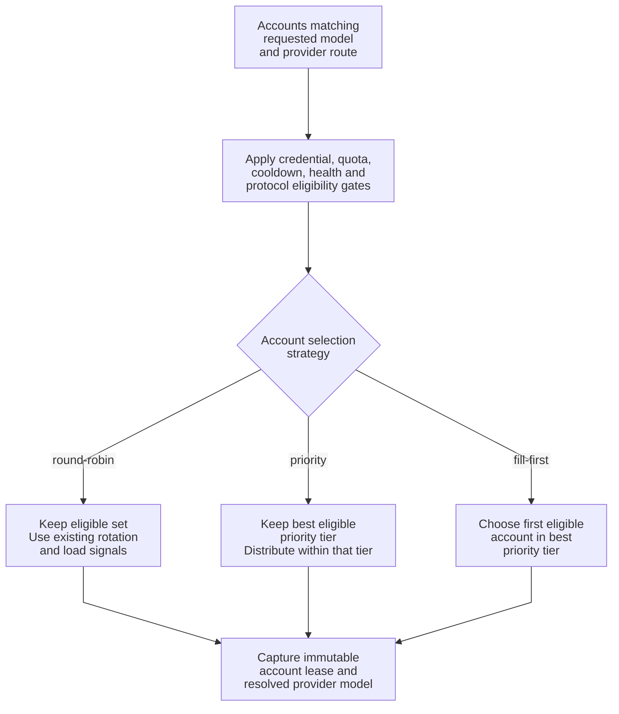
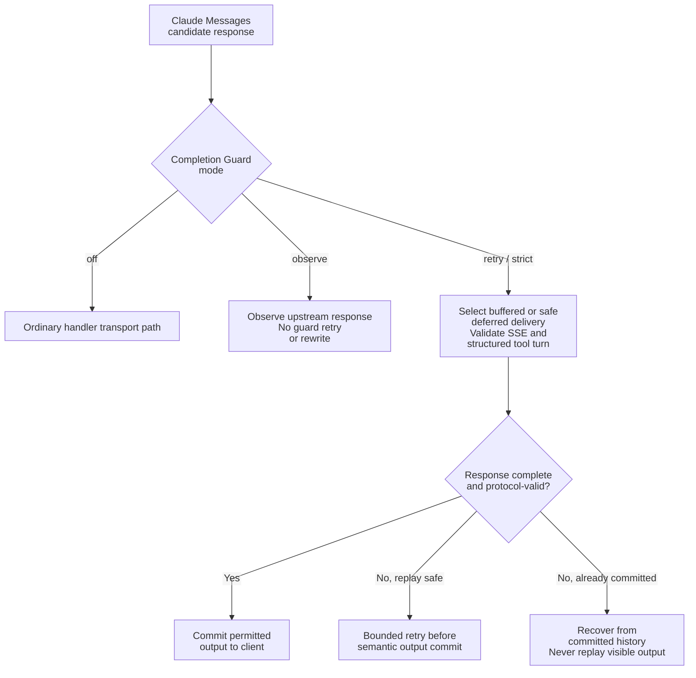

# Kiro-Go

[](https://go.dev/) [](https://www.docker.com/) [](LICENSE)

**Kiro-Go** exposes OpenAI-compatible and Anthropic Messages APIs over a pool of Kiro and other configured upstream accounts. The implementation includes provider-aware routing, account lifecycle safeguards, transport/protocol validation and bounded recovery. **API compatibility is feature- and transport-dependent**: an endpoint name alone does not mean every upstream implements every tool or reasoning feature.

**Languages:** [English](README.md) | [Tiếng Việt](README_VI.md) | [简体中文](README_CN.md)

## Features

- **API surfaces:** Anthropic `POST /v1/messages`, OpenAI `POST /v1/chat/completions`, `POST /v1/responses`, and `GET /v1/models`; streaming where the selected adapter supports it.
- **Upstreams:** Kiro OAuth / Kiro API Key, Direct Anthropic, Amazon Bedrock (Invoke or Converse), and custom-compatible relays, subject to endpoint-specific compatibility checks.
- **Multi-account routing:** `round-robin`, `priority`, and `fill-first` scheduling, eligibility checks, model discovery, cooldown/failover, and per-account health.
- **State safety:** lifecycle-gated asynchronous updates, safe config publication, background token/account reconciliation, and graceful request draining on shutdown.
- **Agent protocols:** tool calls and history, capability-aware thinking, selected Inline Tools / MCP semantics, structured output gates, and Completion Guard for Claude Messages.
- **Operations:** Web admin panel, usage statistics, provider credential import, EN/VI/ZH interface, and HTTP/SOCKS5 outbound proxies.

See [the architecture guide](docs/architecture/overview.md) for implementation details, invariants, supported transports and source/test references.

## Architecture at a glance



The request **must pass both account eligibility and protocol compatibility**. For example, a Kiro account advertising a model is not automatically capable of hosting an Anthropic server tool; a request that requires unsupported semantics must select a suitable transport or fail explicitly. The final response stage is protocol-specific: Claude Messages uses Completion Guard when enabled; OpenAI Responses uses independent state and stream handling. This diagram is conceptual, not a literal call stack. See [provider routing](docs/architecture/provider-routing.md), [agent protocols](docs/architecture/agent-protocol.md) and [Completion Guard](docs/architecture/completion-guard.md).

## Quick start

### Docker Compose (recommended for a local deployment)

Replace `OWNER/REPO` in the clone commands with the repository owner/name shown under **Code → HTTPS** (whether you use this fork or an upstream repository). The local checkout folder is always named `Kiro-Go`.

```bash
git clone --branch main https://github.com/OWNER/REPO.git Kiro-Go
cd Kiro-Go
mkdir -p data
KIRO_PORT=127.0.0.1:8080 docker compose up -d --build
curl -fsS http://localhost:8080/health
```

Compose **builds from this checkout**, mounts `./data` at `/app/data`, exposes the API on host port `8080` by default (the example restricts it to loopback with `KIRO_PORT=127.0.0.1:8080`), and publishes `127.0.0.1:3128` for the **listener-based Kiro Hosted SSO** flow. The separate **manual Microsoft SSO** flow needs no listener or SSH tunnel. To change the published API port, use `KIRO_PORT=127.0.0.1:9090 docker compose up -d --build` for local-only access; the service still listens on container port `8080`. These commands explicitly clone the **`main` branch**.

> **Security:** The supplied Compose file does **not** forward a host `ADMIN_PASSWORD` environment variable. The Compose default without this loopback override exposes the API on all host interfaces. On the first local start, sign in with the fresh-config password `changeme` and change it immediately in the admin UI **before allowing network access**; alternatively use a private Compose override that explicitly sets `ADMIN_PASSWORD` in the container. Compose enables `KIRO_IMPORT_WATCH=1`. Anyone able to write to `./data/imports` can cause accounts to be imported without the admin password. Keep that directory as restricted as `./data/config.json`, or set `KIRO_IMPORT_WATCH=0`. For remote deployments, use HTTPS and restrict access to `/admin`. Only **Kiro Hosted SSO** requires a browser able to reach the server-side callback listener at `localhost:3128` (normally a browser on the Docker host). **Manual Microsoft SSO** works from a remote browser by copying the two redirect URLs into Admin; no inbound `3128` connection or tunnel is required. Publishing the port in Compose does not make a remote browser’s `localhost` point to the VPS.

### Docker build and run (without Compose)

```bash
docker build -t kiro-go:local .
docker run -d \
  --name kiro-go \
  -p 127.0.0.1:8080:8080 \
  -e ADMIN_PASSWORD='replace-with-a-strong-password' \
  -v /absolute/path/to/data:/app/data \
  --restart unless-stopped \
  kiro-go:local
```

Replace `/absolute/path/to/data` with an actual writable host directory. This standalone command does **not** mount the IDE cache or publish the **Kiro Hosted SSO listener** port; use Compose or provide those settings only for that listener-based flow. **Manual Microsoft SSO** does not need the callback port. It also does not enable the import watcher unless requested.

### Build from source

```bash
git clone --branch main https://github.com/OWNER/REPO.git Kiro-Go
cd Kiro-Go
go build -o kiro-go .
./kiro-go
# CLI flag > PORT environment > saved config:
./kiro-go -port 9090
# or: PORT=9090 ./kiro-go
```

Requires Go 1.21+ according to `go.mod`. The server generates `data/config.json` if missing. The initial admin password in a fresh config is `changeme`; **change it before exposing the server**. `ADMIN_PASSWORD` overrides that value at runtime. Open `http://localhost:8080/admin` (or your configured port) to add accounts.

### Hosting and Zeabur

The repository includes a multi-stage `Dockerfile`. On Zeabur, deploy **from this GitHub repository**, expose container port `8080`, configure `ADMIN_PASSWORD`, and mount persistent storage at `/app/data`. Provide an HTTPS domain for external access. For remote sign-in, prefer **manual Microsoft SSO** (paste both browser callback URLs in Admin); it needs no `3128` port forwarding. The distinct **Kiro Hosted SSO** flow uses a callback listener and needs the browser on a host that can reach it. See [authentication](docs/architecture/authentication.md) and [troubleshooting](docs/troubleshooting.md).

## API usage

After adding an eligible account in `/admin`, use one of the supported API routes:

| Interface | Route | Important note |
|---|---|---|
| Anthropic Messages | `POST /v1/messages` | Claude-specific tools/reasoning features require compatible transport |
| Anthropic token counting | `POST /v1/messages/count_tokens` | Estimation and compatibility are model-dependent |
| OpenAI Chat Completions | `POST /v1/chat/completions` | Translation versus passthrough depends on account and request |
| OpenAI Responses | `POST /v1/responses` | Local state and external `previous_response_id` have different ownership |
| Model listing | `GET /v1/models` | Advertised models depend on current provider evidence and availability |
| Health check | `GET /health` | Useful for deployment checks; not proof an upstream account is usable |

```bash
# Anthropic Messages
curl http://localhost:8080/v1/messages \
  -H 'Content-Type: application/json' \
  -H 'anthropic-version: 2023-06-01' \
  -H 'x-api-key: YOUR_CLIENT_API_KEY' \
  -d '{"model":"claude-sonnet-4.5","max_tokens":1024,"messages":[{"role":"user","content":"Hello!"}]}'

# OpenAI Chat Completions
curl http://localhost:8080/v1/chat/completions \
  -H 'Content-Type: application/json' \
  -H 'Authorization: Bearer YOUR_CLIENT_API_KEY' \
  -d '{"model":"gpt-4o","messages":[{"role":"user","content":"Hello!"}]}'
```

`YOUR_CLIENT_API_KEY` represents a client API key configured in the admin panel. By default, client-key enforcement is disabled (`RequireApiKey=false`), so the sample authentication headers may be omitted. **Enable client-key enforcement before making the API public.** When enforcement is enabled with no configured keys, requests are rejected rather than accepted. Model IDs above are examples, **not guaranteed availability**: choose an entry actually returned by `/v1/models` for your configured providers.

## Accounts, importing credentials and routing

Kiro-Go supports Kiro sign-in accounts (AWS Builder ID / IAM Identity Center / Microsoft Enterprise SSO), Kiro API keys, and separately configured upstream transports such as Bedrock, Direct Anthropic and custom-compatible relays. Do not confuse an external identity provider (`external_idp`) with Direct Anthropic or Bedrock API credentials. See [authentication and trust boundaries](docs/architecture/authentication.md).

### Kiro API Key

In the admin panel, add an **API Key** account and enter `ksk_...` (optionally `ksk_...|region`). You can also use the admin credentials API:

```bash
# Set this to the *current* admin password for the following requests.
export ADMIN_PASSWORD='your-current-admin-password'
curl -X POST http://localhost:8080/admin/api/auth/credentials \
  -H 'Content-Type: application/json' \
  -H "X-Admin-Password: $ADMIN_PASSWORD" \
  -d '{"kiroApiKey":"ksk_your_key|us-east-1","authMethod":"api_key","nickname":"cli-key"}'
```

This is an **upstream Kiro API key**, not the key used by API clients connecting to Kiro-Go. Kiro API-key accounts do not use OAuth token refresh or `profileArn`. For an authentication failure, region reprobe is bounded and a candidate region is persisted only after the **runtime** retry succeeds; see [authentication](docs/architecture/authentication.md).

### Microsoft 365 / Entra ID and other credential imports

There are **five categories of account-entry paths** (the interactive category has two SSO flows); file import paths share an internal `h.importCredential` classifier and validation core:

1. **Interactive Enterprise SSO:** Admin → Add Account. **Microsoft Enterprise SSO** uses two manually pasted localhost redirect URLs and works with a remote browser without a tunnel; **Kiro Hosted SSO** uses a `localhost:3128` listener on the server and polls for completion. These are separate flows. See [SSO setup](docs/architecture/authentication.md#2-two-browser-sso-flows-and-callback-ownership).
2. **Paste or upload JSON:** The admin panel accepts the external helper's `CLIProxyAPI_*.json`, including `snake_case` credential fields, subject to validation.
3. **Batch/admin endpoint:** `POST /admin/api/auth/import-cli-json` accepts individual JSON, arrays, supported wrapper formats, or concatenated objects, with per-item results.
4. **Drop-folder watcher:** When `KIRO_IMPORT_WATCH=1`, eligible `CLIProxyAPI_*.json` files in `data/imports/` are processed and moved to `processed/` or `failed/`. Enabled by default **only in the supplied Compose configuration**.
5. **Import Kiro IDE cache:** The admin panel button or `POST /admin/api/auth/import-ide-cache` reads the server's `KIRO_IDE_CACHE` path (default `~/.aws/sso/cache/kiro-auth-token.json`). For Docker Compose, the host cache is mounted read-only and `KIRO_AWS_SSO_CACHE_DIR` controls the host-side directory.

```bash
# Import CLIProxyAPI helper JSON through the authenticated admin API
curl -X POST http://localhost:8080/admin/api/auth/import-cli-json \
  -H "X-Admin-Password: $ADMIN_PASSWORD" \
  -H 'Content-Type: application/json' \
  --data-binary @CLIProxyAPI_user.json

# Read the IDE cache from the server-configured location
curl -X POST http://localhost:8080/admin/api/auth/import-ide-cache \
  -H "X-Admin-Password: $ADMIN_PASSWORD"
```

**Important:** The IDE-cache endpoint intentionally **ignores a client-supplied `path`**. Set `KIRO_IDE_CACHE` on the server instead; allowing arbitrary paths in a request would cross a filesystem trust boundary. An IDE-cache import requires readable refresh material and performs a refresh rather than trusting a stale cache expiry. Keep credentials, import folders, admin sessions and logs private. Microsoft Enterprise SSO is not interchangeable with generic external IdP refresh; provider classification and endpoint validation are enforced server-side.

### Multi-account scheduling



The strategy **never bypasses eligibility**. `priority` chooses the lowest numeric priority tier among *eligible* accounts, then allows the existing selector to distribute within the tier. `fill-first` picks the first eligible account in that tier according to pool/config order. Empty or invalid saved strategy values fall back to `round-robin`; legacy unset account priority uses effective tier `100`. A request snapshots both account lifecycle and model routing evidence; asynchronous completion cannot mutate a newly recreated account that reuses the same ID. See [provider routing](docs/architecture/provider-routing.md) and [account lifecycle](docs/architecture/account-lifecycle.md).

## Agent protocol, Completion Guard and streaming safety

Compatibility is **semantic**, not just JSON syntax. Features such as MCP history, server tools, deferred loading, thinking signatures and structured JSON output may require a transport that preserves those semantics. A compatible-looking model alias is not enough. OpenAI Responses has separate local/external state ownership; Direct Anthropic and Bedrock are **not** native `/v1/responses` adapters in this implementation. See [agent protocol matrix](docs/architecture/agent-protocol.md).



The default guard mode is `strict`, but **semantic completion audit is off by default**. If enabled with `KIRO_AGENT_COMPLETION_AUDIT=enforce`, an audit result of `needs_action` requires an independent verifier to authorize autonomous continuation; uncertainty or missing approval keeps the original usable response. `buffered` retains a response until final checks; `deferred-stream` can emit safe ordinary content early but holds structured tool turns atomically. Stream retry must not duplicate already committed text, reasoning or tools. The `observe` mode does **not** enforce validation. See [Completion Guard](docs/architecture/completion-guard.md) and [streaming/recovery](docs/architecture/streaming-recovery.md).

### Thinking, reasoning and text chunks

A configurable suffix (default `-thinking`) is a Kiro-Go convention; Claude requests may instead supply a top-level `thinking` object, subject to the resolved model's capabilities. Provider-issued thinking signatures are preserved on compatible transparent transports; Kiro's local continuation provenance is **not** presented as an Anthropic signature. `KIRO_ASSISTANT_CHUNK_MODE` and `KIRO_REASONING_CHUNK_MODE` default to `delta` so repeated text is not wrongly discarded; `cumulative` and opt-in `legacy` serve different upstream contracts. See [agent protocols](docs/architecture/agent-protocol.md) and [stream decoding](docs/architecture/streaming-recovery.md).

## Configuration reference

The values below are from the current code and provided Compose file. An option may be **runtime environment-only**, **persisted in `data/config.json`**, or **set through the admin UI**; do not assume that changing the container environment updates an already running process.

| Variable | Meaning | Default / behavior |
|---|---|---|
| `CONFIG_PATH` | Config file location | `data/config.json` |
| `ADMIN_PASSWORD` | Override admin password | Default fresh-config password: `changeme`; set explicitly |
| `PORT`, `HOST` | Listen port and address | `8080`, `0.0.0.0`; CLI `-port` / `-host` overrides env |
| `KIRO_PORT` | Host port published by Docker Compose | `8080`; container remains `8080` |
| `KIRO_IMPORT_WATCH` | Enable credential drop-folder watcher | Off normally; `1` in supplied Compose |
| `KIRO_IMPORT_DIR` | Watcher directory | `data/imports` |
| `KIRO_IDE_CACHE` | Server-side Kiro IDE credential cache | `~/.aws/sso/cache/kiro-auth-token.json`; Compose sets mounted path |
| `KIRO_AWS_SSO_CACHE_DIR` | Host directory mounted read-only by Compose | `${HOME}/.aws/sso/cache` |
| `KIRO_SSO_CALLBACK_BIND` | Bind address for **Kiro Hosted SSO listener only** | Loopback by default; Compose uses `0.0.0.0` in-container; manual Microsoft SSO ignores this variable |
| `KIRO_PROFILE_REGIONS` | Kiro profile/API-key region probe candidates | Built-in list; comma-separated override |
| `KIRO_DIAGNOSTICS` | Aggregate diagnostics master option | Disabled |
| `KIRO_DIAG_STREAM`, `KIRO_DIAG_PAYLOAD`, `KIRO_DIAG_REASONING` | Granular metrics/diagnostics | Disabled |
| `KIRO_DIAG_CHUNKS` | Raw text/chunk logging; can expose secrets | Disabled; **not implied** by `KIRO_DIAGNOSTICS` |
| `KIRO_ASSISTANT_CHUNK_MODE`, `KIRO_REASONING_CHUNK_MODE` | Chunk decoder (`delta` / `cumulative` / `legacy`) | `delta` |
| `KIRO_SYNTHETIC_THINKING_SIGNATURE` | Local fallback policy (`auto` / `always` / `never`) | `auto` |
| `KIRO_AGENT_COMPLETION_GUARD` | Claude guard (`off` / `observe` / `retry` / `strict`) | `strict` |
| `KIRO_AGENT_COMPLETION_DELIVERY` | `auto` / `buffered` / `deferred-stream` | `auto` |
| `KIRO_AGENT_COMPLETION_GUARD_MAX_RETRIES` | Bound guard recovery attempts | `2` (allowed `0`–`4`) |
| `KIRO_AGENT_COMPLETION_GUARD_HEARTBEAT_MS` | Wait-state SSE heartbeat interval | `10000` (allowed `1000`–`60000`) |
| `KIRO_AGENT_COMPLETION_GUARD_MAX_BUFFER_BYTES` | Guard retained-payload budget | `16777216` bytes; not a Go heap cap |
| `KIRO_AGENT_COMPLETION_AUDIT` | Semantic audit (`off` / `observe` / `enforce`) | `off` |
| `KIRO_NATIVE_TOOL_CHOICE` | Native forced tool selection (`never` / `auto` / `always`) | `auto` |
| `KIRO_MAX_REQUEST_BODY_BYTES` | General request-body limit; transport may be stricter | `67108864` bytes (64 MiB); Messages/count_tokens max 32 MiB |
| `LOG_LEVEL` | Logging verbosity (overrides saved `logLevel`) | `info`; accepts `debug`, `info`, `warn`, `error` |
| `BEDROCK_MODEL_MAP` | Optional global JSON map of client model aliases to Bedrock model IDs | Per-account map takes precedence; exact discovered model and built-in fallback may also apply |
| `CUSTOM_API_CREDITS_PER_1K_TOKENS` | Local credit accounting for Custom API forwarding | `1.0` credit per 1,000 tokens when no upstream price is known |

Routing strategy, priority, API key enforcement, thinking preferences and account settings are managed via the admin UI / persisted config. Consult [provider routing](docs/architecture/provider-routing.md), [Completion Guard](docs/architecture/completion-guard.md) and [authentication](docs/architecture/authentication.md) for exact eligibility and failure boundaries.

## Security, limitations and troubleshooting

- **Before public exposure:** replace `changeme`, enable and configure API client authentication, terminate TLS with a trusted reverse proxy and restrict administrative routes. The development defaults are not a production security profile.
- **Secret files:** `/app/data/config.json` contains live upstream credentials. Restrict volume/filesystem access, backups and logs; never commit the data directory or CLI credential exports.
- **Import watcher:** when enabled, directory write access is effectively account-import privilege. Avoid sharing `data/imports` with less-trusted users or services.
- **Protocol compatibility:** an account can be healthy but ineligible for a particular model, tool family, reasoning mode or Responses history. Inspect the requested feature and provider transport before interpreting a 400/503 as a credential failure.
- **Streaming:** a truncated stream is not automatically a successful response; retries stop at the semantic output boundary. Use aggregate diagnostics first; `KIRO_DIAG_CHUNKS` may record sensitive content.
- **Useful checks:** `GET /health`, `GET /v1/models`, account status in `/admin`, then [provider routing](docs/architecture/provider-routing.md) and [streaming recovery](docs/architecture/streaming-recovery.md). `/health` alone does not test an upstream provider.

For deployment examples, see [configuration reference](docs/configuration.md); for callback, model and stream errors, see [troubleshooting](docs/troubleshooting.md).

## Architecture documentation

| Topic | Guide |
|---|---|
| End-to-end request and shutdown lifecycle | [Architecture overview](docs/architecture/overview.md) |
| Model evidence, provider choice and scheduling | [Provider routing](docs/architecture/provider-routing.md) |
| Account generations, reconciler and persistence | [Account lifecycle](docs/architecture/account-lifecycle.md) |
| Claude response integrity and semantic audit | [Completion Guard](docs/architecture/completion-guard.md) |
| Claude tools, MCP, reasoning and Responses ownership | [Agent protocols](docs/architecture/agent-protocol.md) |
| SSE parsing, retry and decoder contracts | [Streaming and recovery](docs/architecture/streaming-recovery.md) |
| OAuth, SSO, API keys and import trust boundaries | [Authentication](docs/architecture/authentication.md) |

## Contributing and upstream credits

Issues and pull requests with reproducible cases and regression tests are welcome. Development includes contributions and integrations from multiple authors; see the [changelog and commit provenance](CHANGELOG.md) and Git history for attribution. Read the architecture documentation before changing routing, lifecycle or protocol handling.

## Disclaimer

For educational and research purposes only. Not affiliated with Amazon, AWS or Kiro. Users are responsible for complying with applicable laws and service terms. Use at your own risk.

## License

[MIT](LICENSE)
