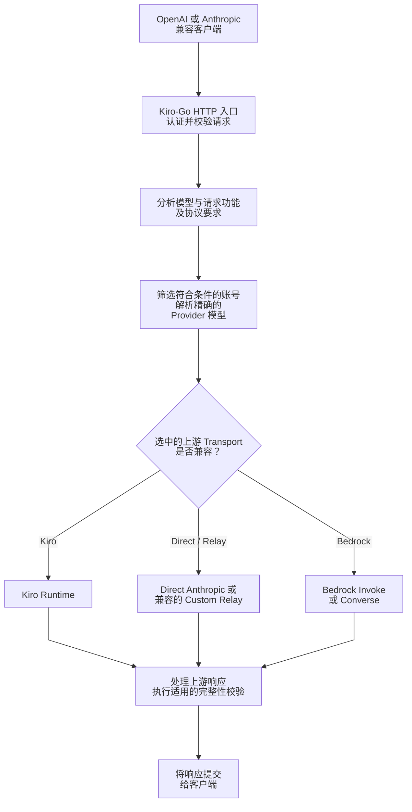
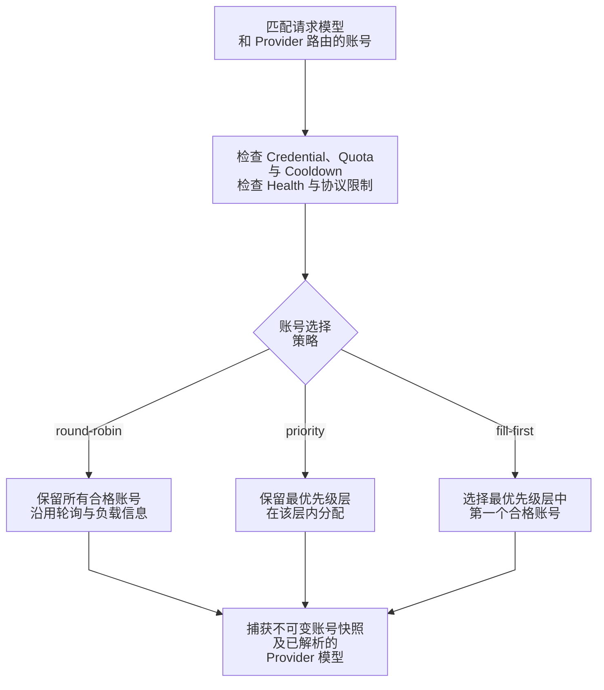
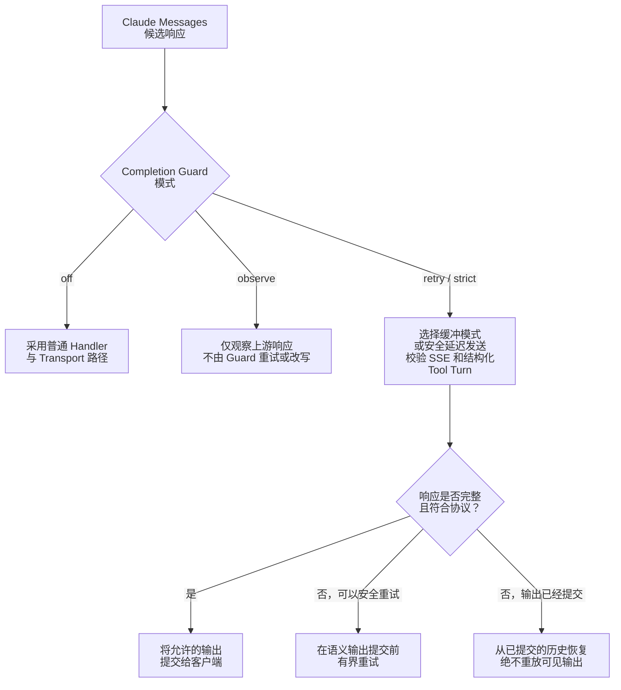

# Kiro-Go

[](https://go.dev/) [](https://www.docker.com/) [](LICENSE)

**Kiro-Go** 将 Kiro 账号及其他已配置的上游账号汇聚为兼容 OpenAI 和 Anthropic Messages 的 API 服务。项目包含按提供商路由、账号生命周期保护、协议兼容性校验和有界恢复机制。**兼容性取决于具体功能及传输后端**：有相同名称的 API 接口不意味着每种上游都支持所有工具或推理功能。

**语言：** [English](README.md) | [Tiếng Việt](README_VI.md) | [简体中文](README_CN.md)

## 功能特性

- **API 接口：** Anthropic `POST /v1/messages`、OpenAI `POST /v1/chat/completions`、`POST /v1/responses`、`GET /v1/models`；在所选适配器支持时提供流式响应。
- **上游类型：** Kiro OAuth / Kiro API Key、Direct Anthropic、Amazon Bedrock（Invoke 或 Converse）以及兼容的自定义中继；不同接口有不同兼容性限制。
- **多账号路由：** `round-robin`、`priority`、`fill-first` 调度、账号可用性检查、模型发现、冷却/故障转移及逐账号健康状态。
- **状态安全：** 通过生命周期代数阻止过期异步写入、安全发布配置、后台令牌/账号协调，以及关闭服务时等待已接纳的请求完成。
- **Agent 协议：** 工具调用与历史记录、按能力启用 thinking、受支持的 Inline Tools / MCP 语义、结构化输出能力检查以及适用于 Claude Messages 的 Completion Guard。
- **运营功能：** Web 管理面板、用量统计、凭证导入、英文/越南文/中文界面及 HTTP/SOCKS5 出站代理。

关于实现细节、系统不变量、支持的 transport 和源码/测试链接，请参阅[架构总览](docs/architecture/zh-CN/overview.md)。

## 架构总览



每个请求必须同时满足**账号可用性与协议兼容性**。例如，Kiro 账号即使公开了某个模型，也不代表它能执行 Anthropic server tool。遇到该后端不支持的语义时，必须选择兼容的传输后端或明确报错，不能静默丢弃字段。最终响应检查根据接口而异：Claude Messages 在启用时走 Completion Guard，OpenAI Responses 则具有独立的状态归属和流式处理规则。该图是概念架构，并非准确的调用栈。参阅[提供商路由](docs/architecture/zh-CN/provider-routing.md)、[Agent 协议](docs/architecture/zh-CN/agent-protocol.md)及 [Completion Guard](docs/architecture/zh-CN/completion-guard.md)。

## 快速开始

### Docker Compose（推荐用于本地部署）

请将 clone 命令中的 `OWNER/REPO` 替换为 GitHub **Code → HTTPS** 中显示的仓库所有者与仓库名（可以是 fork 或上游仓库）。无论仓库名称如何变化，本地目录均命名为 `Kiro-Go`。

```bash
git clone --branch main https://github.com/OWNER/REPO.git Kiro-Go
cd Kiro-Go
mkdir -p data
KIRO_PORT=127.0.0.1:8080 docker compose up -d --build
curl -fsS http://localhost:8080/health
```

Compose **直接构建当前 checkout 的源码**，将 `./data` 挂载到 `/app/data`，默认在宿主机 `8080` 端口发布 API（示例使用 `KIRO_PORT=127.0.0.1:8080` 限制为回环访问），并将 Microsoft SSO 浏览器回调限制在宿主机回环地址 `127.0.0.1:3128`。更改宿主机 API 端口：`KIRO_PORT=127.0.0.1:9090 docker compose up -d --build`（仅本机可访问）；容器内部仍监听 `8080`。上述命令明确检出仓库的 **`main`** 分支。

> **安全提示：** 当前 `docker-compose.yml` **不会自动把宿主机 `ADMIN_PASSWORD` 环境变量传入容器**。如果没有示例中的 loopback 限制，Compose 默认将 API 发布到宿主机所有网络接口。首次本地运行时可用新配置默认密码 `changeme` 登录，但必须在**允许任何网络访问之前**立即在管理界面修改；或者使用私有 Compose override，在容器环境中显式设置 `ADMIN_PASSWORD`。Compose 默认启用 `KIRO_IMPORT_WATCH=1`：能向 `./data/imports` 写文件的主体，无须管理员密码即可导入账号。务必像保护 `./data/config.json` 一样保护该目录，必要时设置 `KIRO_IMPORT_WATCH=0`。远程部署应启用 HTTPS 并限制 `/admin` 的访问。Microsoft SSO 回调要求浏览器运行于 **Docker 宿主机**，而非另一台远程电脑。

### Docker 构建和运行（不使用 Compose）

```bash
docker build -t kiro-go:local .
docker run -d \
  --name kiro-go \
  -p 127.0.0.1:8080:8080 \
  -e ADMIN_PASSWORD='replace-with-a-strong-password' \
  -v /absolute/path/to/data:/app/data \
  --restart unless-stopped \
  kiro-go:local
```

请将 `/absolute/path/to/data` 改成有写权限的宿主机目录。此独立运行命令**未**挂载 IDE cache，也没有发布 Enterprise SSO 回调端口；若有需要，请自行增加相关参数或使用 Compose。除非明确设置，独立运行时也不会启用导入 watcher。

### 从源码编译

```bash
git clone --branch main https://github.com/OWNER/REPO.git Kiro-Go
cd Kiro-Go
go build -o kiro-go .
./kiro-go
# 优先级：CLI 参数 > PORT 环境变量 > 已保存的配置：
./kiro-go -port 9090
# 或者：PORT=9090 ./kiro-go
```

根据 `go.mod`，要求 Go 1.21+。首次运行会自动生成 `data/config.json`。新配置的默认管理密码是 `changeme`；**在对外开放前务必修改**。运行时 `ADMIN_PASSWORD` 可以覆盖配置中的密码。访问 `http://localhost:8080/admin`（或已设置的端口）添加账号。

### 云部署与 Zeabur

仓库包含多阶段 `Dockerfile`。在 Zeabur 上**从本 GitHub 仓库部署**，暴露容器 `8080` 端口、设置 `ADMIN_PASSWORD`，并将持久存储挂载至 `/app/data`。外部访问应使用 HTTPS 域名。Microsoft SSO 的交互式登录采用 loopback 回调，需单独验证浏览器与网络配置，不能假设在远程容器内原样可用。

## API 使用方法

在 `/admin` 中添加可用账号后，即可调用对应的接口：

| 接口 | 路径 | 注意事项 |
|---|---|---|
| Anthropic Messages | `POST /v1/messages` | Claude 特有的工具/推理功能需要兼容的传输后端 |
| Anthropic Token 统计 | `POST /v1/messages/count_tokens` | 估算与兼容性取决于模型 |
| OpenAI Chat Completions | `POST /v1/chat/completions` | 协议转换或透传取决于账号和请求语义 |
| OpenAI Responses | `POST /v1/responses` | 本地与外部 `previous_response_id` 的状态归属不同 |
| 模型列表 | `GET /v1/models` | 取决于当前模型证据和上游可用性 |
| 健康检查 | `GET /health` | 不代表上游账号一定可以完成调用 |

```bash
# Anthropic Messages
curl http://localhost:8080/v1/messages \
  -H 'Content-Type: application/json' \
  -H 'anthropic-version: 2023-06-01' \
  -H 'x-api-key: YOUR_CLIENT_API_KEY' \
  -d '{"model":"claude-sonnet-4.5","max_tokens":1024,"messages":[{"role":"user","content":"Hello!"}]}'

# OpenAI Chat Completions
curl http://localhost:8080/v1/chat/completions \
  -H 'Content-Type: application/json' \
  -H 'Authorization: Bearer YOUR_CLIENT_API_KEY' \
  -d '{"model":"gpt-4o","messages":[{"role":"user","content":"Hello!"}]}'
```

`YOUR_CLIENT_API_KEY` 代表在管理界面中配置的客户端 API Key。默认情况下不强制验证客户端密钥（`RequireApiKey=false`），因此在此模式下可以省略示例中的认证请求头。**公开 API 前务必启用并配置客户端密钥认证。** 若启用了验证但未配置任何密钥，服务会拒绝请求（fail-closed）。示例模型 ID **不保证一定可用**；应从已配置提供商实际返回的 `/v1/models` 中选择。

## 账号、凭证导入与路由

Kiro-Go 支持 Kiro 登录账号（AWS Builder ID / IAM Identity Center / Microsoft Enterprise SSO）、Kiro API Key，以及单独配置的 Bedrock、Direct Anthropic 和自定义兼容中继。外部身份提供商 `external_idp` 不等同于 Direct Anthropic 或 Bedrock API 凭证。参阅[认证与信任边界](docs/architecture/zh-CN/authentication.md)。

### Kiro API Key

在管理界面添加 **API Key** 账号，输入 `ksk_...`（也可用 `ksk_...|region`）。还可以使用管理员凭证 API：

```bash
# 以下请求请使用当前管理员密码。
export ADMIN_PASSWORD='your-current-admin-password'
curl -X POST http://localhost:8080/admin/api/auth/credentials \
  -H 'Content-Type: application/json' \
  -H "X-Admin-Password: $ADMIN_PASSWORD" \
  -d '{"kiroApiKey":"ksk_your_key|us-east-1","authMethod":"api_key","nickname":"cli-key"}'
```

这里的是 **Kiro 上游 API Key**，不是客户端连接 Kiro-Go 所用的密钥。Kiro API-key 账号不走 OAuth refresh，也不使用 `profileArn`。发生认证失败时，重新探测 region 的次数有界；仅当新的 **runtime** 重试成功后才持久化该 region。详见[认证](docs/architecture/zh-CN/authentication.md)。

### Microsoft 365 / Entra ID 与其他凭证导入方式

共有**五种凭证接入方式**；基于文件的导入流程最终统一由 `h.importCredential` 负责分类与校验：

1. **交互式 Enterprise SSO：** 管理界面 → Add Account → Enterprise SSO，使用托管登录页面。
2. **粘贴或上传 JSON：** 管理界面接受外部 helper 生成的 `CLIProxyAPI_*.json`，包括 `snake_case` 字段，经过校验后导入。
3. **批量/管理员 API：** `POST /admin/api/auth/import-cli-json` 接受单个 JSON、数组、支持的 wrapper 格式或串联对象，并返回逐项结果。
4. **文件夹 watcher：** 设置 `KIRO_IMPORT_WATCH=1` 后，`data/imports/` 中符合条件的 `CLIProxyAPI_*.json` 被处理并移至 `processed/` 或 `failed/`。**只有随项目提供的 Compose 配置**默认开启。
5. **导入 Kiro IDE 缓存：** 管理按钮或 `POST /admin/api/auth/import-ide-cache` 从服务器配置的 `KIRO_IDE_CACHE` 路径读取（默认 `~/.aws/sso/cache/kiro-auth-token.json`）。Compose 将宿主机缓存以只读方式挂载；`KIRO_AWS_SSO_CACHE_DIR` 指定宿主机目录。

```bash
# 通过已认证的管理 API 导入 CLIProxyAPI JSON
curl -X POST http://localhost:8080/admin/api/auth/import-cli-json \
  -H "X-Admin-Password: $ADMIN_PASSWORD" \
  -H 'Content-Type: application/json' \
  --data-binary @CLIProxyAPI_user.json

# 从服务端配置的路径读取 Kiro IDE 缓存
curl -X POST http://localhost:8080/admin/api/auth/import-ide-cache \
  -H "X-Admin-Password: $ADMIN_PASSWORD"
```

**重要：** IDE-cache 接口会故意**忽略客户端发送的 `path` 字段**。自定义路径只能通过服务器端 `KIRO_IDE_CACHE` 设置，以防请求越过文件系统信任边界读取任意文件。IDE-cache 导入必须具备可读取的 refresh 凭证，并实际刷新令牌，而非相信旧缓存的过期时间。请保护好凭证、导入目录、管理会话和日志。Microsoft Enterprise SSO 与通用外部 IdP 的刷新流程不能混淆；服务端会分别进行提供商分类和端点验证。

### 多账号调度策略



调度策略**不能绕过账号可用性条件**。`priority` 从*已通过筛选的账号*中选择数值最低的优先级层，再由现有选择器在该层内分配。`fill-first` 则选择该层内按 pool/config 顺序排在最前的可用账号。空的或无效的已保存策略会回退到 `round-robin`；未设置 priority 的旧账号使用有效优先级 `100`。请求会保存账号生命周期及模型路由的快照，因此晚到的异步结果不能误写入复用同一 ID 的新账号。参阅[提供商路由](docs/architecture/zh-CN/provider-routing.md)和[账号生命周期](docs/architecture/zh-CN/account-lifecycle.md)。

## Agent 协议、Completion Guard 与流式安全

这里的兼容性针对**协议语义**，而不只是 JSON 的形状。MCP 历史、server tools、延迟加载、thinking 签名或结构化 JSON 输出可能要求能无损保留相应语义的传输后端。模型别名相同并不保证功能相同。OpenAI Responses 区分本地/外部状态所有权；当前实现中 Direct Anthropic 和 Bedrock **不属于原生 `/v1/responses` 适配器**。参阅[Agent 协议矩阵](docs/architecture/zh-CN/agent-protocol.md)。



Guard 默认模式为 `strict`，但**语义层 completion audit 默认关闭**。当 `KIRO_AGENT_COMPLETION_AUDIT=enforce` 启用时，即使 audit 给出 `needs_action`，仍需独立 verifier 授权才可自主继续；证据不足或未获批准时保留原本可用的回复。`buffered` 在最终验证前保留整个响应；`deferred-stream` 可以先发送安全的普通内容，但需原子性地保留并校验结构化工具回合。重试不得重复发送已提交给客户端的文本、推理或工具调用。`observe` **不执行强制校验**。参阅 [Completion Guard](docs/architecture/zh-CN/completion-guard.md) 与[流式恢复](docs/architecture/zh-CN/streaming-recovery.md)。

### Thinking、推理与流式文本块

可配置的模型后缀（默认 `-thinking`）属于 Kiro-Go 约定；Claude 请求也可提供顶层 `thinking` 对象，但必须符合最终模型的能力约束。在兼容的透明传输后端中，提供商签发的 thinking signature 原样保留；Kiro 内部 continuation 的 provenance signature **不冒充 Anthropic 签名**。`KIRO_ASSISTANT_CHUNK_MODE` 和 `KIRO_REASONING_CHUNK_MODE` 默认 `delta`，避免错误删除有效的重复文本；`cumulative` 与可选的 `legacy` 对应不同上游流式约定。参阅 [Agent 协议](docs/architecture/zh-CN/agent-protocol.md) 与[流式解码](docs/architecture/zh-CN/streaming-recovery.md)。

## 配置参考

下面的值来自当前源码及随附 Compose 文件。有些配置项**只在进程启动时读取环境变量**，有些**保存在 `data/config.json`**，还有些**由管理界面操作**；在正在运行的容器外更改环境变量并不会自动重新加载。

| 变量 | 用途 | 默认值 / 行为 |
|---|---|---|
| `CONFIG_PATH` | 配置文件路径 | `data/config.json` |
| `ADMIN_PASSWORD` | 覆盖管理员密码 | 新配置默认 `changeme`；应显式修改 |
| `PORT`, `HOST` | 监听端口及地址 | `8080`、`0.0.0.0`；CLI `-port` / `-host` 高于环境变量 |
| `KIRO_PORT` | Compose 发布的宿主机端口 | `8080`；容器端口仍为 `8080` |
| `KIRO_IMPORT_WATCH` | 启用文件夹凭证导入 watcher | 通常关闭；随附 Compose 设置 `1` |
| `KIRO_IMPORT_DIR` | Watcher 扫描目录 | `data/imports` |
| `KIRO_IDE_CACHE` | 服务器上的 Kiro IDE 凭证缓存路径 | `~/.aws/sso/cache/kiro-auth-token.json`；Compose 指向挂载位置 |
| `KIRO_AWS_SSO_CACHE_DIR` | Compose 只读挂载的宿主机缓存目录 | `${HOME}/.aws/sso/cache` |
| `KIRO_SSO_CALLBACK_BIND` | Enterprise SSO 回调监听地址 | 通常为 loopback；Compose 网络内用 `0.0.0.0` |
| `KIRO_PROFILE_REGIONS` | Kiro profile/API key 探测 region | 内置列表，可用逗号分隔值覆盖 |
| `KIRO_DIAGNOSTICS` | 启用聚合诊断 | 关闭 |
| `KIRO_DIAG_STREAM`, `KIRO_DIAG_PAYLOAD`, `KIRO_DIAG_REASONING` | 专项统计/诊断 | 关闭 |
| `KIRO_DIAG_CHUNKS` | 原始文本块日志，可能泄露秘密 | 关闭；**不会因** `KIRO_DIAGNOSTICS` **开启而自动开启** |
| `KIRO_ASSISTANT_CHUNK_MODE`, `KIRO_REASONING_CHUNK_MODE` | 文本块解码器（`delta` / `cumulative` / `legacy`） | `delta` |
| `KIRO_SYNTHETIC_THINKING_SIGNATURE` | 本地 fallback 策略（`auto` / `always` / `never`） | `auto` |
| `KIRO_AGENT_COMPLETION_GUARD` | Claude guard（`off` / `observe` / `retry` / `strict`） | `strict` |
| `KIRO_AGENT_COMPLETION_DELIVERY` | `auto` / `buffered` / `deferred-stream` | `auto` |
| `KIRO_AGENT_COMPLETION_GUARD_MAX_RETRIES` | Guard 恢复重试上限 | `2`（允许 `0`–`4`） |
| `KIRO_AGENT_COMPLETION_GUARD_HEARTBEAT_MS` | 等待期间的 SSE heartbeat 间隔 | `10000`（允许 `1000`–`60000`） |
| `KIRO_AGENT_COMPLETION_GUARD_MAX_BUFFER_BYTES` | Guard 保留负载预算 | `16777216` 字节；并非 Go 堆内存上限 |
| `KIRO_AGENT_COMPLETION_AUDIT` | 语义审计（`off` / `observe` / `enforce`） | `off` |
| `KIRO_NATIVE_TOOL_CHOICE` | 原生工具选择（`never` / `auto` / `always`） | `auto` |
| `KIRO_MAX_REQUEST_BODY_BYTES` | 通用请求体限制，transport 可能更严格 | `67108864` 字节（64 MiB）；Messages/count_tokens 最高 32 MiB |

路由策略、账号优先级、客户端密钥强制认证、thinking 偏好及账号信息由管理界面和持久化配置管理。详见[提供商路由](docs/architecture/zh-CN/provider-routing.md)、[Completion Guard](docs/architecture/zh-CN/completion-guard.md)和[认证](docs/architecture/zh-CN/authentication.md)，了解准确的筛选条件及错误边界。

## 安全、限制与故障排查

- **公开服务前：** 修改 `changeme`，启用并配置客户端 API Key 验证，使用可信的 HTTPS 反向代理并限制管理路由。开发环境的默认设置**不属于生产安全配置**。
- **凭证文件：** `/app/data/config.json` 包含有效的上游凭证。保护卷、文件系统、备份及日志；不要提交 data 目录或 CLI 导出的凭证。
- **导入 watcher：** 开启后，目录写入权限相当于账号导入权限。不要与低信任用户/服务共享 `data/imports`。
- **协议兼容：** 健康的账号也可能不支持某个模型、工具类别、推理模式或 Responses 历史。在将 400/503 归咎于凭证之前，应检查请求语义及传输后端。
- **流式输出：** 截断的流不能自动视为成功；超过语义输出提交边界后不得重新播放整个请求。优先开启聚合诊断；`KIRO_DIAG_CHUNKS` 可能记录敏感内容。
- **常用检查：** `GET /health`、`GET /v1/models`、`/admin` 中的账号状态，以及[提供商路由](docs/architecture/zh-CN/provider-routing.md)和[流式恢复](docs/architecture/zh-CN/streaming-recovery.md)。`/health` 本身不会测试上游账号。

## 架构文档

| 主题 | 文档 |
|---|---|
| 完整请求流程与关闭生命周期 | [架构总览](docs/architecture/zh-CN/overview.md) |
| 模型证据、提供商选择与调度 | [Provider 路由](docs/architecture/zh-CN/provider-routing.md) |
| 账号 generation、reconciler 与持久化 | [账号生命周期](docs/architecture/zh-CN/account-lifecycle.md) |
| Claude 响应完整性与语义审计 | [Completion Guard](docs/architecture/zh-CN/completion-guard.md) |
| Claude tools、MCP、reasoning 与 Responses 状态归属 | [Agent 协议](docs/architecture/zh-CN/agent-protocol.md) |
| SSE、重试与解码器约束 | [流完整性与恢复](docs/architecture/zh-CN/streaming-recovery.md) |
| OAuth、SSO、API Key 与导入信任边界 | [身份认证与凭据导入](docs/architecture/zh-CN/authentication.md) |

## 参与贡献与上游致谢

欢迎提交附有复现步骤和回归测试的 issue / PR。项目包含多位贡献者的开发与集成成果，请参阅 [CHANGELOG 及提交记录](CHANGELOG.md)追溯变更来源。修改路由、生命周期或协议逻辑前，请先阅读架构文档。

## 免责声明

本项目仅供学习与研究，与 Amazon、AWS 或 Kiro 无关。用户应自行遵守适用法律及服务条款，并自行承担使用风险。

## 许可证

[MIT](LICENSE)
