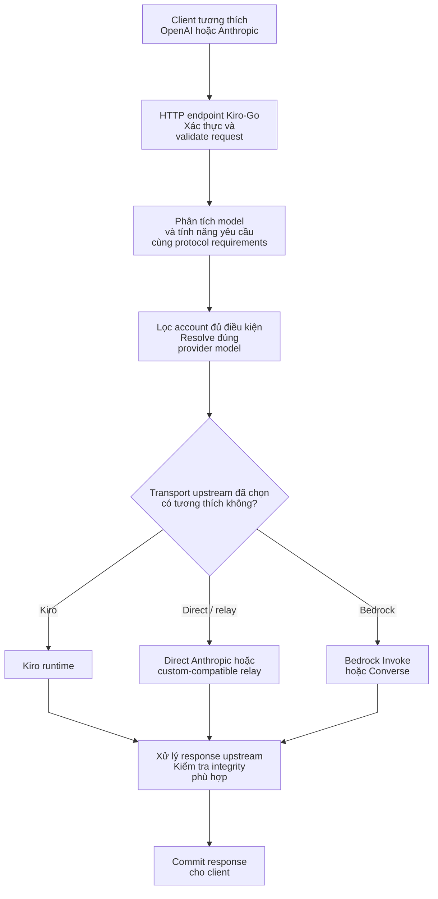
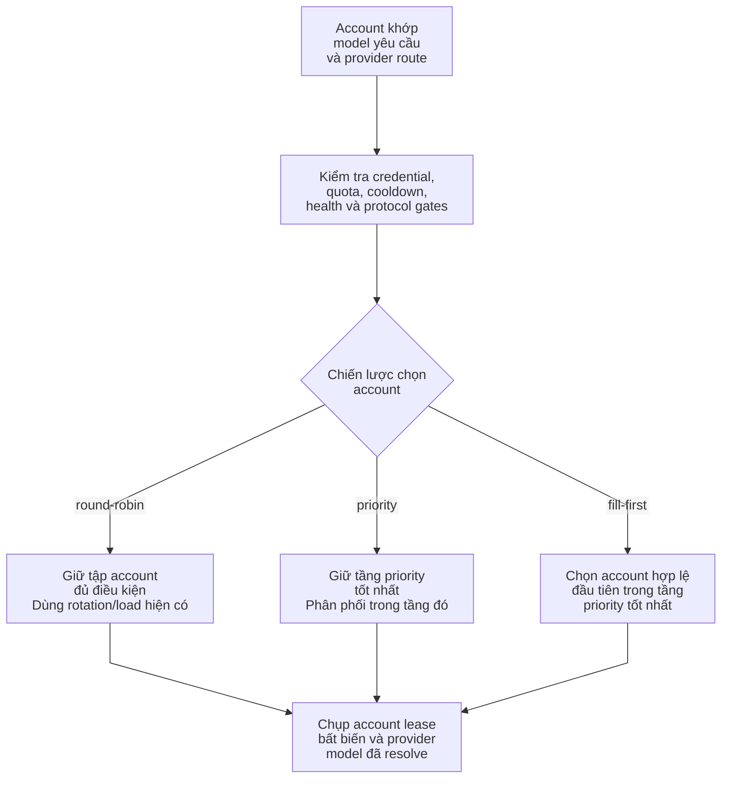
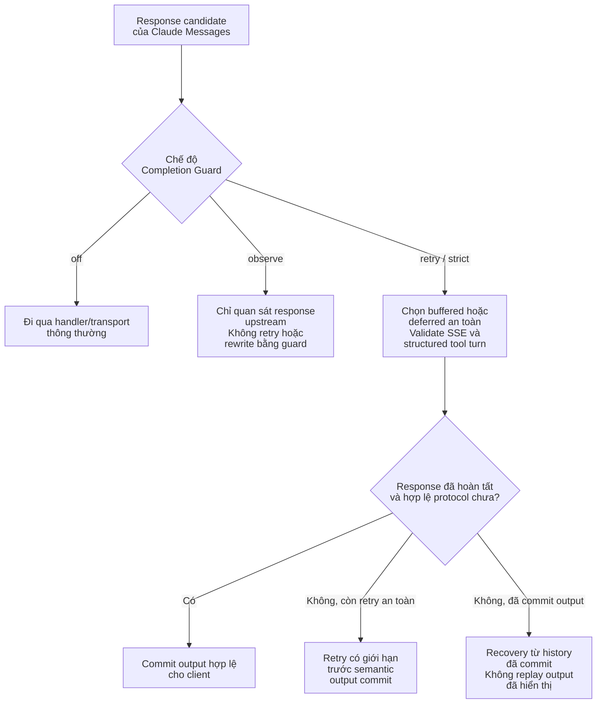

# Kiro-Go

[](https://go.dev/) [](https://www.docker.com/) [](LICENSE)

**Kiro-Go** cung cấp API tương thích OpenAI và Anthropic Messages trên một pool tài khoản Kiro cùng các upstream được cấu hình. Dự án có routing theo provider, bảo vệ vòng đời tài khoản, kiểm tra tính tương thích giao thức và cơ chế phục hồi có giới hạn. **Tính tương thích phụ thuộc tính năng và transport**: có endpoint tương ứng không có nghĩa mọi upstream đều hỗ trợ mọi loại tool hoặc reasoning.

**Ngôn ngữ:** [English](README.md) | [Tiếng Việt](README_VI.md) | [简体中文](README_CN.md)

## Tính năng

- **API:** Anthropic `POST /v1/messages`, OpenAI `POST /v1/chat/completions`, `POST /v1/responses` và `GET /v1/models`; hỗ trợ streaming khi adapter được chọn cho phép.
- **Upstream:** Kiro OAuth / Kiro API Key, Direct Anthropic, Amazon Bedrock (Invoke hoặc Converse) và relay tương thích, với các điều kiện tương thích riêng từng endpoint.
- **Routing nhiều tài khoản:** `round-robin`, `priority`, `fill-first`, kiểm tra account hợp lệ, khám phá model, cooldown/failover và health theo account.
- **An toàn trạng thái:** chặn tác vụ bất đồng bộ lỗi thời bằng lifecycle generation, ghi cấu hình an toàn, background reconciliation và chờ request hoàn tất khi shutdown.
- **Giao thức agent:** tool calls/history, thinking theo capability, các ngữ nghĩa Inline Tools / MCP được hỗ trợ, kiểm tra structured output và Completion Guard cho Claude Messages.
- **Vận hành:** Web admin, thống kê sử dụng, nhập credential, giao diện EN/VI/ZH và outbound proxy HTTP/SOCKS5.

Xem [tổng quan kiến trúc](docs/architecture/vi/overview.md) để tìm hiểu implementation, invariant, transport được hỗ trợ và liên kết tới source/test.

## Tổng quan kiến trúc



Một request phải vượt qua **cả kiểm tra account hợp lệ lẫn tương thích giao thức**. Ví dụ, account Kiro có quảng bá một model không đồng nghĩa hỗ trợ Anthropic server tool. Nếu yêu cầu chứa ngữ nghĩa mà transport không đáp ứng được thì phải chọn transport khác hoặc trả lỗi rõ ràng, không âm thầm bỏ trường dữ liệu. Bước xử lý response tùy giao thức: Claude Messages có Completion Guard khi bật, còn OpenAI Responses có cơ chế quản lý state và stream riêng. Đây là sơ đồ khái niệm, không phải call stack chính xác. Xem [provider routing](docs/architecture/vi/provider-routing.md), [agent protocol](docs/architecture/vi/agent-protocol.md) và [Completion Guard](docs/architecture/vi/completion-guard.md).

## Bắt đầu nhanh

### Docker Compose (khuyến nghị cho máy local)

Thay `OWNER/REPO` trong các lệnh clone bằng tên chủ sở hữu/repository tại **Code → HTTPS** trên GitHub (có thể là fork hoặc upstream). Thư mục checkout luôn có tên `Kiro-Go`, dù repository có đổi tên.

```bash
git clone --branch main https://github.com/OWNER/REPO.git Kiro-Go
cd Kiro-Go
mkdir -p data
KIRO_PORT=127.0.0.1:8080 docker compose up -d --build
curl -fsS http://localhost:8080/health
```

Compose **build từ source của checkout hiện tại**, mount `./data` vào `/app/data`, mặc định công bố API trên port `8080` (ví dụ giới hạn trên loopback qua `KIRO_PORT=127.0.0.1:8080`) và chỉ publish callback Microsoft SSO trên loopback máy host `127.0.0.1:3128`. Để đổi cổng host: `KIRO_PORT=127.0.0.1:9090 docker compose up -d --build` nếu chỉ cần truy cập local; container vẫn dùng cổng `8080`. Các lệnh clone trực tiếp branch chính **`main`** của repository.

> **Bảo mật:** `docker-compose.yml` hiện **không truyền** biến `ADMIN_PASSWORD` từ môi trường host vào container. Nếu không giới hạn địa chỉ như ví dụ, cấu hình Compose mặc định công bố API trên mọi interface của host. Khi mới chạy local, đăng nhập với mật khẩu fresh-config `changeme` và đổi ngay trên admin UI **trước khi cho phép truy cập qua mạng**; hoặc dùng Compose override riêng để truyền `ADMIN_PASSWORD` vào container. Compose bật `KIRO_IMPORT_WATCH=1`: bất kỳ ai ghi được vào `./data/imports` đều có thể thêm account mà không cần mật khẩu admin. Hãy bảo vệ thư mục này giống `./data/config.json`, hoặc tắt watcher bằng `KIRO_IMPORT_WATCH=0`. Khi triển khai từ xa, sử dụng HTTPS và giới hạn `/admin`. Callback Microsoft SSO yêu cầu browser chạy **trên Docker host**, không phải máy từ xa.

### Docker build và run (không dùng Compose)

```bash
docker build -t kiro-go:local .
docker run -d \
  --name kiro-go \
  -p 127.0.0.1:8080:8080 \
  -e ADMIN_PASSWORD='replace-with-a-strong-password' \
  -v /absolute/path/to/data:/app/data \
  --restart unless-stopped \
  kiro-go:local
```

Thay `/absolute/path/to/data` bằng thư mục host có quyền ghi. Lệnh standalone này **không** mount IDE cache hoặc publish callback Enterprise SSO; nếu cần hãy bổ sung cấu hình riêng hoặc dùng Compose. Watcher cũng không tự bật trong lệnh này.

### Build từ source

```bash
git clone --branch main https://github.com/OWNER/REPO.git Kiro-Go
cd Kiro-Go
go build -o kiro-go .
./kiro-go
# Thứ tự ưu tiên: cờ CLI > biến môi trường PORT > cấu hình đã lưu:
./kiro-go -port 9090
# Hoặc: PORT=9090 ./kiro-go
```

Theo `go.mod`, yêu cầu Go 1.21+. Khi chưa tồn tại, server tự tạo `data/config.json`. Mật khẩu admin mặc định trong cấu hình mới là `changeme`; **phải đổi trước khi mở dịch vụ ra mạng**. `ADMIN_PASSWORD` ghi đè giá trị này lúc chạy. Mở `http://localhost:8080/admin` (hoặc cổng đã cấu hình) để thêm tài khoản.

### Hosting và Zeabur

Repository có `Dockerfile` multi-stage. Trên Zeabur, deploy **từ repository GitHub này**, expose cổng container `8080`, đặt `ADMIN_PASSWORD`, và mount storage bền vững tại `/app/data`. Dùng HTTPS domain nếu truy cập bên ngoài. Với Microsoft SSO interactive, callback loopback cần cấu hình browser/network phù hợp và kiểm tra riêng; không nên mặc định coi cơ chế này chạy được y nguyên trong container từ xa.

## Sử dụng API

Sau khi thêm account hợp lệ trong `/admin`, dùng các route tương ứng:

| Giao diện | Route | Lưu ý |
|---|---|---|
| Anthropic Messages | `POST /v1/messages` | Tools/reasoning đặc thù Claude cần transport tương thích |
| Đếm token Anthropic | `POST /v1/messages/count_tokens` | Ước lượng và mức tương thích phụ thuộc model |
| OpenAI Chat Completions | `POST /v1/chat/completions` | Dịch giao thức hay passthrough tùy account và request |
| OpenAI Responses | `POST /v1/responses` | `previous_response_id` local và external có quyền sở hữu state khác nhau |
| Danh sách model | `GET /v1/models` | Phụ thuộc model evidence và tình trạng provider hiện tại |
| Health | `GET /health` | Không chứng minh account upstream đang dùng được |

```bash
# Anthropic Messages
curl http://localhost:8080/v1/messages \
  -H 'Content-Type: application/json' \
  -H 'anthropic-version: 2023-06-01' \
  -H 'x-api-key: YOUR_CLIENT_API_KEY' \
  -d '{"model":"claude-sonnet-4.5","max_tokens":1024,"messages":[{"role":"user","content":"Hello!"}]}'

# OpenAI Chat Completions
curl http://localhost:8080/v1/chat/completions \
  -H 'Content-Type: application/json' \
  -H 'Authorization: Bearer YOUR_CLIENT_API_KEY' \
  -d '{"model":"gpt-4o","messages":[{"role":"user","content":"Hello!"}]}'
```

`YOUR_CLIENT_API_KEY` là key dành cho client được tạo trong admin. Mặc định, kiểm tra client key tắt (`RequireApiKey=false`), nên có thể bỏ header xác thực của ví dụ. **Hãy bật yêu cầu API key trước khi công khai dịch vụ.** Nếu đã bật nhưng chưa cấu hình key, tất cả request bị từ chối (fail-closed). Model ID trong ví dụ **không bảo đảm có sẵn**; hãy chọn model thực sự được trả bởi `/v1/models` với provider đã cấu hình.

## Tài khoản, import credential và routing

Kiro-Go hỗ trợ Kiro sign-in (AWS Builder ID / IAM Identity Center / Microsoft Enterprise SSO), Kiro API Key và transport upstream cấu hình riêng như Bedrock, Direct Anthropic và custom relay. `external_idp` là kiểu nhà cung cấp danh tính, không đồng nghĩa credential Direct Anthropic hoặc Bedrock. Xem [authentication và trust boundary](docs/architecture/vi/authentication.md).

### Kiro API Key

Trong admin, thêm tài khoản **API Key**, nhập `ksk_...` (hoặc `ksk_...|region`). Cũng có thể dùng admin credentials API:

```bash
# Dùng mật khẩu admin hiện tại cho các lệnh bên dưới.
export ADMIN_PASSWORD='your-current-admin-password'
curl -X POST http://localhost:8080/admin/api/auth/credentials \
  -H 'Content-Type: application/json' \
  -H "X-Admin-Password: $ADMIN_PASSWORD" \
  -d '{"kiroApiKey":"ksk_your_key|us-east-1","authMethod":"api_key","nickname":"cli-key"}'
```

Đây là **Kiro upstream API key**, không phải key để client truy cập Kiro-Go. Kiro API-key account không dùng OAuth refresh và không có `profileArn`. Khi gặp lỗi xác thực, việc dò lại region được giới hạn; region ứng viên chỉ được lưu khi lần thử trên **runtime** thành công. Xem [authentication](docs/architecture/vi/authentication.md).

### Microsoft 365 / Entra ID và những đường import khác

Có **năm đường thêm credential**; các đường import file đều hội tụ tại bộ phân loại và kiểm tra `h.importCredential`:

1. **Enterprise SSO interactive:** Admin → Add Account → Enterprise SSO, thông qua luồng đăng nhập hosted portal.
2. **Paste hoặc upload JSON:** Admin hỗ trợ `CLIProxyAPI_*.json` do helper bên ngoài xuất, bao gồm các trường `snake_case`, sau khi validation.
3. **API import hàng loạt:** `POST /admin/api/auth/import-cli-json` hỗ trợ JSON đơn, array, các wrapper hợp lệ hoặc nhiều object nối tiếp; trả kết quả theo từng item.
4. **Drop-folder watcher:** Với `KIRO_IMPORT_WATCH=1`, các file `CLIProxyAPI_*.json` trong `data/imports/` được xử lý rồi chuyển sang `processed/` hoặc `failed/`. **Chỉ Compose đi kèm** bật mặc định.
5. **Import Kiro IDE cache:** Nút admin hoặc `POST /admin/api/auth/import-ide-cache` đọc đường dẫn do server cấu hình qua `KIRO_IDE_CACHE` (mặc định `~/.aws/sso/cache/kiro-auth-token.json`). Docker Compose mount cache host dạng read-only; `KIRO_AWS_SSO_CACHE_DIR` quyết định thư mục host.

```bash
# Import JSON từ CLIProxyAPI qua API quản trị có xác thực
curl -X POST http://localhost:8080/admin/api/auth/import-cli-json \
  -H "X-Admin-Password: $ADMIN_PASSWORD" \
  -H 'Content-Type: application/json' \
  --data-binary @CLIProxyAPI_user.json

# Đọc cache của Kiro IDE từ đường dẫn đã cấu hình trên server
curl -X POST http://localhost:8080/admin/api/auth/import-ide-cache \
  -H "X-Admin-Password: $ADMIN_PASSWORD"
```

**Quan trọng:** Endpoint IDE-cache cố ý **bỏ qua `path` do client gửi**. Muốn đổi đường dẫn phải đặt `KIRO_IDE_CACHE` trên server; nếu cho request chỉ định đường dẫn tùy ý sẽ vượt qua ranh giới tin cậy của filesystem. Import IDE-cache yêu cầu refresh material đọc được và thực hiện refresh thay vì tin vào expiry cũ. Hãy bảo vệ credential, import folder, admin session và log. Microsoft Enterprise SSO không thể đánh đồng với generic external IdP refresh; backend phân loại provider và kiểm tra endpoint riêng.

### Lập lịch nhiều tài khoản



Chiến lược chọn account **không bao giờ bỏ qua eligibility**. `priority` chọn tầng priority có số nhỏ nhất trong *các account hợp lệ*, rồi để selector hiện tại phân phối trong tầng đó. `fill-first` chọn account hợp lệ đầu tiên cùng tầng theo thứ tự pool/config. Giá trị strategy rỗng hoặc sai trong config sẽ fallback về `round-robin`; account cũ chưa đặt priority dùng tầng hiệu dụng `100`. Mỗi request chụp snapshot lifecycle và model route, do đó tác vụ bất đồng bộ hoàn tất muộn không thể sửa account mới có cùng ID. Xem [provider routing](docs/architecture/vi/provider-routing.md) và [account lifecycle](docs/architecture/vi/account-lifecycle.md).

## Agent protocol, Completion Guard và an toàn streaming

Tương thích ở đây là **ngữ nghĩa giao thức**, không chỉ là JSON hợp lệ. MCP history, server tools, deferred loading, thinking signatures hoặc structured JSON có thể yêu cầu một transport giữ nguyên các ngữ nghĩa đó. Model alias giống nhau chưa đủ để bảo đảm tương thích. OpenAI Responses phân biệt quyền sở hữu state local/external; Direct Anthropic và Bedrock **không phải adapter `/v1/responses` native** ở bản hiện tại. Xem [bảng giao thức agent](docs/architecture/vi/agent-protocol.md).



Guard mặc định là `strict`, nhưng **semantic completion audit mặc định tắt**. Khi bật `KIRO_AGENT_COMPLETION_AUDIT=enforce`, kết quả audit `needs_action` còn phải được verifier độc lập cho phép thì mới tự động tiếp tục; trường hợp thiếu bằng chứng hoặc không được chấp thuận sẽ giữ câu trả lời gốc còn dùng được. `buffered` giữ toàn bộ phản hồi đến lúc kiểm tra xong; `deferred-stream` có thể gửi nội dung thường sớm nhưng giữ nguyên một lượt tool có cấu trúc cho đến khi xác thực được. Retry không được phát lại text, reasoning hoặc tool đã commit cho client. `observe` **không cưỡng chế** kiểm tra. Xem [Completion Guard](docs/architecture/vi/completion-guard.md) và [streaming/recovery](docs/architecture/vi/streaming-recovery.md).

### Thinking, reasoning và các đoạn stream

Hậu tố cấu hình được (mặc định `-thinking`) là quy ước riêng Kiro-Go; request Claude cũng có thể mang object `thinking` ở top-level tùy capability của model đã resolve. Chữ ký thinking do provider phát hành được giữ khi đi qua transport transparent tương thích; chữ ký provenance cho continuation nội bộ Kiro **không được nhận là chữ ký Anthropic**. Hai biến `KIRO_ASSISTANT_CHUNK_MODE`, `KIRO_REASONING_CHUNK_MODE` mặc định `delta` để không làm mất text lặp hợp lệ; `cumulative` và `legacy` opt-in tương ứng với hợp đồng stream khác. Xem [agent protocol](docs/architecture/vi/agent-protocol.md) và [stream decoder](docs/architecture/vi/streaming-recovery.md).

## Tham chiếu cấu hình

Các giá trị dưới đây dựa trên source và Compose hiện tại. Có option **chỉ đọc từ môi trường runtime**, có option **lưu trong `data/config.json`**, hoặc **cấu hình qua admin UI**; đổi biến môi trường không đồng nghĩa process đang chạy sẽ nạp lại biến đó.

| Biến | Ý nghĩa | Mặc định / cách xử lý |
|---|---|---|
| `CONFIG_PATH` | Đường dẫn config | `data/config.json` |
| `ADMIN_PASSWORD` | Ghi đè mật khẩu admin | Config mới mặc định `changeme`; nên đặt giá trị riêng |
| `PORT`, `HOST` | Cổng và địa chỉ listen | `8080`, `0.0.0.0`; CLI `-port` / `-host` ưu tiên hơn env |
| `KIRO_PORT` | Cổng host của Docker Compose | `8080`; cổng container vẫn `8080` |
| `KIRO_IMPORT_WATCH` | Bật watcher nhận credential | Mặc định tắt; `1` trong Compose đi kèm |
| `KIRO_IMPORT_DIR` | Thư mục watcher | `data/imports` |
| `KIRO_IDE_CACHE` | Đường dẫn cache Kiro IDE trên server | `~/.aws/sso/cache/kiro-auth-token.json`; Compose dùng đường dẫn mount |
| `KIRO_AWS_SSO_CACHE_DIR` | Cache host mount read-only bởi Compose | `${HOME}/.aws/sso/cache` |
| `KIRO_SSO_CALLBACK_BIND` | Bind listener callback Enterprise SSO | Thường là loopback; `0.0.0.0` bên trong mạng Compose |
| `KIRO_PROFILE_REGIONS` | Danh sách region để dò Kiro profile/API key | Danh sách có sẵn; cho phép override bằng dấu phẩy |
| `KIRO_DIAGNOSTICS` | Bật nhóm diagnostics tổng hợp | Tắt |
| `KIRO_DIAG_STREAM`, `KIRO_DIAG_PAYLOAD`, `KIRO_DIAG_REASONING` | Metrics/diagnostics riêng | Tắt |
| `KIRO_DIAG_CHUNKS` | Ghi raw chunks, có thể chứa secret | Tắt; **không tự bật** theo `KIRO_DIAGNOSTICS` |
| `KIRO_ASSISTANT_CHUNK_MODE`, `KIRO_REASONING_CHUNK_MODE` | Decoder (`delta` / `cumulative` / `legacy`) | `delta` |
| `KIRO_SYNTHETIC_THINKING_SIGNATURE` | Chính sách fallback nội bộ (`auto` / `always` / `never`) | `auto` |
| `KIRO_AGENT_COMPLETION_GUARD` | Claude guard (`off` / `observe` / `retry` / `strict`) | `strict` |
| `KIRO_AGENT_COMPLETION_DELIVERY` | `auto` / `buffered` / `deferred-stream` | `auto` |
| `KIRO_AGENT_COMPLETION_GUARD_MAX_RETRIES` | Giới hạn retry guard | `2` (cho phép `0`–`4`) |
| `KIRO_AGENT_COMPLETION_GUARD_HEARTBEAT_MS` | Chu kỳ heartbeat SSE khi chờ | `10000` (cho phép `1000`–`60000`) |
| `KIRO_AGENT_COMPLETION_GUARD_MAX_BUFFER_BYTES` | Budget dữ liệu giữ lại của guard | `16777216` byte; không phải trần heap của Go |
| `KIRO_AGENT_COMPLETION_AUDIT` | Audit ngữ nghĩa (`off` / `observe` / `enforce`) | `off` |
| `KIRO_NATIVE_TOOL_CHOICE` | Chọn tool native (`never` / `auto` / `always`) | `auto` |
| `KIRO_MAX_REQUEST_BODY_BYTES` | Giới hạn body chung; transport có thể thấp hơn | `67108864` byte (64 MiB); Messages/count_tokens tối đa 32 MiB |

Routing strategy, priority, yêu cầu client API key, thinking và thông tin account được cấu hình trong admin UI / config đã lưu. Xem [provider routing](docs/architecture/vi/provider-routing.md), [Completion Guard](docs/architecture/vi/completion-guard.md) và [authentication](docs/architecture/vi/authentication.md) để hiểu điều kiện eligibility và ranh giới lỗi.

## Bảo mật, giới hạn và xử lý sự cố

- **Trước khi mở mạng:** đổi `changeme`, bật và cấu hình client API key, dùng reverse proxy HTTPS tin cậy và hạn chế đường admin. Giá trị mặc định dành cho phát triển, **không** phải production security profile.
- **File secret:** `/app/data/config.json` chứa credential upstream thực sự. Hạn chế quyền trên volume/filesystem, bản sao lưu và log; không commit data hoặc credential CLI.
- **Import watcher:** khi bật, quyền ghi vào thư mục tương đương quyền import account. Không chia sẻ `data/imports` với user/service kém tin cậy.
- **Tính tương thích:** account có thể khỏe nhưng không phù hợp model, tool, reasoning hoặc Responses history cụ thể. Kiểm tra tính năng request và transport trước khi kết luận 400/503 do credential.
- **Streaming:** luồng bị cắt không được tự nhận là thành công; retry dừng tại ranh giới output đã commit. Ưu tiên diagnostics tổng hợp; `KIRO_DIAG_CHUNKS` có thể ghi dữ liệu nhạy cảm.
- **Kiểm tra nhanh:** `GET /health`, `GET /v1/models`, trạng thái account trong `/admin`, sau đó xem [provider routing](docs/architecture/vi/provider-routing.md) và [streaming recovery](docs/architecture/vi/streaming-recovery.md). `/health` không kiểm tra được upstream account.

## Tài liệu kiến trúc

| Chủ đề | Tài liệu |
|---|---|
| Luồng request và shutdown | [Tổng quan kiến trúc](docs/architecture/vi/overview.md) |
| Model evidence, provider và scheduler | [Định tuyến provider](docs/architecture/vi/provider-routing.md) |
| Account generation, reconciler và persistence | [Vòng đời account](docs/architecture/vi/account-lifecycle.md) |
| Độ toàn vẹn Claude response, semantic audit | [Completion Guard](docs/architecture/vi/completion-guard.md) |
| Claude tools, MCP, reasoning và Responses state | [Giao thức agent](docs/architecture/vi/agent-protocol.md) |
| SSE, retry và decoder | [Streaming và khôi phục](docs/architecture/vi/streaming-recovery.md) |
| OAuth, SSO, API Key, import trust boundary | [Xác thực và import credential](docs/architecture/vi/authentication.md) |

## Đóng góp và ghi nhận upstream

Hoan nghênh issue/PR có bước tái hiện và regression tests. Dự án được phát triển và tích hợp từ đóng góp của nhiều tác giả; xem [CHANGELOG và lịch sử commit](CHANGELOG.md) để truy vết nguồn gốc thay đổi. Nên đọc tài liệu kiến trúc trước khi sửa routing, lifecycle hoặc giao thức.

## Tuyên bố miễn trừ

Chỉ phục vụ học tập, nghiên cứu; không liên kết với Amazon, AWS hoặc Kiro. Người dùng chịu trách nhiệm tuân thủ luật và điều khoản dịch vụ áp dụng. Tự chịu rủi ro khi sử dụng.

## Giấy phép

[MIT](LICENSE)
