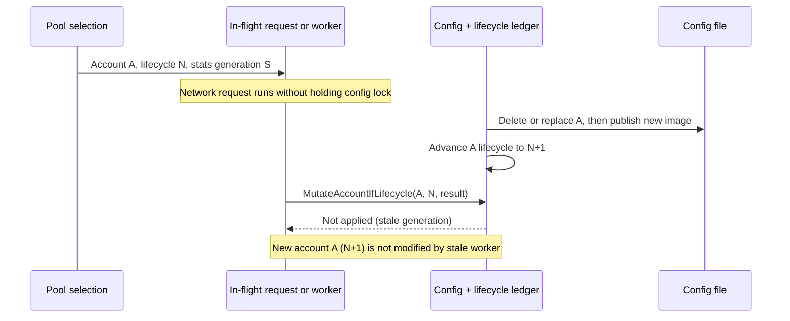
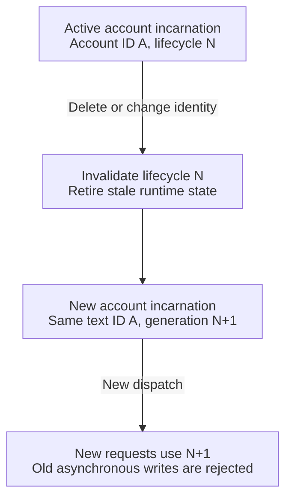
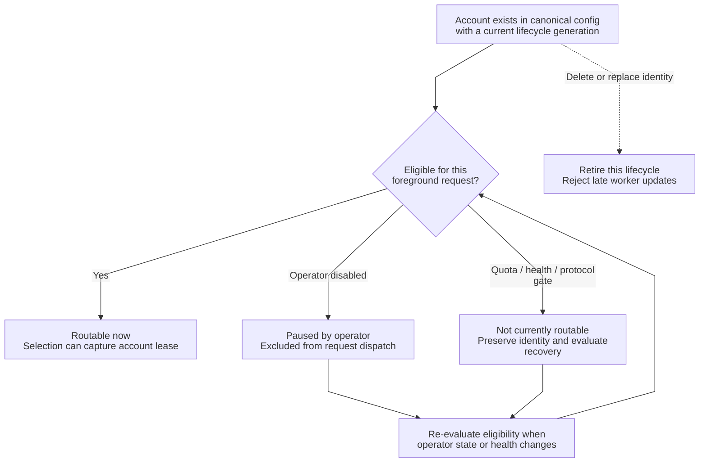
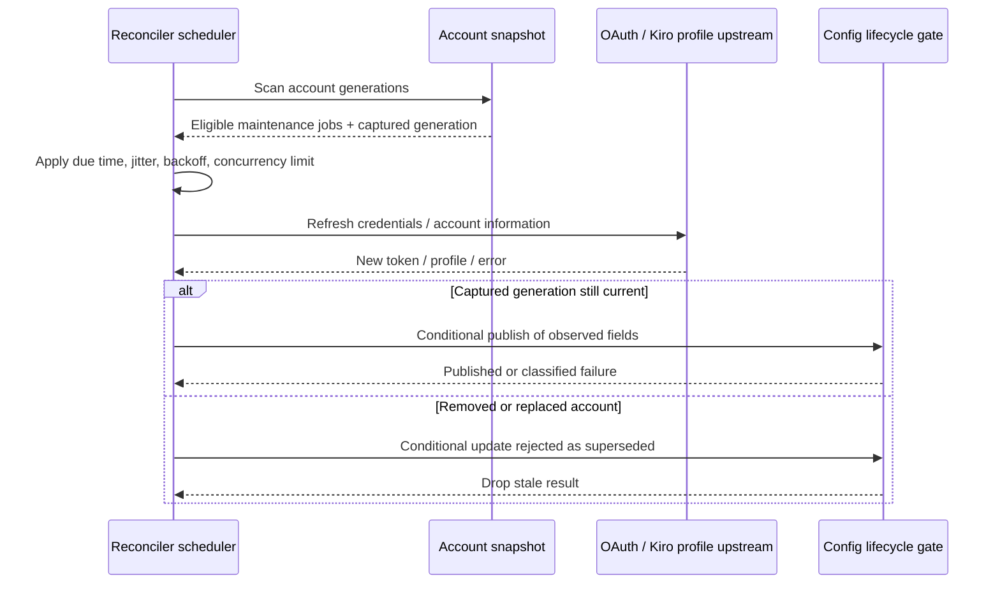
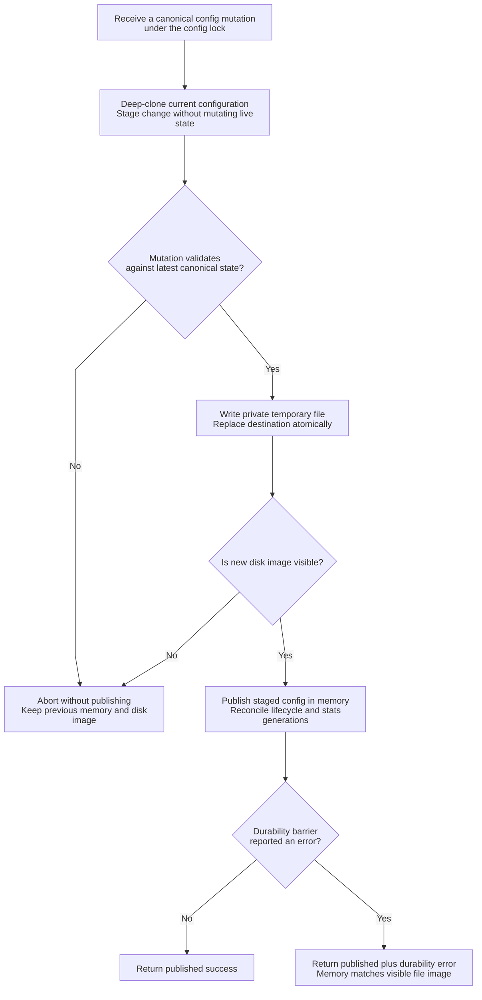

# Account lifecycle, reconciliation and durable state

> **Languages:** [English](account-lifecycle.md) · [Tiếng Việt](vi/account-lifecycle.md) · [简体中文](zh-CN/account-lifecycle.md)

> **Snapshot:** [`63d4e2bb4375`](https://github.com/trankien84/Kiro-Go/commit/63d4e2bb4375d85aed46e72d1d7c5df25138fa41). Account **lifecycle identity** is not the same as the string account ID, and scheduling eligibility is not the same as token-maintenance eligibility.

## 1. Account identity and generation fencing

The pool captures an immutable `AccountSelection` while holding its selection lock: a deep-cloned account plus a `LifecycleGeneration` and a separate `StatsGeneration`. A delete/recreate or dispatch-identity replacement invalidates the old lifecycle; routine account statistics, quota and enablement changes need not start a new lifecycle. Workers must check their captured generation before mutating current canonical state.

This is a **race-prevention scenario**, not a mandatory delete between every request. Lifecycle generations are process-local gates that protect concurrent workers; do not describe them as globally durable, distributed fencing tokens.

**Source:** [`config/account_lifecycle_generation.go`](../../config/account_lifecycle_generation.go) (`markAccountLifecycleDeletedLocked`, `accountDispatchIdentityChanged`, `MutateAccount...IfLifecycle`), [`config/config_transaction.go`](../../config/config_transaction.go), [`pool/account_selection.go`](../../pool/account_selection.go). **Tests:** [`config/account_dispatch_lifecycle_test.go`](../../config/account_dispatch_lifecycle_test.go), [`pool/account_selection_lifecycle_test.go`](../../pool/account_selection_lifecycle_test.go).

## 2. Account lifecycle vs. routability

The lifecycle identity and the current routing condition are separate dimensions:

**Why two generations matter**

- `LifecycleGeneration` protects the *logical identity of the account and its upstream credentials*. Removing account A and adding a new account with text ID `A` must not let a delayed worker from the former incarnation update the replacement.
- `StatsGeneration` independently fences statistics collection/reset so queued accounting can neither resurrect obsolete counters nor write against a replaced stats epoch.
- An in-flight request holds an `AccountSelection` snapshot, not a mutable pointer into the live config. It may complete using that snapshot, but its side effects are conditionally published only if the expected generation remains current.

**Example:** Worker W starts refreshing account A at generation 7. An administrator deletes A and creates another A at generation 8. When W returns, `MutateAccountIfLifecycle(A, 7, ...)` is rejected; the new A retains its own tokens and health state. These are **process-local fences**, not durable distributed identifiers.

**Lifecycle and routability are independent**

A lifecycle is created when an account is added or imported and retired when the account is deleted or its *dispatch identity* changes. Routability is evaluated repeatedly and can change **without** changing that identity: an operator pause, cooldown, quota state or unsupported model can temporarily make the account unavailable. Conversely, re-enabling the account does not resurrect a retired generation.

**Example:** An operator-disabled OAuth account may remain eligible for background credential maintenance when its status has no provider-driven ban reason; that is different from allowing foreground inference requests. An account in a terminal credential/provider state must not be silently treated as merely operator-paused.

The first diagram shows what invalidates a generation: deletion or replacement of dispatch identity. Creating the same textual account ID again starts a new lifecycle, not a resurrection of the old one. The second diagram shows derived **routing conditions** within a live lifecycle. `Routing gates` include credentials, quota, health, circuit state and protocol capability. A change in these gates does not by itself retire the identity.

The routability diagram shows **derived routing conditions**, not a literal enum stored in `config.Account`. A paused account can remain eligible for background credential maintenance. A terminal credential/provider health state is not silently converted into an operator pause. A newly recreated account with the same string ID is a **new lifecycle**, not a transition back from `Retired`.

**Source:** [`pool/account.go`](../../pool/account.go), [`pool/account_credential_eligibility.go`](../../pool/account_credential_eligibility.go), [`proxy/account_reconciler.go`](../../proxy/account_reconciler.go) (`accountSupportsCredentialMaintenance`).

## 3. Background maintenance and stale result rejection

`proxy/account_reconciler.go` uses distinct credential and account-info maintenance lanes with bounded concurrency, jitter and backoff; it is not a request-handler synchronous refresh of **every** account. `accountSupportsCredentialMaintenance` intentionally distinguishes operator-disabled routing from failure-driven disablement, so background token upkeep need not make a disabled account routable. Token refresh can also occur in request paths; all writers still need correct lifecycle ownership.

**Source:** [`proxy/account_reconciler.go`](../../proxy/account_reconciler.go), [`proxy/account_info_reconcile.go`](../../proxy/account_info_reconcile.go), [`auth/refresh_context.go`](../../auth/refresh_context.go), [`auth/refresh_failure.go`](../../auth/refresh_failure.go), [`proxy/token_refresh_reconciliation.go`](../../proxy/token_refresh_reconciliation.go). **Tests:** [`proxy/account_reconciler_fencing_test.go`](../../proxy/account_reconciler_fencing_test.go), [`auth/refresh_lifecycle_test.go`](../../auth/refresh_lifecycle_test.go).

### Reading the reconciler sequence

Background reconciliation is keyed by account lifecycle rather than by text ID alone. A scheduler obtains a snapshot and determines whether credential refresh and/or account-info refresh is due. Those operations can involve network calls and backoff; therefore the scheduler does not hold the canonical config lock for their entire duration. On return, a generation-aware publication compares the worker's captured identity with the current account. If an administrator deleted/replaced the account during the network call, the stale result cannot overwrite the replacement's credentials, quota, ban state or stats.

An operator pause and a provider-terminal failure also have different maintenance policies. The reconciler is designed not to re-enable an account merely because it refreshed a token. Refresh failure classes affect whether a retry is sensible; see [Authentication](authentication.md).

## 4. Transactional config publication

The canonical configuration follows copy-on-write: clone the current `Config`, apply the proposed mutation, serialize and replace the config file, then publish the new in-memory object **only if** the new file image is already visible. If a later durability barrier fails *after* replacement, the new image may still be published in memory to remain consistent with the visible disk image; thus `published=true, err!=nil` is a meaningful outcome, **not** proof of a rollback.

**Transaction walkthrough**

1. The mutation is staged against a deep copy while holding the canonical config lock; errors during validation leave the original authoritative object untouched.
2. A private temporary file is written and used to replace the destination. If the replacement never becomes visible, the process keeps the old in-memory configuration.
3. Once the new file is visible, the process publishes the staged configuration and reconciles account lifecycle/statistics generations. A durability-barrier error **after** visibility can still return an error even though the mutation has published: the returned `published` bit disambiguates that outcome.

**Example:** A disk sync reports failure after a successful path replacement. Rolling back only RAM would create a mismatch with the already-visible new file. The transaction therefore retains the new in-memory image and surfaces a published-plus-error outcome. This is not a multi-process database transaction.

OS-specific private-file helpers enforce constrained permissions on Unix and Windows; they do **not** provide transaction isolation across multiple independently running Kiro-Go processes writing one config file. The pool and config stat generations also prevent a delayed stats worker from resurrecting counters after reset/replacement.

**Source:** [`config/config_transaction.go`](../../config/config_transaction.go), [`config/config_file_write.go`](../../config/config_file_write.go), [`config/account_stats_generation.go`](../../config/account_stats_generation.go), [`internal/privatefile/security_unix.go`](../../internal/privatefile/security_unix.go), [`internal/privatefile/security_windows.go`](../../internal/privatefile/security_windows.go). **Tests:** [`config/config_file_security_test.go`](../../config/config_file_security_test.go), [`config/account_stats_generation_test.go`](../../config/account_stats_generation_test.go), [`internal/privatefile/security_windows_test.go`](../../internal/privatefile/security_windows_test.go).

## 5. Operational implications

- Never use the text ID alone as an asynchronous mutation authority: check the captured lifecycle generation.
- Do not assume a successful upstream OAuth refresh guarantees a persisted token; handle rotated-refresh-token persistence errors explicitly (see [Authentication](authentication.md)).
- A worker marked superseded must not ban, refresh, reset or update the replacement account.
- `fill-first` account ordering/priority updates are optimistic-concurrency administrative writes, not an in-memory-only UI sort. See [Provider routing](provider-routing.md).
