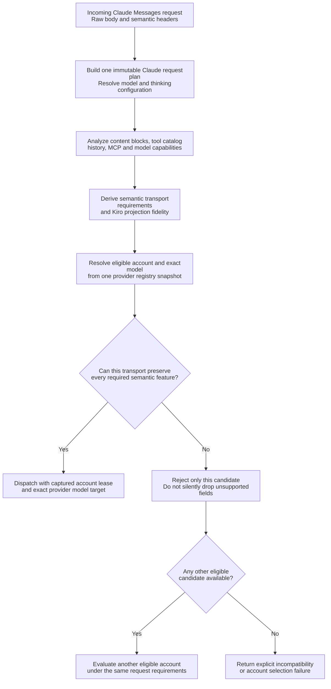
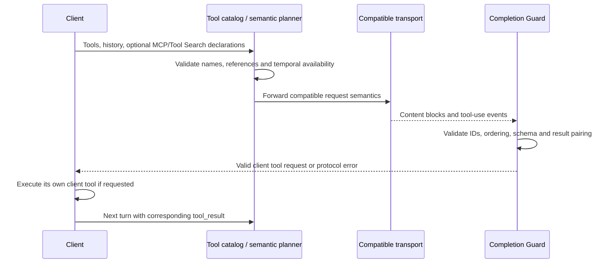
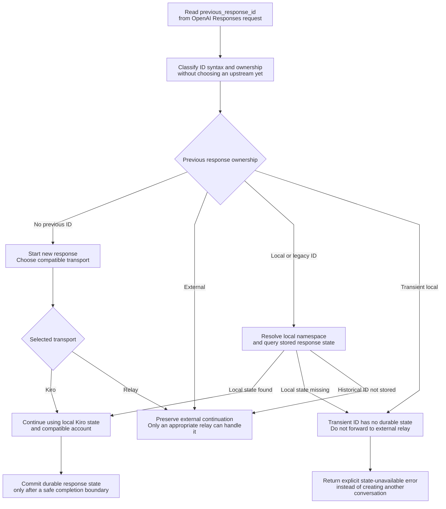

# Agent protocol fidelity and transport requirements

> **Languages:** [English](agent-protocol.md) · [Tiếng Việt](vi/agent-protocol.md) · [简体中文](zh-CN/agent-protocol.md)

> **Snapshot:** [`63d4e2bb4375`](https://github.com/trankien84/Kiro-Go/commit/63d4e2bb4375d85aed46e72d1d7c5df25138fa41). The accepted wire shape is not sufficient to prove that a provider can execute it faithfully. This page distinguishes **Claude Messages semantic routing** from **OpenAI Responses routing**, which has different transport support.

## 1. Analyze semantics before choosing a Claude transport

**Planning and selection walkthrough**

1. Normalize the incoming wire request once, including declared tools, historical tool identities, model aliases, thinking configuration, betas and protocol-bearing fields. The resulting `claudeRequestPlan` becomes the common semantic reference for routing and conversion.
2. Build a transport requirement set **from features actually used**, rather than assuming a beta header alone means the corresponding functionality is needed. Distinguish exact representation, supported emulation, and unsupported projection.
3. Candidate evaluation combines the immutable registry's account/model evidence with the request's requirements. Kiro-native, Direct Anthropic, custom relay, Bedrock Invoke and Bedrock Converse are not interchangeable merely because all can serve a Claude-looking model name.
4. Incompatible candidates are excluded before dispatch. If no candidate can preserve required features, return an explicit error; do not drop MCP, signed-thinking or structured-output fields just to make an unsupported adapter accept the payload.

**Example:** A user message with a client-executed `tool_use` is different from a request for provider-owned MCP connector execution. Forwarding the former as a client tool does **not** establish support for the latter on Kiro-native or Bedrock.

The reusable `claudeRequestPlan` contains the parsed request, requested and resolved model, reasoning/capabilities, normalized semantic request, content inventory, Kiro projection, normalized tool catalog and transport requirements. Provider routing uses these rather than reinterpreting the request independently in every adapter. Raw request material is retained where transparent forwarding is required; unsupported semantics must not be silently dropped in an inexact Kiro translation.

**Source:** [`proxy/claude_request_plan.go`](../../proxy/claude_request_plan.go), [`proxy/claude_request_semantics.go`](../../proxy/claude_request_semantics.go), [`proxy/claude_content_inventory.go`](../../proxy/claude_content_inventory.go), [`proxy/claude_transport_requirements.go`](../../proxy/claude_transport_requirements.go), [`proxy/claude_kiro_projection.go`](../../proxy/claude_kiro_projection.go). **Tests:** [`proxy/claude_request_plan_test.go`](../../proxy/claude_request_plan_test.go), [`proxy/claude_semantic_transport_regression_test.go`](../../proxy/claude_semantic_transport_regression_test.go).

## 2. Capability matrix: decisions, not universal promises

| Transport in Claude request planner | Can be selected for Claude Messages? | What decides compatibility? |
| --- | --- | --- |
| `kiro_native` | Conditional | Kiro projection fidelity, selected model schema and tool/protocol requirements |
| `custom_api_relay` | Conditional | Transparent relay compatibility; excluded for some forwarded continuations |
| `direct_anthropic` | Conditional | Anthropic Messages request semantics and deployment/model capability |
| `bedrock_invoke` | Conditional | Invoke-model request adapter and supported protocol/beta semantics |
| `bedrock_converse` | Conditional | Converse adapter and its distinct feature set |
| `unsupported` | No | Unknown or invalid account kind / unsupported transport |

This is deliberately **not** a yes/no table claiming that all server tools, MCP features, Tool Search, JSON output, signed thinking or future model betas work on any one transport. Capability is evaluated per **request + model + account + actual transport**. `claudeAccountCompatibleWithRequirements` explicitly rejects unknown account kinds, excludes custom relay for certain forwarded continuations, and rejects Kiro when projection would lose required semantics.

**Source:** [`proxy/claude_transport_requirements.go`](../../proxy/claude_transport_requirements.go) (`claudeTransportKindForAccount`, `claudeAccountCompatibleWithRequirements`, `nextCompatibleClaudeCandidate`), [`proxy/claude_model_capabilities.go`](../../proxy/claude_model_capabilities.go). **Tests:** [`proxy/claude_transport_requirements_test.go`](../../proxy/claude_transport_requirements_test.go), [`proxy/model_protocol_contract_regression_test.go`](../../proxy/model_protocol_contract_regression_test.go).

## 3. Tools: ownership, deferred availability, references

Client tools remain tools the **client** executes; Kiro-Go does not become a local executor of arbitrary GitHub Copilot/VS Code/MCP tools. In contrast, provider-owned server tools and MCP connector behavior have their own protocol state. The content and history analyzers distinguish client `tool_use`/`tool_result` from `server_tool_use`, `mcp_tool_use`, `mcp_tool_result`, tool catalog declarations, `defer_loading` and dynamically discovered members. Routing for features that cannot be represented on Kiro/Bedrock must choose a compatible transparent transport or fail explicitly.

Some tools may be declared but not yet *available* (`defer_loading`). Tool Search and MCP member loading require a consistent reference identity and correct temporal ordering. A tool added mid-conversation is not automatically usable in past turns. Unknown tool or server-side semantics are not silently reclassified as ordinary client tools.

**Source:** [`proxy/claude_inline_tool_history.go`](../../proxy/claude_inline_tool_history.go), [`proxy/claude_mcp_member_history.go`](../../proxy/claude_mcp_member_history.go), [`proxy/claude_native_toolset_history.go`](../../proxy/claude_native_toolset_history.go), [`proxy/agent_completion_guard_catalog.go`](../../proxy/agent_completion_guard_catalog.go), [`proxy/agent_completion_guard_tool_reference.go`](../../proxy/agent_completion_guard_tool_reference.go). **Tests:** [`proxy/claude_mcp_tool_search_reference_test.go`](../../proxy/claude_mcp_tool_search_reference_test.go), [`proxy/claude_temporal_tool_identity_test.go`](../../proxy/claude_temporal_tool_identity_test.go), [`proxy/claude_inline_tools_protocol_test.go`](../../proxy/claude_inline_tools_protocol_test.go).

### Reading the tool-history sequence

The client submits tool declarations plus conversation history. The planner checks not only whether names exist in the catalog but **when** a tool became available in the conversation. An Inline Tool or deferred MCP member discovered in a later turn must not be treated as executable in an earlier turn. The response guard subsequently checks that any returned client `tool_use` has valid identity and input, and that the next client request pairs its `tool_result` correctly.

The client performs its own local tools (for example VS Code/Copilot tools). By contrast, a provider-owned `server_tool_use` or MCP connector event has server-side semantics and state; representing it as a generic client tool would change what performs the action and who owns the result. A transport without that capability is rejected or replaced with a compatible transparent route.

## 4. Thinking, signatures and structured output

- **Reasoning:** schema-driven Kiro reasoning capabilities are separate from Direct Anthropic/model capability information; unsupported explicit thinking configurations are validated rather than guessed.
- **Thinking signatures:** provider-issued signatures are preserved only across compatible transparent/native transport boundaries. For Kiro-local continuation a proxy-owned provenance signature is used; do not present that synthetic/provenance signature as a provider-issued Anthropic signature.
- **Structured JSON output:** `output_config.format` is a generation constraint. Kiro projection is allowed only when the **selected** Kiro account's **fresh live model** schema advertises the corresponding additional-request-field support.
- **Protocol metadata:** citations, stop details, fallback boundaries, container state, MCP and server-tool metadata may be semantically significant and must be preserved or explicitly rejected, not silently coerced into plain text.

**Source:** [`proxy/reasoning.go`](../../proxy/reasoning.go), [`proxy/thinking_signature.go`](../../proxy/thinking_signature.go), [`proxy/claude_kiro_structured_output.go`](../../proxy/claude_kiro_structured_output.go), [`proxy/claude_transport_requirements.go`](../../proxy/claude_transport_requirements.go). **Tests:** [`proxy/thinking_signature_test.go`](../../proxy/thinking_signature_test.go), [`proxy/claude_kiro_structured_output_test.go`](../../proxy/claude_kiro_structured_output_test.go).

## 5. OpenAI Responses has independent state ownership

`/v1/responses` must classify `previous_response_id` before selecting a compatible transport. The code distinguishes no previous ID, externally owned ID, transient local ID, namespaced local ID, and ambiguous historical IDs. A transient local ID from `store=false` **must never be forwarded** as though an external Responses server owns it; a local missing/unavailable state returns an error rather than silently starting a different conversation.

**Ownership walkthrough for `previous_response_id`**

- **No ID:** a fresh response may select any transport that can satisfy the request.
- **External ID:** do not assume a local Kiro state store owns it; the selected relay must be compatible with the upstream state.
- **Current-instance local ID:** load local state. A missing record is an error, not permission to silently start another conversation.
- **Transient local ID (`store=false`):** it is not durable and must never be sent to an external relay as a supposedly valid upstream continuation.
- **Historical/ambiguous ID:** an exact local-state hit takes precedence; a miss can remain external to preserve legacy relay behavior. A foreign namespaced ID is also not automatically owned by this instance.

**Example:** A client sends an ID generated by Kiro-Go with `store=false` as the next `previous_response_id`. It has no stored state; returning a state-unavailable error preserves conversation integrity. Silently forwarding that ID to an unrelated upstream could continue the wrong conversation or produce misleading output. For current Responses dispatch, Kiro and a compatible custom relay have different obligations; Direct Anthropic and Bedrock are not native Responses transports.

The diagram simplifies instance namespace resolution: **a foreign namespace** can be external; a **matching local namespace with missing state** cannot. This is not an implicit promise that Direct Anthropic or Bedrock accounts support native OpenAI Responses. In the current `responsesTransportForAccount` selection, Kiro OAuth/API-key and compatible custom relay routes have distinct capabilities; Direct Anthropic and Bedrock are rejected as native Responses transports.

**Responses tool choice boundary:** `auto` and `none` can use the Kiro adapter if other checks pass. `required` or a specific function requires the experimental `KIRO_NATIVE_TOOL_CHOICE=always` path; passthrough-only shapes cannot use Kiro translation. For `parallel_tool_calls=false`, Kiro is not claimed to implement a native serial-tool switch: the local adapter buffers and accepts only an at-most-one-tool-call candidate.

**Source:** [`proxy/responses_state_routing.go`](../../proxy/responses_state_routing.go) (`classifyResponseID`, `resolveResponseStateOwnershipByClass`), [`proxy/responses_handler.go`](../../proxy/responses_handler.go), [`proxy/responses_store.go`](../../proxy/responses_store.go), [`proxy/openai_projection.go`](../../proxy/openai_projection.go). **Tests:** [`proxy/responses_state_routing_phase_test.go`](../../proxy/responses_state_routing_phase_test.go), [`proxy/responses_state_commit_phase_test.go`](../../proxy/responses_state_commit_phase_test.go), [`proxy/openai_projection_boundary_test.go`](../../proxy/openai_projection_boundary_test.go).

## 6. Web search and other provider-owned features

Kiro's native `web_search` adapter uses its own Kiro MCP integration; it is not evidence that arbitrary external MCP connectors or generic server-tool functionality can be projected through Kiro. Model and transport gates still apply.

**Source:** [`proxy/websearch.go`](../../proxy/websearch.go), [`proxy/websearch_loop.go`](../../proxy/websearch_loop.go), [`proxy/claude_transport_requirements.go`](../../proxy/claude_transport_requirements.go). **Tests:** [`proxy/websearch_test.go`](../../proxy/websearch_test.go), [`proxy/websearch_loop_test.go`](../../proxy/websearch_loop_test.go).
