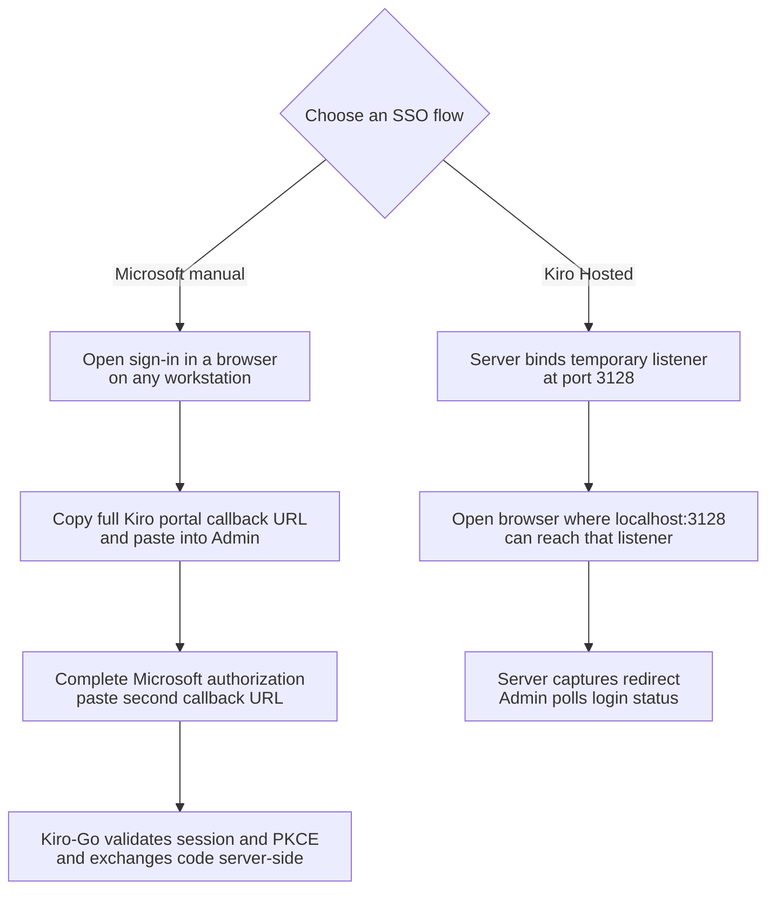
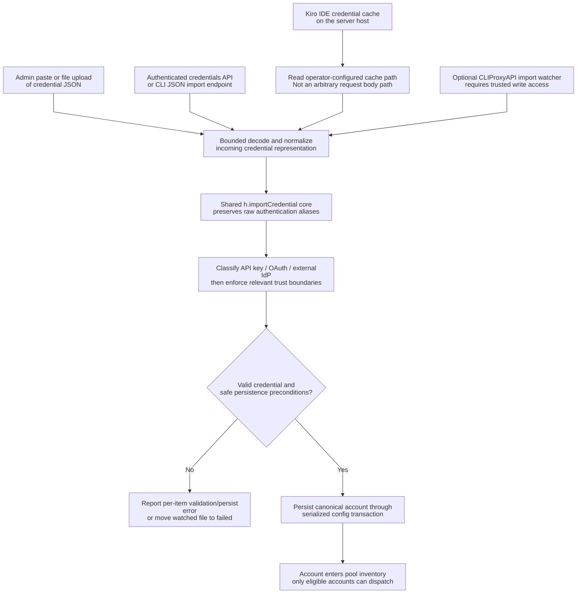
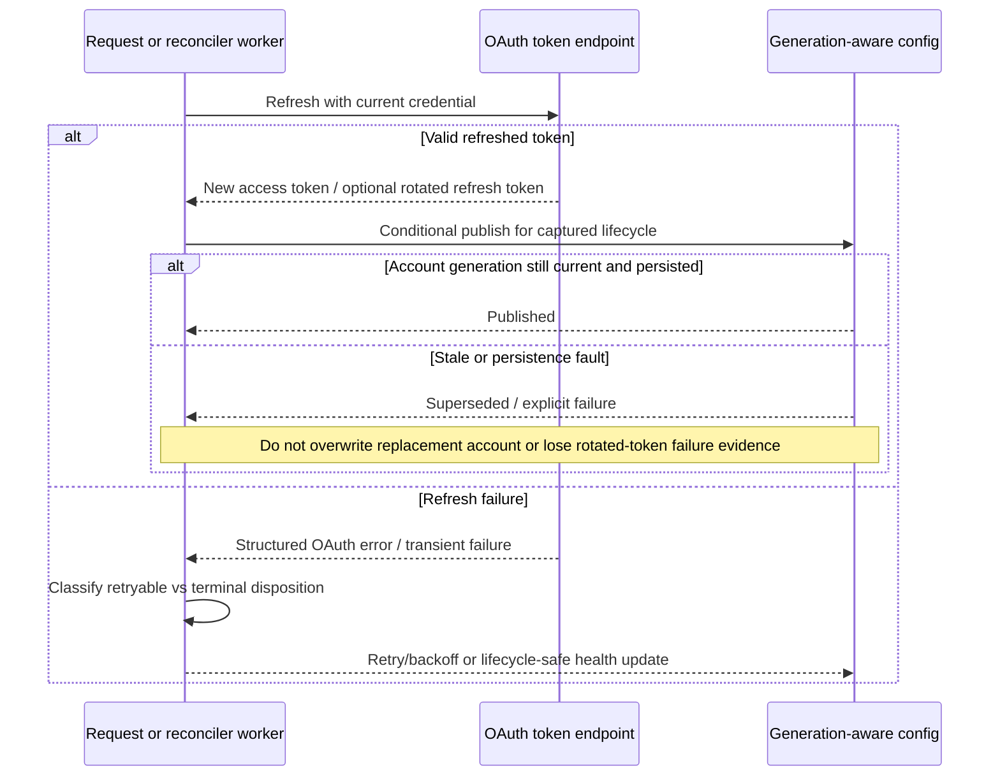

# Authentication, credential imports and refresh safety

> **Languages:** [English](authentication.md) · [Tiếng Việt](vi/authentication.md) · [简体中文](zh-CN/authentication.md)

> **Snapshot:** [`63d4e2bb4375`](https://github.com/trankien84/Kiro-Go/commit/63d4e2bb4375d85aed46e72d1d7c5df25138fa41). Credential import, OAuth refresh and provider account selection are **different** operations. An import is not proof that a credential will remain routable forever.

## 1. Auth methods and credential provenance

| Credential family | Key boundary / behavior |
| --- | --- |
| AWS Builder ID and IAM Identity Center | OAuth/SSO credentials with token refresh and account/profile region handling |
| Microsoft Entra ID / Enterprise SSO | Browser-based interactive sign-in or approved credential import, with Microsoft-specific identity and token-endpoint checks |
| Generic `external_idp` | Must not be mislabeled as Microsoft merely because it shares the `external_idp` auth method string |
| Kiro API Key | `ksk_...` credential uses Kiro CLI runtime, `tokentype: API_KEY`, **not** OAuth refresh or `profileArn` |
| Kiro IDE local cache | Server-side read of the signed-in IDE credential, then mandatory validation/refresh before persistence |

Microsoft 365 tenant policies such as MFA and Conditional Access are why a headless password grant is not the normal Enterprise SSO path. Authentication classification is based on the appropriate upstream/identity evidence rather than a guess from a generic field.

**Source:** [`auth/microsoft_sso.go`](../../auth/microsoft_sso.go), [`auth/oidc.go`](../../auth/oidc.go), [`auth/kiro_sso.go`](../../auth/kiro_sso.go), [`config/account_credentials.go`](../../config/account_credentials.go), [`proxy/handler.go`](../../proxy/handler.go). **Tests:** [`auth/microsoft_sso_test.go`](../../auth/microsoft_sso_test.go), [`proxy/microsoft_lifecycle_test.go`](../../proxy/microsoft_lifecycle_test.go).

## 2. Two browser SSO flows and callback ownership

Kiro-Go intentionally exposes **two different entry points**. They are not interchangeable, despite both using Kiro's hosted sign-in portal and the fixed browser redirect `http://localhost:3128`.

| Flow | Admin/API | Who receives the redirect? | Remote workstation and tunnel |
| --- | --- | --- | --- |
| **Microsoft Enterprise SSO (manual)** | Admin's Microsoft option; `/admin/api/auth/microsoft-sso/start`, `/complete`, `/select-profile`, `/cancel` | Browser navigates to localhost and may show a connection error. **Operator copies the entire URL into Admin**, twice (Kiro portal descriptor, then Microsoft OAuth code). Kiro-Go validates each step; it **does not bind port 3128** for this flow. | Browser may run on another machine; **no SSH tunnel and no published callback port required**. |
| **Kiro Hosted SSO (listener)** | Admin's Kiro Hosted option; `/admin/api/auth/kiro-sso/start`, `/poll`, `/select-profile`, `/cancel` | `auth/kiro_sso.go` opens a temporary HTTP listener on port `3128`; browser must reach that exact host from its own `localhost` redirect. The server captures the callback and the Admin UI polls for completion. | Typically requires a browser on the server/Docker host, or an explicitly configured tunnel/network arrangement. Merely publishing `3128` on a VPS does **not** redirect a remote browser's `localhost` there. |

**Manual flow sequence.** Start the login in Admin and open the returned Kiro sign-in URL. After portal authentication, copy the **whole** `http://localhost:3128/signin/callback?...` URL from the browser address bar (even if the localhost page fails). Submit it to Admin; Kiro-Go validates the descriptor and returns a Microsoft authorization URL. Sign in with Microsoft (including MFA if required); copy the **whole** `http://localhost:3128/oauth/callback?...` URL and submit it to Admin. The server checks the Microsoft leg's `state` and PKCE, exchanges the authorization code, and may ask you to select a Kiro profile. Do not share callback URLs or put authorization codes in logs. The manual session is limited to **10 minutes**; expired/used sessions require a new start.

**Hosted listener deployment.** The checked-in Compose configuration preserves `127.0.0.1:3128:3128` and `KIRO_SSO_CALLBACK_BIND=0.0.0.0` **for this separate flow only**. The host publication is loopback-only, but an in-container `0.0.0.0` listener may be reachable by other containers on a shared Docker network during the temporary login window. Secure the network or use manual Microsoft SSO instead. Do not remove the listener settings unless you deliberately retire Kiro Hosted SSO.

**Source:** [`auth/microsoft_sso.go`](../../auth/microsoft_sso.go) (`StartMicrosoftSSOLogin`, `ContinueMicrosoftSSOLogin`), [`auth/kiro_sso.go`](../../auth/kiro_sso.go) (`StartKiroSsoLogin`, `startListener`), [`proxy/handler.go`](../../proxy/handler.go), [`docker-compose.yml`](../../docker-compose.yml). **Tests:** [`auth/microsoft_sso_test.go`](../../auth/microsoft_sso_test.go), [`auth/kiro_sso_test.go`](../../auth/kiro_sso_test.go), [`proxy/microsoft_handler_test.go`](../../proxy/microsoft_handler_test.go).

## 3. Import paths converge on one classifier

**Import paths and trust boundaries**

1. The browser/admin JSON form, authenticated credential import endpoints, IDE-cache import and optional filesystem watcher are **entry points**, not separate credential classifiers. Each ultimately converges on `h.importCredential`, which performs canonical authentication-method/provider classification and import-side validation.
2. The Kiro IDE cache is read **server-side** using the configured path (the default or `KIRO_IDE_CACHE`). The request body's old `path` override is deliberately ignored to prevent arbitrary filesystem reads; Docker users must explicitly mount the host cache if they expect this path to exist inside the container.
3. A watcher can ingest credentials without an admin HTTP request, so write access to `data/imports` is equivalent to the ability to submit account imports. It must not be shared with less-trusted users. The watcher is opt-in for a bare binary and enabled by the checked-in Compose file.
4. Successful decoding does not mean automatic eligibility for inference. The credential is classified and persisted before ordinary pool/model/health gates decide whether it can be dispatched.

**Example:** A generic `external_idp` JSON with a missing explicit Microsoft declaration must not be forced into the Microsoft refresh path simply because it has a token endpoint. All import methods must use the same classifier so their results cannot drift.

`POST /admin/api/auth/credentials`, `POST /admin/api/auth/import-cli-json`, IDE-cache import and the optional drop-folder watcher converge on `h.importCredential`. This prevents each import path from inventing its own Microsoft-vs-generic `external_idp` classification. Input aliases and `snake_case`/`camelCase` normalization occur before the canonical classification. Admin/UI interactions and filesystem watcher require **different** trust assumptions.

**Source:** [`proxy/handler.go`](../../proxy/handler.go) (`apiImportCredentials`, `importCredential`, `apiImportCliJson`, `apiImportIdeCache`), [`proxy/cli_json_import.go`](../../proxy/cli_json_import.go), [`proxy/import_watcher.go`](../../proxy/import_watcher.go). **Tests:** [`proxy/import_credentials_test.go`](../../proxy/import_credentials_test.go), [`proxy/cli_json_import_test.go`](../../proxy/cli_json_import_test.go), [`proxy/import_watcher_test.go`](../../proxy/import_watcher_test.go).

### IDE cache: request path override is deliberately ignored

The `/admin/api/auth/import-ide-cache` request body may still be parsed for backwards-tolerant handling, but **`body.path` is intentionally ignored**. Server-side lookup uses `KIRO_IDE_CACHE`, then the default `~/.aws/sso/cache/kiro-auth-token.json`. `readIdeCacheCredential` enforces a **1 MiB** file limit and requires usable refresh material; a client must not use the endpoint to read an arbitrary path. This is a security constraint, not a missing API feature. Do not reintroduce an example that sends `-d '{"path":"..."}'` as though the endpoint accepted client-selected file paths.

**Source:** [`proxy/handler.go`](../../proxy/handler.go) (`apiImportIdeCache`), [`proxy/ide_cache_import.go`](../../proxy/ide_cache_import.go). **Tests:** [`proxy/ide_cache_import_test.go`](../../proxy/ide_cache_import_test.go).

### Drop-folder watcher security boundary

`KIRO_IMPORT_WATCH` is off for a bare executable and **on** in the checked-in `docker-compose.yml`. Files named `CLIProxyAPI_*.json` in `data/imports/` can be imported without submitting an admin password. Anyone who can write to that path can therefore trigger account creation. Do not mount it to a wider-trust directory than account configuration; disable the watcher if a shared/synced directory is less trusted. Processed and failed files are moved to subdirectories; error information must remain bounded and avoid secret leakage.

**Source:** [`docker-compose.yml`](../../docker-compose.yml), [`proxy/import_watcher.go`](../../proxy/import_watcher.go).

## 4. OAuth refresh failure is not one generic ban reason

Refresh errors distinguish **retryable**, **credential-terminal**, and **configuration-terminal** cases. A structured `OAuthTokenEndpointError` retains the standardized error code separately from the description; it is unsafe to infer policy from a prose message or HTTP 400 alone. A rotated refresh token is particularly sensitive: if an IdP rotation succeeds but local persistence fails, the new token cannot be quietly discarded.

**Source:** [`auth/refresh_failure.go`](../../auth/refresh_failure.go), [`auth/refresh_persistence_recovery.go`](../../auth/refresh_persistence_recovery.go), [`auth/refresh_context.go`](../../auth/refresh_context.go), [`proxy/account_reconciler.go`](../../proxy/account_reconciler.go). **Tests:** [`auth/refresh_failure_test.go`](../../auth/refresh_failure_test.go), [`auth/refresh_lifecycle_test.go`](../../auth/refresh_lifecycle_test.go).

### Reading the refresh sequence

For refreshable OAuth credentials, an asynchronous worker contacts the token endpoint using the current credential snapshot. The provider may return a **rotated refresh token**: once rotated, the old refresh token can become unusable. Persistence must therefore be generation-aware and any failure after rotation must be explicitly reported rather than silently discarded. The stored refresh state belongs to the original account lifecycle and cannot be written into a replacement account that happens to reuse the same string ID.

The implementation uses structured OAuth failure disposition rather than simply interpreting any HTTP 400 as permanent invalid credentials: retryable transport/rate-limit conditions, invalid credentials and invalid client configuration are materially different operator actions.

## 5. Kiro API-key region reprobe

The Kiro API-key region reprobe is bounded and only for applicable Kiro API-key authentication failures, not all providers or arbitrary errors. Candidate regions are validated. A REST/control-plane probe alone is **not** sufficient to persist a new runtime region; the new region is committed only after the retry against the actual Kiro runtime succeeds. Otherwise, restore the previous runtime choice. Reprobe is suppressed if a failed attempt already emitted output, to avoid replaying visible semantics.

**Source:** [`proxy/kiro_api.go`](../../proxy/kiro_api.go) (`reprobeApiKeyRegion`), [`config/account_lifecycle_generation.go`](../../config/account_lifecycle_generation.go), [`proxy/kiro.go`](../../proxy/kiro.go). **Tests:** [`proxy/kiro_apikey_region_test.go`](../../proxy/kiro_apikey_region_test.go).

## 6. Read-only diagnostics and operational safety

- Treat files in `data/` and cache mounts as secrets; restrictive file permissions and Docker volume boundaries matter.
- Do not log JWTs, access/refresh tokens, full Authorization headers or actual CLI JSON credential samples.
- Importing an account does not bypass model/capability/routing eligibility; see [Provider routing](provider-routing.md).
- When an account is replaced, in-flight refresh results must be discarded unless lifecycle ownership is still current; see [Account lifecycle](account-lifecycle.md).
