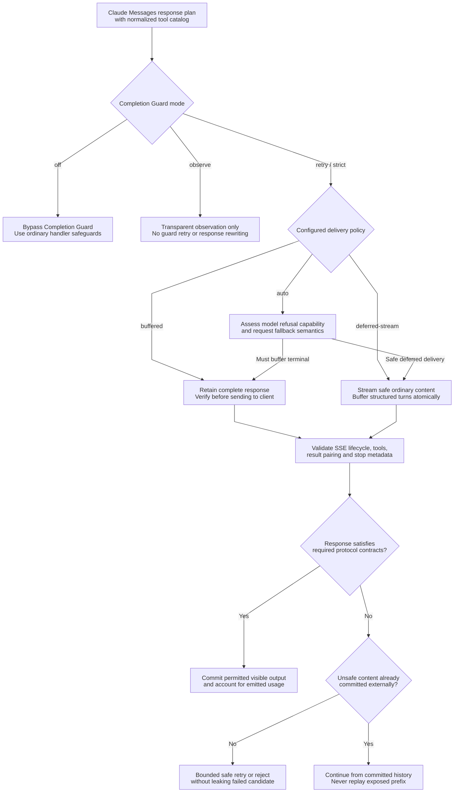
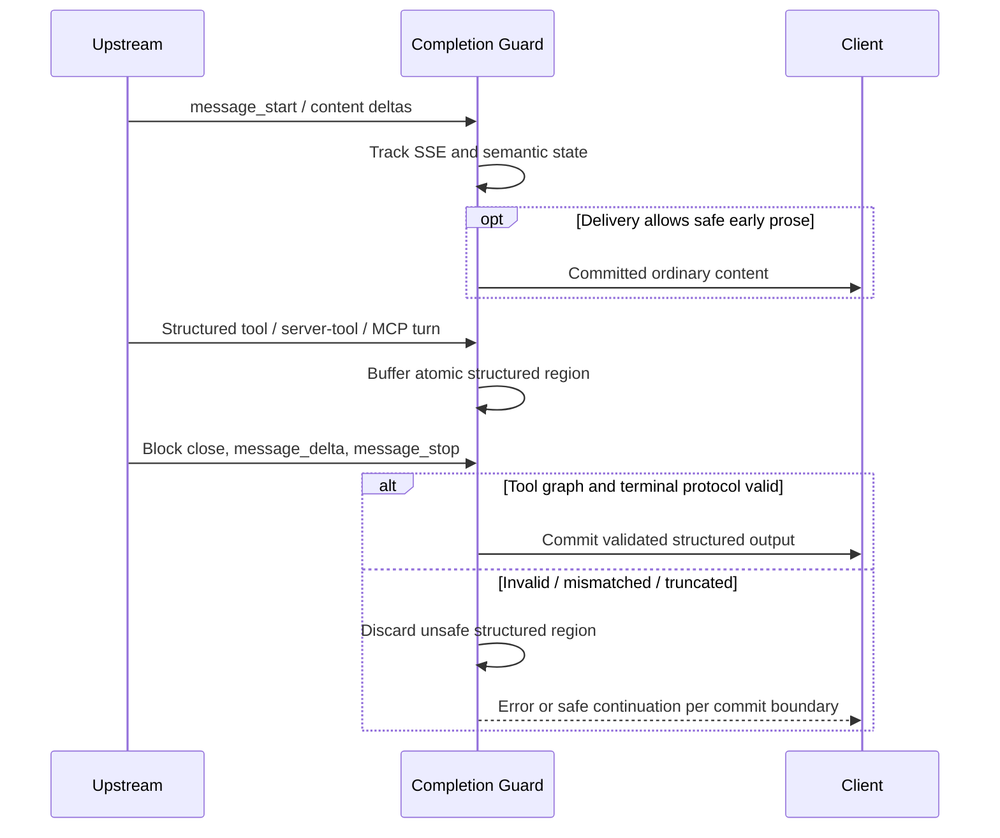
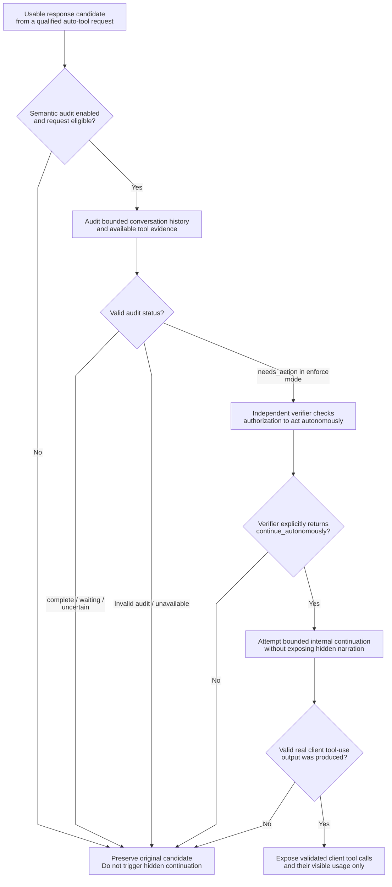

# Completion Guard: protocol safety, delivery and semantic audit

> **Languages:** [English](completion-guard.md) · [Tiếng Việt](vi/completion-guard.md) · [简体中文](zh-CN/completion-guard.md)

> **Snapshot:** [`63d4e2bb4375`](https://github.com/trankien84/Kiro-Go/commit/63d4e2bb4375d85aed46e72d1d7c5df25138fa41). This is a Claude Messages response guard, **not** a universal assertion that all endpoints use the same output validator. Intermediate deterministic completion-action/confidence heuristics were removed; do not document them as active functionality.

## 1. Guard modes are different contracts

| `KIRO_AGENT_COMPLETION_GUARD` | Behavior to expect |
| --- | --- |
| `off` | Completion Guard disabled; ordinary handler/transport checks still apply |
| `observe` | Transparent guard observation; one upstream attempt, **no** guard-driven validation/retry/rewrite or semantic audit |
| `retry` | Guard recovery/validation path; precise rejection and retry handling depends on request and output commitment |
| `strict` (default) | Strict protocol checks and bounded recovery for invalid/incomplete structured output |

`KIRO_AGENT_COMPLETION_DELIVERY` accepts `auto` (default), `buffered`, and `deferred-stream`. `KIRO_AGENT_COMPLETION_GUARD_MAX_RETRIES` defaults to `2` (range `0..4` in the parsed plan). Do not equate a maximum retry budget with a promise that every failure is safely retryable. `KIRO_AGENT_COMPLETION_GUARD_MAX_BUFFER_BYTES` is a retained-data **accounting** bound, not a strict Go heap-size cap.

**Source:** [`proxy/agent_completion_guard.go`](../../proxy/agent_completion_guard.go) (`completionGuardModeFromEnv`, `completionGuardDeliveryModeFromEnv`, `buildAgentCompletionGuardPlanForModelWithCatalogAndCapabilities`), [`proxy/agent_completion_guard_budget.go`](../../proxy/agent_completion_guard_budget.go). **Tests:** [`proxy/agent_completion_guard_test.go`](../../proxy/agent_completion_guard_test.go), [`proxy/agent_completion_guard_long_term_regression_test.go`](../../proxy/agent_completion_guard_long_term_regression_test.go).

## 2. Validation and delivery decision

**Delivery decisions, step by step**

1. `off` leaves Completion Guard inactive while normal transport and request validation still occur. `observe` is a transparent one-attempt pass-through for this guard; it does **not** quietly enforce tool validation, replay, or launch semantic audits.
2. `buffered` retains the complete candidate until terminal fields and structured content can be checked. `deferred-stream` may expose safe ordinary prose early but retains an atomic structured region (tool calls, paired server tool results, MCP/mixed turns) until verified.
3. Under `auto`, the guard considers model capabilities and `fallbacks`. If a terminal streamed refusal could invalidate content already exposed, buffered delivery is required even when deferred streaming would otherwise be attractive.
4. An invalid response is handled relative to the **commit boundary**. Before anything unsafe is exposed, a bounded retry/rejection may be possible. After commitment, only a continuation based on already-committed visible state can avoid repeating output.

**Example:** If a response starts with ordinary text and then emits malformed `tool_use` JSON, previously emitted prose cannot be retracted. The structured tool turn must remain atomic; the recovery path must not replay the visible prefix as though the client never saw it.

`deferred-stream` means a **structured** turn (client tool, server tool, MCP or mixed continuation) may need to be buffered atomically after earlier permissible content has streamed. It does not mean all output is withheld. Model capabilities such as *streamed refusal* and request `fallbacks` can force terminal buffering even if deferred delivery was requested: once bytes reach a client they cannot be retracted. Non-stream requests use buffering for verification.

**Source:** [`proxy/agent_completion_guard_capabilities.go`](../../proxy/agent_completion_guard_capabilities.go), [`proxy/agent_completion_guard_tool_state.go`](../../proxy/agent_completion_guard_tool_state.go), [`proxy/agent_completion_guard_tool_protocol.go`](../../proxy/agent_completion_guard_tool_protocol.go), [`proxy/agent_completion_guard_projection.go`](../../proxy/agent_completion_guard_projection.go).

## 3. Structural protocol validation

The guard checks more than whether an assistant generated text. Its structured validation covers, subject to the concrete request/tool catalog: complete SSE lifecycle; content-block ordering and closure; tool `id`, name, JSON arguments, required schema fields and reference identity; `tool_choice`; server-tool call/result pairing; MCP and Tool Search/deferred declarations; thinking/signature and compaction/fallback boundaries; and terminal stop behavior. Unknown/future protocol fields are **not** permission to silently rewrite an unsupported tool turn.

**Source:** [`proxy/agent_completion_guard_catalog.go`](../../proxy/agent_completion_guard_catalog.go), [`proxy/agent_completion_guard_tool_protocol.go`](../../proxy/agent_completion_guard_tool_protocol.go), [`proxy/agent_completion_guard_tool_reference.go`](../../proxy/agent_completion_guard_tool_reference.go), [`proxy/agent_completion_guard_tool_state.go`](../../proxy/agent_completion_guard_tool_state.go). **Tests:** [`proxy/agent_completion_guard_tool_protocol_test.go`](../../proxy/agent_completion_guard_tool_protocol_test.go), [`proxy/agent_completion_guard_official_protocol_fixture_test.go`](../../proxy/agent_completion_guard_official_protocol_fixture_test.go).

### Reading the structural-validation sequence

A Messages stream is a protocol lifecycle, not an unordered bag of text deltas. The guard tracks `message_start`, opened and closed content blocks, permitted delta types, cumulative `message_delta`, `message_stop`, and the state of client/server/MCP tool calls. A tool call with malformed JSON, an unresolved tool-result reference, a duplicated block index, or contradictory terminal metadata cannot be treated as a valid completed tool turn.

**Deferred streaming** specifically addresses the case where earlier *ordinary* text can be delivered but the remaining *structured* turn must commit as a unit. If late validation discovers a broken tool result, it discards the uncommitted structured region rather than exposing half of an action. A streamed refusal-capable model can require whole-response buffering because previously sent text cannot be rolled back.

## 4. Semantic completion audit is not confidence-score gating

`KIRO_AGENT_COMPLETION_AUDIT` accepts `off` (default), `observe`, and `enforce`. An audit is relevant only under a qualifying auto tool-choice request with declared tools; structural observe disables it. The candidate is classified as `complete`, `waiting_for_user`, `needs_action`, or `uncertain`. **Only** a valid `needs_action` audit in `enforce` mode requests an independent verifier. The verifier must explicitly return `continue_autonomously`; `do_not_continue`, invalid output or unavailable evidence do not authorize an autonomous action.

**Why the semantic audit has two independent decisions**

An audit is only considered under the qualifying auto-tool request conditions and when enabled. A candidate judged `complete`, `waiting_for_user` or `uncertain` does not authorize autonomous work. Even a valid `needs_action` result under `enforce` must pass an **independent verifier** that checks whether the missing action is already authorized, without requiring new credentials, consent, clarification or another user decision.

If the verifier returns `do_not_continue`, produces invalid output, or is unavailable, Kiro-Go keeps the usable original response. If continuation is approved, internal narration is still not published as a user answer: only valid client-visible tool calls can cross that boundary, with visible usage accounting. The protocol guard and semantic audit are **distinct**; the audit is not a heuristic confidence threshold.

**IMPORTANT:** audit/verifier/continuation may fail. The usable original must not be replaced by hidden narration or a fabricated tool call. Both streamed and buffered paths distinguish internal text from actual client-visible `tool_use` blocks; usage for hidden internal attempts is not counted as client-visible output usage.

**Source:** [`proxy/agent_completion_guard.go`](../../proxy/agent_completion_guard.go) (`completionGuardAuditRequiresVerification`, `completionGuardAuditContinuationApproved`), [`proxy/agent_completion_guard_visibility.go`](../../proxy/agent_completion_guard_visibility.go). **Tests:** [`proxy/agent_completion_guard_contract_test.go`](../../proxy/agent_completion_guard_contract_test.go), [`proxy/agent_completion_guard_visibility_test.go`](../../proxy/agent_completion_guard_visibility_test.go).

## 5. Recovery invariant

**Before commitment:** retry may be safe for retryable upstream/semantic faults within a bounded budget, provided no externally committed state or irreversible side effect makes replay unsafe. **After commitment:** a fresh replay would duplicate output; continuation uses only committed visible semantic state. Incomplete thinking and rejected hidden attempts are not simply inserted into ordinary client-visible history. For lower-level EventStream transport rules, see [Streaming and recovery](streaming-recovery.md).
