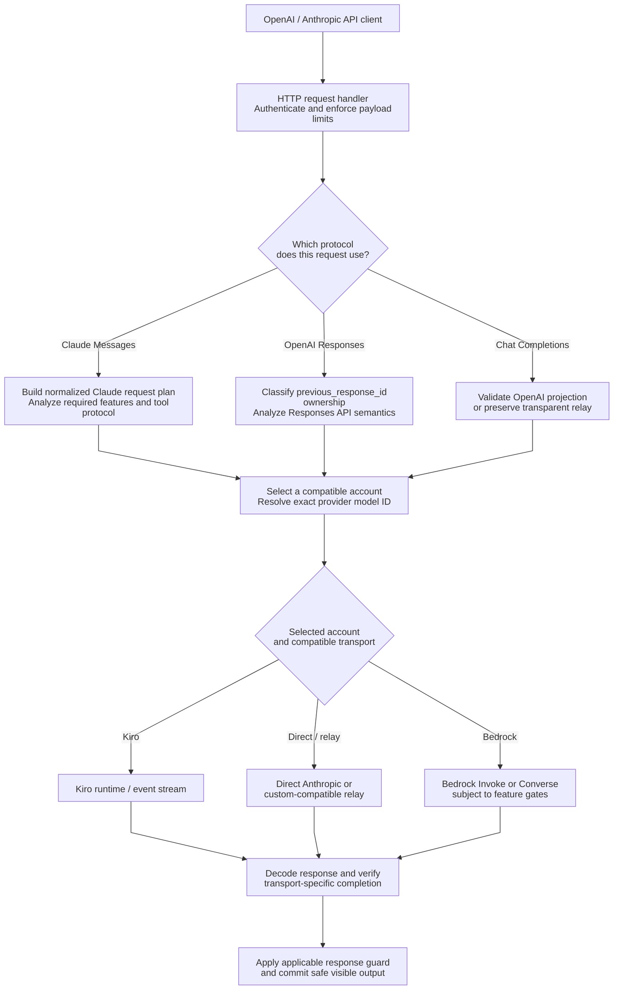
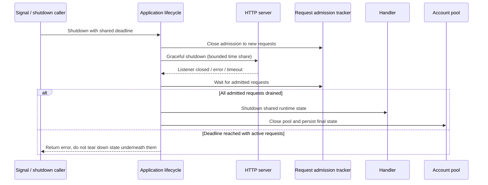

# Architecture overview

> **Languages:** [English](overview.md) · [Tiếng Việt](vi/overview.md) · [简体中文](zh-CN/overview.md)

> **Implementation reference:** `trankien84/Kiro-Go`, commit [`63d4e2bb4375`](https://github.com/trankien84/Kiro-Go/commit/63d4e2bb4375d85aed46e72d1d7c5df25138fa41). These diagrams describe this snapshot, **not** a promise that every provider supports every endpoint or future Claude feature. No external service or account is needed to read them.

## Navigation

| Area | Detailed document | Main purpose |
| --- | --- | --- |
| Account and model routing | [Provider routing](provider-routing.md) | Eligibility, immutable model resolution, scheduling and Bedrock |
| Credential and runtime ownership | [Account lifecycle](account-lifecycle.md) | Generations, background refresh, config persistence |
| Response safety | [Completion Guard](completion-guard.md) | Protocol validation, output commit and semantic audit |
| Claude and OpenAI interfaces | [Agent protocols](agent-protocol.md) | Tool/MCP semantics, compatibility and Responses state |
| Kiro stream transport | [Streaming and recovery](streaming-recovery.md) | Framing, stop signals and no-duplicate retry |
| Sign-in and imports | [Authentication](authentication.md) | OAuth/SSO, API keys and import trust boundaries |

## 1. Request flow and trust boundaries

**How to read this diagram**

1. The client protocol determines **which semantic contract** the request must satisfy. Claude Messages, OpenAI Responses and OpenAI Chat Completions are different request and state models, even if the same account supports more than one endpoint.
2. The planner keeps the model name requested by the caller distinct from the provider's actual model ID. It also carries necessary protocol features into selection instead of making an account eligible merely because it lists a model with the right display name.
3. After an account/transport is selected, response verification is **protocol-specific**. For example, Claude Completion Guard validates structured Messages output; Responses has independent state ownership and event rules. The diagram's final box represents the applicable checks, **not** an unconditional guard wrapping every API.

**Example:** A Claude request carrying MCP server-tool history may require a transparent Messages transport; the same model name on a Kiro account does not by itself make that account compatible. If no eligible candidate preserves the request, Kiro-Go should report an incompatibility rather than silently remove tool metadata.

This is a **conceptual map**, not a precise call stack: `Completion Guard` is the Claude Messages protection path, while OpenAI Responses has separate ownership, projection and streaming checks. The selection block does not imply that all three protocol families can use all the transports; candidate-specific compatibility gates decide that. Client-visible output is not invariably buffered: see [deferred streaming](completion-guard.md).

**Implementation anchors:** [`proxy/handler.go`](../../proxy/handler.go), [`proxy/claude_request_plan.go`](../../proxy/claude_request_plan.go), [`proxy/claude_transport_requirements.go`](../../proxy/claude_transport_requirements.go), [`proxy/responses_handler.go`](../../proxy/responses_handler.go), [`proxy/openai_projection.go`](../../proxy/openai_projection.go), [`proxy/agent_completion_guard.go`](../../proxy/agent_completion_guard.go).

## 2. Application lifetime and graceful shutdown

`application_lifecycle.go` introduces `requestTracker` (`enter`, `leave`, `startDrain`, `wait`) and `application.shutdown`. Shutdown uses **one overall deadline**, with a portion reserved for HTTP shutdown and the remainder for drain/cleanup. It does not mean a long-running stream has an unlimited shutdown grace period. In `main.go`, `WriteTimeout=0` intentionally permits long-lived SSE during normal operation; this is distinct from shutdown deadlines.

**Implementation:** [`application_lifecycle.go`](../../application_lifecycle.go), [`main.go`](../../main.go). **Regression:** [`application_lifecycle_test.go`](../../application_lifecycle_test.go).

### Shutdown timeline: why the order matters

A shutdown signal first **closes admission** so new requests cannot race teardown. Existing admitted requests keep the shared Handler/AccountPool resources they still need. The HTTP listener is asked to shut down with a bounded share of the overall deadline, then the admission tracker waits for the in-flight work to drain. Only when it is safe does cleanup proceed to Handler shutdown and pool/final-stat handling; if active requests outlive the deadline, forcibly closing their shared state would introduce state corruption, so the operation reports an error instead.

This contract is distinct from **normal SSE operation**, where `WriteTimeout=0` avoids imposing a fixed total write limit on long generations. The lack of that normal timeout does not remove the overall graceful-shutdown deadline.

## 3. What gets preserved, and what must be rejected

There are three distinct decisions, which must not be conflated:

1. **Selection eligibility:** is an account healthy, allowed, credential-ready, and compatible with the requested model and request semantics?
2. **Projection fidelity:** can the selected transport preserve required fields (including tool identifiers, history, thinking, JSON format, and provider-owned metadata), either directly or through a supported adapter?
3. **Response commitment:** is the result safe to expose, or must structured fragments be buffered, retried, continued, or rejected?

An OpenAI-compatible endpoint is not a guarantee of exact Anthropic Messages or native Responses semantics. In particular, a **Direct Anthropic account is not a native `/v1/responses` transport** in the current Responses handler. See [Agent protocols](agent-protocol.md) for the endpoint-specific limits.

**Implementation:** [`proxy/provider_registry.go`](../../proxy/provider_registry.go), [`proxy/projection_fidelity.go`](../../proxy/projection_fidelity.go), [`proxy/claude_transport_requirements.go`](../../proxy/claude_transport_requirements.go), [`proxy/responses_handler.go`](../../proxy/responses_handler.go).

## 4. Documentation maintenance contract

- Trace architectural changes to implementation **and a matching regression test**; a test file's presence is not a claim that tests passed.
- Treat diagrams as a snapshot of the implementation above. For changed routing or provider capability rules, update both the diagram and its prose.
- Do not describe the `observe` guard mode as an enforced response validator or the removed completion-action heuristic as current behavior.
- Do not show a fallback after already committed output as a fresh replay of the full request.
- Never place real credentials, cached tokens, account IDs, or private model responses in the diagrams.

## Diagram authoring and preview checks

**Prefer meaningful, readable nodes over artificial character limits.** Flowcharts on these pages deliberately use multiline labels that include the action and its relevant qualifier. The per-diagram initialization requests **SVG text labels** (`htmlLabels: false`) to avoid the embedded `foreignObject` measurement/clipping issues reported in some VS Code/JetBrains previews. `wrappingWidth: 270` allows a larger text region before Mermaid wraps and `minNodeWidth: 220` requests a wider minimum label area on renderers that support it; `nodeSpacing` and `rankSpacing` provide room for branching connectors. These are renderer-level *hints*, not CSS-fixed boxes and not a guarantee that different Mermaid versions calculate identical dimensions.

Avoid setting a hard CSS `width` on node rectangles: a renderer can then size the shape without correctly adjusting the layout edge routing. Instead, use 2–3 meaningful lines with ` `, increase available label width through Mermaid config when supported, and split very dense diagrams **by responsibility**, not by an arbitrary number of characters. Keep complex edge predicates summarized on the arrows and document their exact conditions below.

**Required review:** Parse every diagram, then render it in **both** VS Code Markdown Preview and GitHub Markdown. At common desktop width, verify text is not clipped, diamonds contain their questions, arrows do not obscure each other and the overall chart is not shrunk beyond legibility. Differences may occur between Mermaid versions and loaded fonts; parsing alone cannot certify layout. The text descriptions and source links remain authoritative if a preview renderer cannot represent a diagram correctly.
