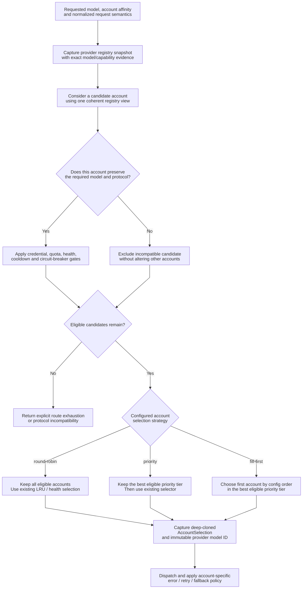
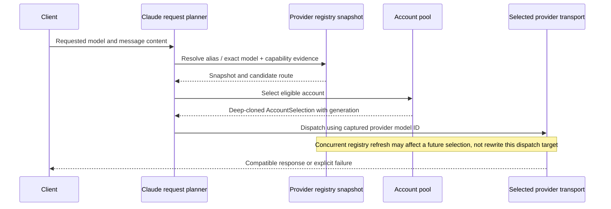

# Provider model routing and account scheduling

> **Languages:** [English](provider-routing.md) · [Tiếng Việt](vi/provider-routing.md) · [简体中文](zh-CN/provider-routing.md)

> **Snapshot:** [`63d4e2bb4375`](https://github.com/trankien84/Kiro-Go/commit/63d4e2bb4375d85aed46e72d1d7c5df25138fa41). The model registry, account scheduler, and protocol planner are separate layers. This document describes their contracts rather than implying one universal provider-routing rule for every API.

## 1. Routing decision pipeline

**Decision walkthrough**

1. The request enters with a **requested** model ID and any caller/account affinity. The registry supplies **evidence** about models and capabilities discovered on individual account lifecycles; a public alias alone is insufficient to prove an upstream target.
2. Candidate filtering has two independent aspects: *protocol compatibility* (can this transport represent the request?) and *operational availability* (is this account currently credential-valid, unblocked, within quota and not in an active cooldown/circuit state?). Exclusion is local to the unsuitable candidate or failure scope, not a global model ban.
3. Only the already-eligible set goes to scheduling. `round-robin` keeps all candidates for historical LRU/health selection; `priority` narrows to the lowest effective numeric tier; `fill-first` picks the first account in that tier according to configured order. A selected account's deep-cloned lease and provider model ID are captured for the ensuing dispatch.
4. If a request fails later, the handler follows separate error-classification and bounded-retry rules; **the scheduler is not itself a blanket retry mechanism**.

**Example:** Accounts A and B both have effective priority 10, and C has 20. With all healthy, `priority` allows A/B to compete through existing selection, while `fill-first` chooses the first eligible among A/B. If A is cooling down, B can be chosen; priority never overrides a cooldown or protocol restriction.

This is a **logical composition** of the request planner, provider registry, and pool selector: their individual filters are not guaranteed to execute in precisely this drawing order. Failure after dispatch has a separate per-account/provider retry policy. The scheduler never brings back accounts excluded by a prior eligibility gate.

**Source:** [`proxy/claude_request_plan.go`](../../proxy/claude_request_plan.go), [`proxy/claude_transport_requirements.go`](../../proxy/claude_transport_requirements.go) (`nextCompatibleClaudeCandidate`), [`proxy/provider_registry.go`](../../proxy/provider_registry.go), [`pool/account.go`](../../pool/account.go), [`pool/account_scheduler.go`](../../pool/account_scheduler.go).

## 2. Three scheduling modes

| Strategy | Candidate behavior | Important distinction |
| --- | --- | --- |
| `round-robin` (default) | Does not narrow the already-eligible candidate set | Historical selector still considers existing LRU/health signals; not a promise of mathematically even distribution |
| `priority` | Keep accounts in the **best eligible** priority tier | Lowest numeric priority wins; within tier, existing selection applies |
| `fill-first` | Pick the **first account in pool/config order** in the best eligible priority tier | Not round-robin within the tier; reordering accounts changes the preferred target |

Unset/non-positive account priorities map to effective priority `100`. `fill-first` does not bypass quota/health/cooldown constraints, and it can move to another eligible account when the preferred one ceases to qualify. Admin priority/order writes use observed-state checks to avoid overwriting concurrent changes.

**Source:** [`config/account_selection.go`](../../config/account_selection.go) (`NormalizeAccountSelectionStrategy`, `EffectiveAccountPriority`), [`pool/account_scheduler.go`](../../pool/account_scheduler.go) (`applyAccountSelectionStrategy`), [`config/account_routing_admin.go`](../../config/account_routing_admin.go). **Tests:** [`pool/account_scheduler_test.go`](../../pool/account_scheduler_test.go), [`config/account_routing_admin_test.go`](../../config/account_routing_admin_test.go).

## 3. Immutable model evidence and dispatch affinity

`proxy/provider_registry.go` distinguishes the caller's **requested model ID**, the provider's **opaque model ID**, and the **public model ID**. Exact provider IDs are not passed through client-facing alias rewriting. Where a case-insensitive fallback would be ambiguous, lookup must not guess. Immutable snapshots preserve the selected target across concurrent registry updates; lifecycle checks protect account-specific runtime state.

A provider's advertised model is not always evidence that it can satisfy a **specific** Claude feature. For example, Kiro structured JSON `output_config.format` requires the **selected Kiro account/model's live** `AdditionalModelRequestFieldsSchema` to advertise that field. Another account's positive snapshot cannot authorize it.

**Source:** [`proxy/provider_registry.go`](../../proxy/provider_registry.go) (`providerRouteIndex.resolve`, `buildAccountRoutes`, `resolveCandidateProviderRoute`), [`proxy/provider_runtime_state.go`](../../proxy/provider_runtime_state.go), [`pool/account_selection.go`](../../pool/account_selection.go), [`proxy/claude_kiro_structured_output.go`](../../proxy/claude_kiro_structured_output.go). **Tests:** [`proxy/provider_registry_phase_test.go`](../../proxy/provider_registry_phase_test.go), [`proxy/claude_kiro_structured_output_test.go`](../../proxy/claude_kiro_structured_output_test.go).

### Why a registry refresh cannot rewrite an in-flight dispatch

A provider registry is a snapshot of what individual account/model combinations advertised at a particular point. The selected candidate retains both the immutable account generation and the **exact provider model identifier**. If a background discovery updates the public model union immediately afterwards, the already selected request still uses its captured target; the updated registry affects subsequent selections only. This avoids mid-flight alias reinterpretation or capability leakage between accounts.

**Ambiguous alias example:** If two distinct provider IDs fold to the same case-insensitive lookup key, a fallback lookup must not guess one arbitrarily. Similarly, Kiro structured JSON output requires capability evidence for the *selected account's live model schema*, not just a second account advertising that field.

## 4. Provider, model and lifecycle isolation

Provider runtime state is scoped to accounts and their lifecycles. Its model snapshots, discovery data, denial/cooldown markers, and route-publication state must not be borrowed across unrelated credentials or stale account generations. Distinguish:

- **Transport failure:** a broken socket or truncated EventStream is not automatically proof of invalid credentials. See [Streaming and recovery](streaming-recovery.md).
- **Credential or account failure:** may lead to account-specific refresh, quarantine or reconciliation according to the classifier.
- **Model/permission failure:** can exclude a model or capability without treating every other model on that account as broken.
- **Retry-After or throttling:** can impose cooldown without changing the configured routing policy.

**Source:** [`proxy/provider_runtime_state.go`](../../proxy/provider_runtime_state.go), [`proxy/account_failover.go`](../../proxy/account_failover.go), [`pool/account.go`](../../pool/account.go).

## 5. Bedrock is not one homogeneous Claude transport

Bedrock *Invoke* and *Converse* have different protocol surfaces. Account capability gating accounts for the selected operation, supported features, discovered foundation/inference-profile targets and callable regions. A listed model or an operator-defined alias is **not** proof of successful invocation. Discovery uses bounded control-plane reads and a per-lifecycle, context-aware gate to avoid overlapping discovery jobs.

**Source:** [`proxy/bedrock_discovery_hardening.go`](../../proxy/bedrock_discovery_hardening.go), [`proxy/bedrock_discovery.go`](../../proxy/bedrock_discovery.go), [`proxy/bedrock_region.go`](../../proxy/bedrock_region.go), [`proxy/claude_transport_requirements.go`](../../proxy/claude_transport_requirements.go). **Tests:** [`proxy/bedrock_discovery_context_hardening_test.go`](../../proxy/bedrock_discovery_context_hardening_test.go), [`proxy/bedrock_region_context_test.go`](../../proxy/bedrock_region_context_test.go).

For a protocol-level compatibility picture, see [Agent protocols](agent-protocol.md).
