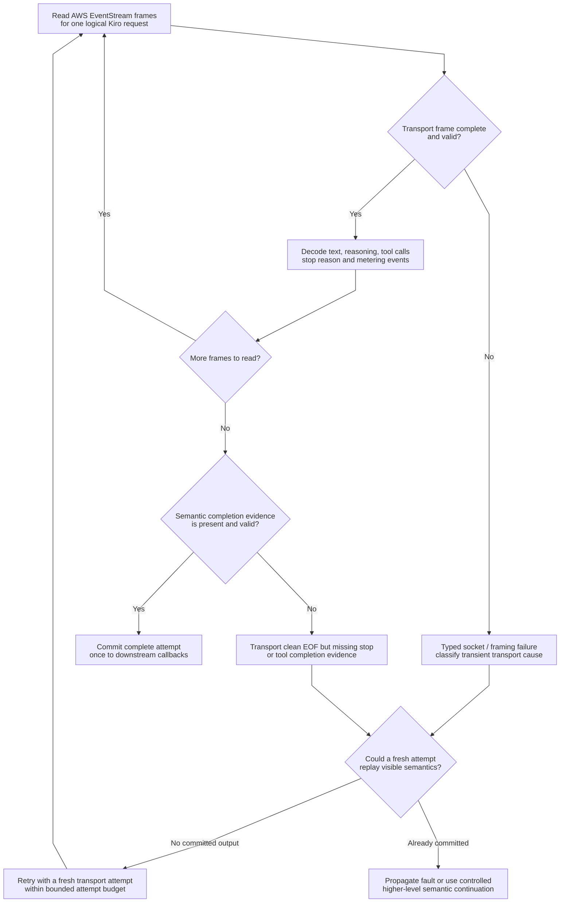
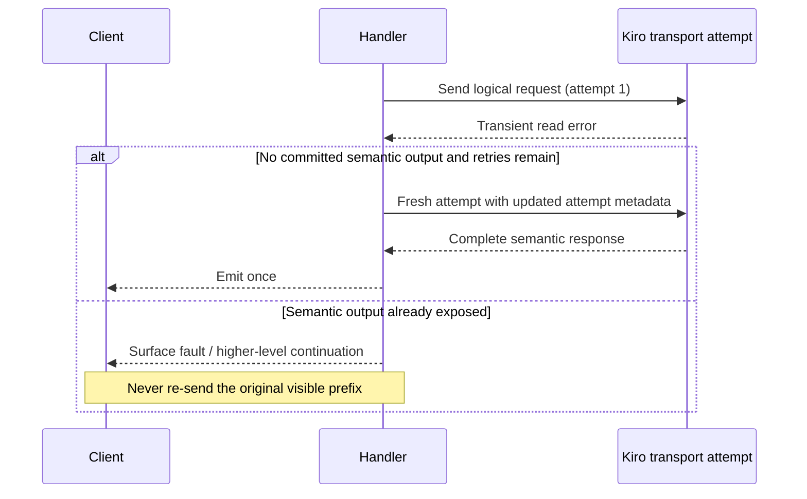

# Streaming integrity, text decoding and recovery

> **Languages:** [English](streaming-recovery.md) · [Tiếng Việt](vi/streaming-recovery.md) · [简体中文](zh-CN/streaming-recovery.md)

> **Snapshot:** [`63d4e2bb4375`](https://github.com/trankien84/Kiro-Go/commit/63d4e2bb4375d85aed46e72d1d7c5df25138fa41). Transport retries and Completion Guard semantic continuations have different commit boundaries. An EOF is not automatically a successful answer.

## 1. Transport read and integrity checks

Kiro's AWS EventStream is parsed into semantic callbacks: assistant/reasoning text, tool-use state, stop reason, metering and context signals. The transport layer distinguishes transient connection/read failures, incomplete frames, and clean transport EOF with missing semantic terminal evidence. An actual upstream `stopReason` or delivered tool call may be terminal evidence; text or reasoning alone without such evidence is considered incomplete.

**Failure and replay walkthrough**

1. One logical Kiro invocation can make multiple transport attempts, but not indefinitely (`kiroTransportMaxAttempts` is 3). Each attempt parses raw AWS EventStream framing separately from semantic text/tool/stop events.
2. **Transport completeness is not semantic completeness.** A clean socket EOF with text but without required terminal evidence remains truncated; it is not a successful assistant turn merely because the network closed normally.
3. Before retry, the recovery layer checks whether the attempt already delivered any semantic output that cannot be reset: text, reasoning/signature, tool use or error callback. Once visible output has escaped, replaying the original request could duplicate text or tool execution.
4. A higher-level caller that retains output in a private buffer may support reset and retry before final commitment. A streaming caller must conservatively treat emitted semantic callbacks as a no-replay boundary.

**Example:** The provider sends `"abc"` and then its EventStream is truncated. If `"abc"` has already reached the client, a new full replay may produce `"abcabc"` or duplicate a tool call. The correct recovery is to surface the incomplete result or use a separate continuation from committed state; it is not a fresh blind retry.

`kiroTransportMaxAttempts` is `3` (a distinct lower-level retry limit from Completion Guard's retry configuration). The HTTP attempt is new while the logical invocation identity and correct attempt metadata remain coherent. **Do not** map all network faults to invalid credentials or account bans. A successful TCP close without semantic terminal fields is not enough to claim completion.

**Source:** [`proxy/stream_integrity.go`](../../proxy/stream_integrity.go) (`classifyStreamIntegrity`), [`proxy/kiro_transport_recovery.go`](../../proxy/kiro_transport_recovery.go) (`callKiroAPIContextWithRecovery`), [`proxy/kiro.go`](../../proxy/kiro.go). **Tests:** [`proxy/stream_integrity_test.go`](../../proxy/stream_integrity_test.go), [`proxy/kiro_transport_recovery_test.go`](../../proxy/kiro_transport_recovery_test.go).

## 2. The exact no-replay boundary

A semantic callback can be a stronger replay boundary than raw response bytes: text, thinking/signatures, tool-use or error callbacks may already have been delivered. Some higher-level callers buffer callbacks and explicitly support safe reset before retry; streaming callers conservatively forbid replay after semantic output. Completion Guard may continue from **committed** history instead of replaying the original prompt; that is a separate controlled operation.

**Source:** [`proxy/kiro_transport_recovery.go`](../../proxy/kiro_transport_recovery.go) (`kiroAttemptCallbacks`, `replaySafe`, `resetForRetry`), [`proxy/agent_completion_guard.go`](../../proxy/agent_completion_guard.go).

### Reading the retry sequence

The transport layer is allowed to create a **new HTTP attempt** while keeping the identity of the *logical request* stable and updating per-attempt metadata. The decisive question is not merely whether response bytes arrived, but whether semantic callbacks have been **externally committed**. If a buffered caller can discard all pending events, its safe retry window can be wider than that of a live streaming caller. If output has already escaped to the client, restarting the original request risks double emission and possibly repeated tool effects.

Transport retry and Completion Guard recovery are separate controls. The former handles low-level connection and EventStream integrity failures; the latter may construct a **continuation** from visible committed history after an unsafe-to-replay partial response. Neither guarantees recovery for every failure class.

## 3. Text chunk decoding: never infer replay from repeated text

| Mode | Input contract | Output behavior |
| --- | --- | --- |
| `delta` (default) | Each event adds new text | Emit the chunk verbatim, even if it equals a previous chunk |
| `cumulative` | Each event contains an expanding prefix | Emit newly appended suffix; repeated snapshot emits nothing |
| `legacy` (opt-in) | Historical overlap heuristic | May drop real repeated characters; **not recommended** unless required for known legacy input |

If `cumulative` sees a non-prefix event, it emits the current chunk unchanged and switches to `delta` rather than guessing a suffix overlap. Assistant and reasoning use **separate** environment variables: `KIRO_ASSISTANT_CHUNK_MODE` and `KIRO_REASONING_CHUNK_MODE`, both default to `delta`.

**Source:** [`proxy/stream_text_decoder.go`](../../proxy/stream_text_decoder.go) (`Push`, `legacyNormalizeChunk`). **Tests:** [`proxy/stream_text_decoder_test.go`](../../proxy/stream_text_decoder_test.go).

## 4. Cancellation, usage and diagnostics

- Request cancellation propagates through the Kiro request context and retry backoff rather than leaving orphaned upstream work.
- Failed hidden attempts must not duplicate text, tool calls or client-visible usage; transport attempt accounting and semantic commitment are distinct.
- Diagnostic flags are optional; raw SSE/chunk logging can include sensitive user content and must not be enabled casually.
- An idle/progress watchdog for long-running streams is distinct from a fixed whole-stream HTTP write timeout.

**Source:** [`proxy/kiro_transport_recovery.go`](../../proxy/kiro_transport_recovery.go), [`proxy/http_idle_watchdog.go`](../../proxy/http_idle_watchdog.go), [`diagnostics/flags.go`](../../diagnostics/flags.go), [`main.go`](../../main.go). **Tests:** [`proxy/http_idle_watchdog_test.go`](../../proxy/http_idle_watchdog_test.go), [`proxy/stream_integrity_paths_test.go`](../../proxy/stream_integrity_paths_test.go).

See [Completion Guard](completion-guard.md) for atomic structured-turn validation and the separate semantic audit/continuation policy.
