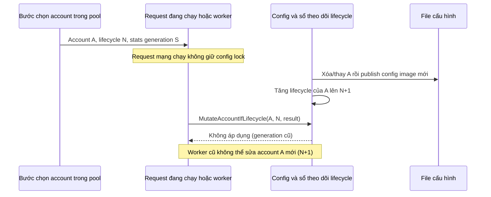
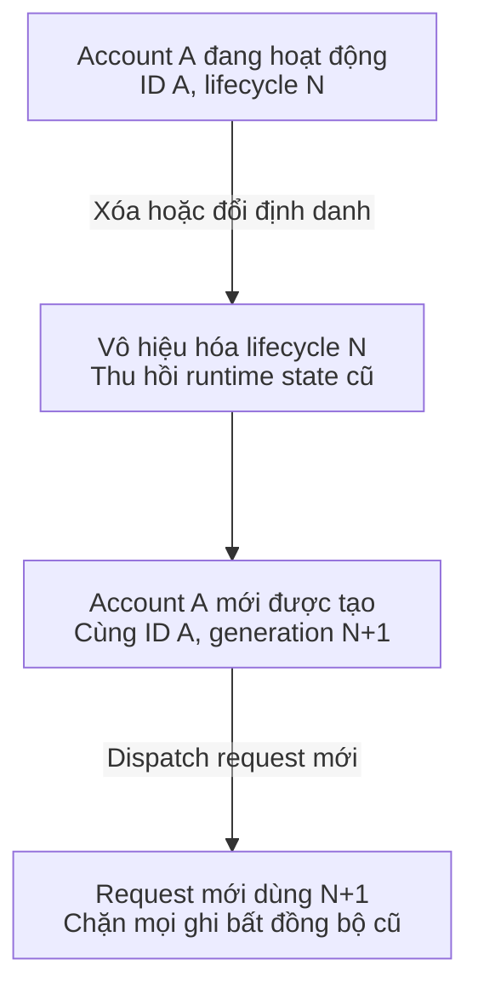
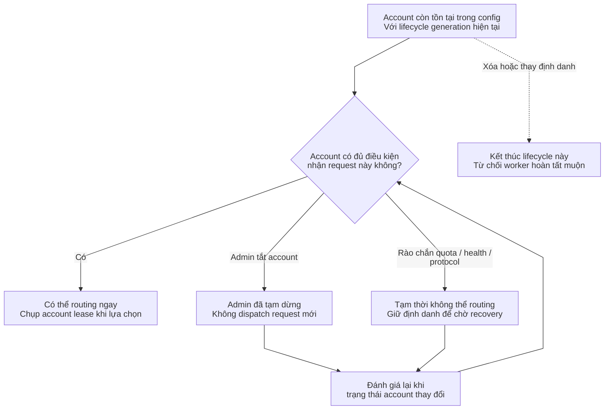
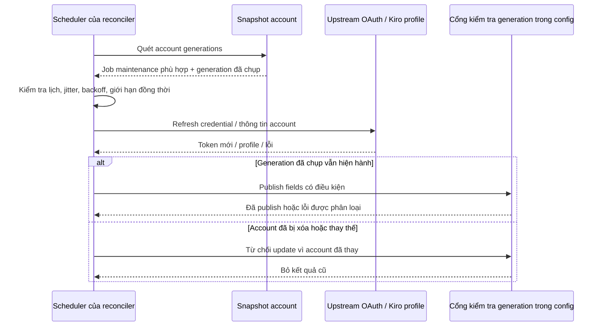
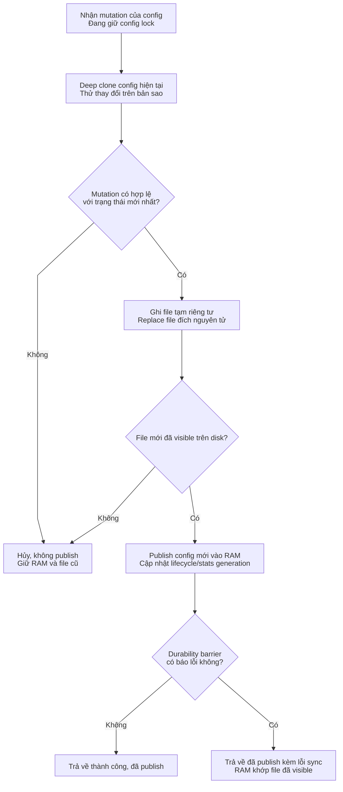

# Vòng đời account, reconciliation và lưu trạng thái bền vững

> **Ngôn ngữ:** [English](../account-lifecycle.md) · [Tiếng Việt](../vi/account-lifecycle.md) · [简体中文](../zh-CN/account-lifecycle.md)

> **Snapshot:** [`63d4e2bb4375`](https://github.com/trankien84/Kiro-Go/commit/63d4e2bb4375d85aed46e72d1d7c5df25138fa41). **Lifecycle identity** của account không chỉ là ID dạng chuỗi. Điều kiện được routing request cũng khác với điều kiện được background refresh token.

## 1. Định danh account và generation fencing

Khi chọn account, pool giữ selection lock để chụp một `AccountSelection` bất biến: bản deep clone của account, `LifecycleGeneration` và `StatsGeneration` riêng biệt. Xóa/tạo lại account hoặc đổi dispatch identity làm generation cũ hết hiệu lực; các cập nhật thông thường về thống kê, quota, enablement không nhất thiết tạo lifecycle mới. Worker phải kiểm tra generation đã chụp trước khi sửa canonical state hiện tại.

Đây là **tình huống ngăn race condition**, không phải mỗi request đều phải xóa account. Generation chỉ là hàng rào trong **một process** nhằm bảo vệ tác vụ đồng thời, không phải distributed fencing token được lưu bền vững toàn hệ thống.

**Mã nguồn:** [`config/account_lifecycle_generation.go`](../../../config/account_lifecycle_generation.go) (`markAccountLifecycleDeletedLocked`, `accountDispatchIdentityChanged`, `MutateAccount...IfLifecycle`), [`config/config_transaction.go`](../../../config/config_transaction.go), [`pool/account_selection.go`](../../../pool/account_selection.go). **Kiểm thử:** [`config/account_dispatch_lifecycle_test.go`](../../../config/account_dispatch_lifecycle_test.go), [`pool/account_selection_lifecycle_test.go`](../../../pool/account_selection_lifecycle_test.go).

## 2. Lifecycle khác với khả năng routing

Lifecycle identity và trạng thái có thể dispatch hiện tại là **hai chiều độc lập**:

**Tại sao cần hai generation?**

- `LifecycleGeneration` bảo vệ *định danh logic và credential upstream* của account. Xóa A rồi tạo A mới cùng string ID không được cho phép worker của A cũ cập nhật A mới.
- `StatsGeneration` bảo vệ các đợt thống kê/reset độc lập; queue cập nhật trễ không được phục hồi counter đã xóa hoặc ghi vào epoch thống kê mới.
- Request đang chạy giữ snapshot `AccountSelection`, không giữ con trỏ có thể sửa vào config live. Nó có thể hoàn thành bằng snapshot đó, nhưng side effect chỉ được publish nếu generation vẫn khớp.

**Ví dụ:** Worker W bắt đầu refresh A ở generation 7. Admin xóa A rồi thêm một A mới ở generation 8. Khi W trả kết quả, `MutateAccountIfLifecycle(A, 7, ...)` bị từ chối; token và health của A mới giữ nguyên. Đây là **fence cục bộ process**, không phải ID phân tán.

**Lifecycle và routability không đồng nhất**

Lifecycle hình thành khi account được thêm/import; kết thúc khi bị xóa hoặc *dispatch identity* thay đổi. Routability được đánh giá lại cho từng request và có thể thay đổi **mà không đổi lifecycle**: admin pause, cooldown, quota cạn hoặc model không hỗ trợ đều có thể tạm loại account. Bật lại account cũng không làm generation đã retired sống lại.

**Ví dụ:** Account OAuth bị admin tắt có thể vẫn được background maintenance refresh nếu không có ban reason do provider. Điều đó **không** có nghĩa account được dispatch inference. Trạng thái credential/provider bị terminal failure không được coi đơn giản là admin pause.

Sơ đồ đầu biểu diễn thao tác khiến generation hết hiệu lực; tạo account mới với cùng text ID luôn là một lifecycle mới. Sơ đồ thứ hai diễn giải **điều kiện routing** trong một lifecycle còn tồn tại. Các gate bao gồm credential, quota, health, circuit state và protocol capability; thay đổi gate không mặc định retire định danh.

Đây là các trạng thái **suy ra lúc routing**, không phải enum được lưu trong `config.Account`. Account paused vẫn có thể được chăm sóc credential ở background. Một account đã retired không chuyển về `Eligible` bằng cách bật lại cờ trên generation cũ.

**Mã nguồn:** [`pool/account.go`](../../../pool/account.go), [`pool/account_credential_eligibility.go`](../../../pool/account_credential_eligibility.go), [`proxy/account_reconciler.go`](../../../proxy/account_reconciler.go) (`accountSupportsCredentialMaintenance`).

## 3. Background maintenance và loại bỏ kết quả cũ

`proxy/account_reconciler.go` tổ chức các lane bảo trì credential và account-info riêng, có giới hạn concurrency, jitter và backoff. Nó **không** sync-refresh toàn bộ account trong request handler. `accountSupportsCredentialMaintenance` phân biệt admin disable với disable do lỗi provider; giữ token còn hạn không có nghĩa phải đưa account vào tập được routing. Request path cũng có thể refresh token, nhưng mọi writer vẫn phải tuân thủ lifecycle ownership.

**Mã nguồn:** [`proxy/account_reconciler.go`](../../../proxy/account_reconciler.go), [`proxy/account_info_reconcile.go`](../../../proxy/account_info_reconcile.go), [`auth/refresh_context.go`](../../../auth/refresh_context.go), [`auth/refresh_failure.go`](../../../auth/refresh_failure.go), [`proxy/token_refresh_reconciliation.go`](../../../proxy/token_refresh_reconciliation.go). **Kiểm thử:** [`proxy/account_reconciler_fencing_test.go`](../../../proxy/account_reconciler_fencing_test.go), [`auth/refresh_lifecycle_test.go`](../../../auth/refresh_lifecycle_test.go).

### Cách đọc sequence của reconciler

Scheduler làm việc theo account **lifecycle**, không chỉ string ID. Từ snapshot, nó xác định lúc nào cần refresh credential hoặc account info. Vì đây là network I/O có thể chậm/retry, scheduler không khóa canonical config suốt thời gian gọi upstream. Khi nhận kết quả, bước publish có điều kiện so generation của worker với account hiện tại. Nếu trong lúc chờ admin đã xóa/thay account, kết quả cũ không được ghi đè token, quota, ban hay stats của account mới.

Admin pause và terminal failure do provider có chính sách maintenance khác nhau. Refresh token thành công **không tự bật lại account**. Error disposition quyết định liệu có nên retry; xem [Authentication](authentication.md).

## 4. Ghi config theo transaction

Canonical config dùng copy-on-write: clone `Config` hiện tại, áp dụng thay đổi trên bản sao, serialize rồi thay file trước khi publish object mới vào RAM **chỉ khi file mới đã hiện diện ở đích**. Nếu durability barrier báo lỗi **sau** lúc replace file, RAM vẫn có thể publish bản mới để đồng bộ với file người khác nhìn thấy; `published=true, err!=nil` là kết quả có ý nghĩa, **không** có nghĩa đã rollback.

**Diễn giải transaction**

1. Khi giữ config lock, mutation được thực hiện trên deep clone; lỗi validation không làm đổi canonical object.
2. Ghi file tạm với quyền riêng tư rồi replace file đích. Nếu file mới chưa từng visible, giữ config cũ trong RAM.
3. Khi file mới đã visible, publish config staged và reconcile lifecycle/stats generation. Durability error sau bước này có thể đi kèm mutation **đã publish**; bit `published` phân biệt trường hợp đó.

**Ví dụ:** Disk sync lỗi sau khi replace path đã thành công. Chỉ rollback RAM sẽ làm RAM lệch với file đã có trên disk. Vì vậy transaction giữ bản mới trong RAM, đồng thời trả kết quả **published + error**. Đây không phải transaction database giữa nhiều process.

Private-file helpers riêng Windows/Unix áp quyền truy cập hạn chế, nhưng **không** cung cấp isolation giữa nhiều process Kiro-Go cùng ghi một config. Stats generation ngăn worker ghi trễ làm sống lại counter đã reset.

**Mã nguồn:** [`config/config_transaction.go`](../../../config/config_transaction.go), [`config/config_file_write.go`](../../../config/config_file_write.go), [`config/account_stats_generation.go`](../../../config/account_stats_generation.go), [`internal/privatefile/security_unix.go`](../../../internal/privatefile/security_unix.go), [`internal/privatefile/security_windows.go`](../../../internal/privatefile/security_windows.go). **Kiểm thử:** [`config/config_file_security_test.go`](../../../config/config_file_security_test.go), [`config/account_stats_generation_test.go`](../../../config/account_stats_generation_test.go), [`internal/privatefile/security_windows_test.go`](../../../internal/privatefile/security_windows_test.go).

## 5. Lưu ý khi vận hành

- Không dùng riêng text ID để cho phép mutation bất đồng bộ; phải so generation đã chụp.
- OAuth refresh thành công upstream chưa chắc token đã persist. Phải xử lý riêng lỗi lưu rotated refresh token; xem [Authentication](authentication.md).
- Worker đã superseded không được ban, refresh, reset hay thay account mới.
- Thay đổi priority/thứ tự `fill-first` là thao tác admin có optimistic concurrency, **không** chỉ sắp xếp UI trong bộ nhớ. Xem [Provider routing](provider-routing.md).
