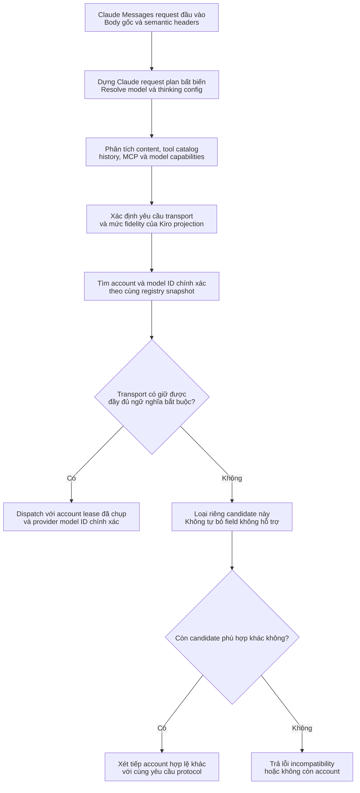
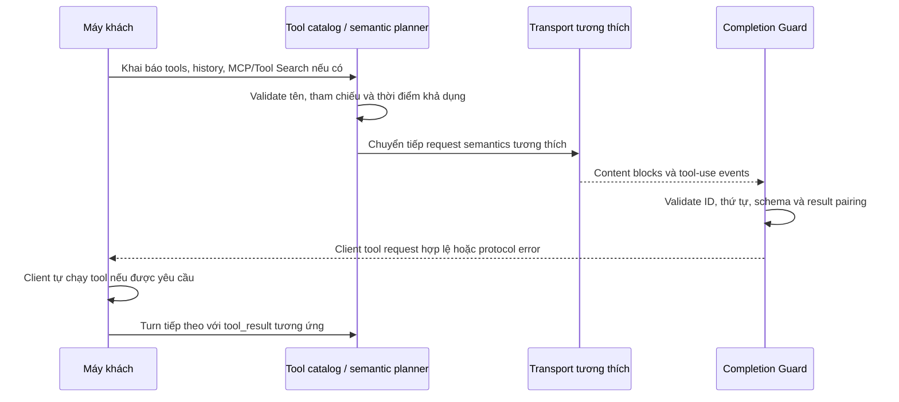
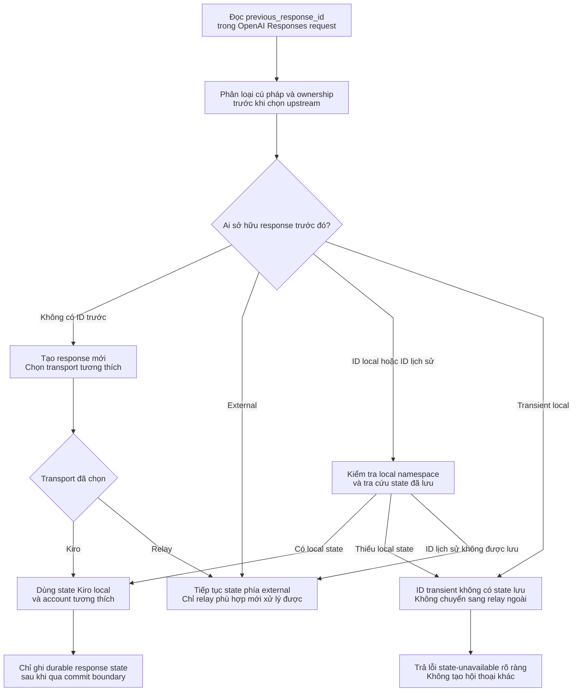

# Giữ nguyên ngữ nghĩa giao thức agent và yêu cầu transport

> **Ngôn ngữ:** [English](../agent-protocol.md) · [Tiếng Việt](../vi/agent-protocol.md) · [简体中文](../zh-CN/agent-protocol.md)

> **Snapshot:** [`63d4e2bb4375`](https://github.com/trankien84/Kiro-Go/commit/63d4e2bb4375d85aed46e72d1d7c5df25138fa41). JSON/request hợp lệ không đủ chứng minh provider thực thi **đúng ngữ nghĩa**. Phải phân biệt routing theo **Claude Messages** với routing **OpenAI Responses**, vì hai API hỗ trợ transport khác nhau.

## 1. Phân tích ngữ nghĩa trước khi chọn Claude transport

**Diễn giải planner và quá trình chọn account**

1. Chuẩn hóa wire request **một lần**, bao gồm tool đã khai báo, danh tính tool trong lịch sử, model alias, thinking, beta header và những field mang ý nghĩa giao thức. Kết quả là `claudeRequestPlan` làm chuẩn chung cho routing và chuyển đổi.
2. Rút ra transport requirements từ **tính năng được sử dụng thực tế**, không suy ra ngay khi thấy beta header. Phân biệt giữ nguyên chính xác, emulation được hỗ trợ và projection không tương thích.
3. So sánh requirements với model/capability evidence từ immutable registry của từng candidate. Kiro-native, Direct Anthropic, custom relay, Bedrock Invoke và Converse không thể hoán đổi chỉ vì tên model nhìn giống nhau.
4. Loại candidate không phù hợp **trước** dispatch. Nếu không còn account nào bảo toàn feature bắt buộc, trả lỗi rõ ràng; tuyệt đối không tự bỏ MCP, signed thinking hay structured output cho vừa adapter.

**Ví dụ:** `tool_use` do client thực thi khác với lệnh chạy MCP connector **do provider sở hữu**. Hỗ trợ client tool không đồng nghĩa transport Kiro-native/Bedrock hỗ trợ server-side MCP tùy ý.

`claudeRequestPlan` giữ parsed request, requested/resolved model, reasoning/capability, semantic request chuẩn hóa, content inventory, Kiro projection, tool catalog và transport requirements. Những tầng sau phải dùng chung plan thay vì mỗi adapter tự diễn giải request một kiểu. Raw payload vẫn được giữ khi cần transparent forwarding.

**Mã nguồn:** [`proxy/claude_request_plan.go`](../../../proxy/claude_request_plan.go), [`proxy/claude_request_semantics.go`](../../../proxy/claude_request_semantics.go), [`proxy/claude_content_inventory.go`](../../../proxy/claude_content_inventory.go), [`proxy/claude_transport_requirements.go`](../../../proxy/claude_transport_requirements.go), [`proxy/claude_kiro_projection.go`](../../../proxy/claude_kiro_projection.go). **Kiểm thử:** [`proxy/claude_request_plan_test.go`](../../../proxy/claude_request_plan_test.go), [`proxy/claude_semantic_transport_regression_test.go`](../../../proxy/claude_semantic_transport_regression_test.go).

## 2. Ma trận capability: quyết định theo request, không hứa chung chung

| Transport | Có thể chọn cho Claude Messages? | Điều kiện |
| --- | --- | --- |
| `kiro_native` | Tùy điều kiện | Projection fidelity của Kiro, schema model đã chọn và yêu cầu tool/protocol |
| `custom_api_relay` | Tùy điều kiện | Relay có thể forward đúng nghĩa; một số continuation không được chọn |
| `direct_anthropic` | Tùy điều kiện | Semantics của Anthropic Messages và capability của deployment/model |
| `bedrock_invoke` | Tùy điều kiện | Adapter Invoke và protocol/beta mà nó hỗ trợ |
| `bedrock_converse` | Tùy điều kiện | Adapter Converse với khả năng riêng |
| `unsupported` | Không | Loại account không biết/không hợp lệ hoặc transport không hỗ trợ |

Đây **không** phải bảng khẳng định mọi server tool, MCP, Tool Search, JSON output, signed thinking hoặc beta tương lai đều dùng được trên từng transport. Compatibility được kiểm tra theo **request + model + account + transport thật**. `claudeAccountCompatibleWithRequirements` từ chối account kind lạ, chặn custom relay ở một số forwarded continuation và chặn Kiro nếu projection làm mất ngữ nghĩa bắt buộc.

**Mã nguồn:** [`proxy/claude_transport_requirements.go`](../../../proxy/claude_transport_requirements.go) (`claudeTransportKindForAccount`, `claudeAccountCompatibleWithRequirements`, `nextCompatibleClaudeCandidate`), [`proxy/claude_model_capabilities.go`](../../../proxy/claude_model_capabilities.go). **Kiểm thử:** [`proxy/claude_transport_requirements_test.go`](../../../proxy/claude_transport_requirements_test.go), [`proxy/model_protocol_contract_regression_test.go`](../../../proxy/model_protocol_contract_regression_test.go).

## 3. Tool: ai thực thi, khi nào khả dụng và định danh tham chiếu

Client tools do **client** tự chạy; Kiro-Go không trở thành runtime thực thi mọi tool của GitHub Copilot/VS Code/MCP. Ngược lại, server tools do provider sở hữu và MCP connector có state riêng. Phân tích content/history phải tách `tool_use`/`tool_result` của client khỏi `server_tool_use`, `mcp_tool_use`, `mcp_tool_result`, khai báo tool catalog, `defer_loading` và tool member được khám phá động. Feature không thể biểu diễn ở Kiro/Bedrock phải đi transparent transport tương thích hoặc trả lỗi.

Tool có thể được khai báo nhưng chưa **khả dụng** (`defer_loading`). Tool Search/MCP member phải có reference identity nhất quán và đúng thứ tự thời gian. Tool thêm ở turn sau không tự nhiên hợp lệ ở turn trước. Những semantics server-side chưa biết không được ép thành client tool thông thường.

**Mã nguồn:** [`proxy/claude_inline_tool_history.go`](../../../proxy/claude_inline_tool_history.go), [`proxy/claude_mcp_member_history.go`](../../../proxy/claude_mcp_member_history.go), [`proxy/claude_native_toolset_history.go`](../../../proxy/claude_native_toolset_history.go), [`proxy/agent_completion_guard_catalog.go`](../../../proxy/agent_completion_guard_catalog.go), [`proxy/agent_completion_guard_tool_reference.go`](../../../proxy/agent_completion_guard_tool_reference.go). **Kiểm thử:** [`proxy/claude_mcp_tool_search_reference_test.go`](../../../proxy/claude_mcp_tool_search_reference_test.go), [`proxy/claude_temporal_tool_identity_test.go`](../../../proxy/claude_temporal_tool_identity_test.go), [`proxy/claude_inline_tools_protocol_test.go`](../../../proxy/claude_inline_tools_protocol_test.go).

### Đọc lịch sử tool theo timeline

Client gửi khai báo tool cùng lịch sử hội thoại. Planner kiểm tra không chỉ **tên có trong catalog không** mà còn **tool được mở từ turn nào**. Inline Tool/MCP member được load sau không được coi là khả dụng trước đó. Guard kiểm tra ID/input của `tool_use` trả về và `tool_result` ở request tiếp theo có khớp không.

Tool local (ví dụ VS Code/Copilot tools) do client chạy. `server_tool_use` do provider hay MCP connector chạy có ownership/state khác; đổi nó thành generic client tool làm thay đổi bên thực thi và người giữ kết quả. Transport không giữ được hợp đồng này phải bị loại hoặc thay bằng transparent route phù hợp.

## 4. Thinking, signature và structured output

- **Reasoning:** capability Kiro lấy từ schema riêng, khác capability model/Direct Anthropic; thinking config được yêu cầu rõ nhưng không hỗ trợ phải được validate, không đoán.
- **Thinking signature:** signature do provider phát chỉ được bảo toàn qua ranh giới transport tương thích. Continuation Kiro-local dùng provenance do proxy sở hữu; không mạo nhận nó là chữ ký Anthropic.
- **Structured JSON output:** `output_config.format` là ràng buộc khi sinh text. Kiro projection chỉ hợp lệ nếu schema model **live, còn mới, trên account đã chọn** khai báo hỗ trợ field đó.
- **Protocol metadata:** citation, stop reason, fallback boundary, container state, MCP và server-tool metadata có thể làm thay đổi nghĩa; phải giữ nguyên hoặc từ chối rõ, không biến thành plain text.

**Mã nguồn:** [`proxy/reasoning.go`](../../../proxy/reasoning.go), [`proxy/thinking_signature.go`](../../../proxy/thinking_signature.go), [`proxy/claude_kiro_structured_output.go`](../../../proxy/claude_kiro_structured_output.go), [`proxy/claude_transport_requirements.go`](../../../proxy/claude_transport_requirements.go). **Kiểm thử:** [`proxy/thinking_signature_test.go`](../../../proxy/thinking_signature_test.go), [`proxy/claude_kiro_structured_output_test.go`](../../../proxy/claude_kiro_structured_output_test.go).

## 5. OpenAI Responses có quyền sở hữu state riêng

`/v1/responses` phân loại `previous_response_id` **trước** khi chọn transport. Các loại gồm: không có ID, ID phía external, transient local, namespaced local và historical ID nhập nhằng. ID transient từ `store=false` **không bao giờ** được forward như state do upstream ngoài sở hữu. Local state mất/hỏng phải báo lỗi thay vì âm thầm khởi tạo hội thoại khác.

**Cách xử lý từng loại `previous_response_id`**

- **Không có ID:** request mới có thể chọn transport nào đáp ứng ngữ nghĩa.
- **External ID:** không đoán local store sở hữu; relay được chọn phải hiểu state phía upstream.
- **Local ID của instance hiện tại:** đọc local state; không tìm thấy phải báo lỗi, không tự tạo hội thoại mới.
- **Transient local (`store=false`):** state không bền vững, tuyệt đối không forward sang external relay như continuation hợp lệ.
- **Historical/ambiguous:** nếu lookup local có bản ghi khớp chính xác thì dùng local; không có thì có thể xem là external để tương thích relay cũ. Foreign namespaced ID cũng không mặc nhiên thuộc instance này.

**Ví dụ:** Client gửi lại response ID được Kiro-Go tạo với `store=false` làm `previous_response_id`. Không có state lưu trữ; lỗi state-unavailable giúp giữ tính nhất quán hội thoại. Forward bừa sang upstream khác có thể tạo kết quả gây hiểu nhầm.

Sơ đồ rút gọn logic namespace: **foreign namespace** có thể là external, nhưng **matching local namespace thiếu state** thì không được fallback sang external. Direct Anthropic và Bedrock hiện **không** phải native OpenAI Responses transport; handler chọn Kiro OAuth/API-key và custom relay theo điều kiện riêng.

**Giới hạn tool choice:** `auto` và `none` có thể chạy qua Kiro adapter khi các gate khác đạt. `required` hoặc specific function cần nhánh thử nghiệm `KIRO_NATIVE_TOOL_CHOICE=always`; passthrough-only không được dịch sang Kiro. Với `parallel_tool_calls=false`, Kiro không có native serial-tool switch: adapter local buffer phản hồi và chỉ commit candidate có tối đa một tool call.

**Mã nguồn:** [`proxy/responses_state_routing.go`](../../../proxy/responses_state_routing.go) (`classifyResponseID`, `resolveResponseStateOwnershipByClass`), [`proxy/responses_handler.go`](../../../proxy/responses_handler.go), [`proxy/responses_store.go`](../../../proxy/responses_store.go), [`proxy/openai_projection.go`](../../../proxy/openai_projection.go). **Kiểm thử:** [`proxy/responses_state_routing_phase_test.go`](../../../proxy/responses_state_routing_phase_test.go), [`proxy/responses_state_commit_phase_test.go`](../../../proxy/responses_state_commit_phase_test.go), [`proxy/openai_projection_boundary_test.go`](../../../proxy/openai_projection_boundary_test.go).

## 6. Web search và tính năng do provider sở hữu

Adapter native `web_search` của Kiro dùng tích hợp Kiro MCP riêng; điều đó không chứng minh mọi connector MCP ngoài hoặc server tool tùy ý đều projection được qua Kiro. Các rào chắn model/transport vẫn phải áp dụng.

**Mã nguồn:** [`proxy/websearch.go`](../../../proxy/websearch.go), [`proxy/websearch_loop.go`](../../../proxy/websearch_loop.go), [`proxy/claude_transport_requirements.go`](../../../proxy/claude_transport_requirements.go). **Kiểm thử:** [`proxy/websearch_test.go`](../../../proxy/websearch_test.go), [`proxy/websearch_loop_test.go`](../../../proxy/websearch_loop_test.go).
