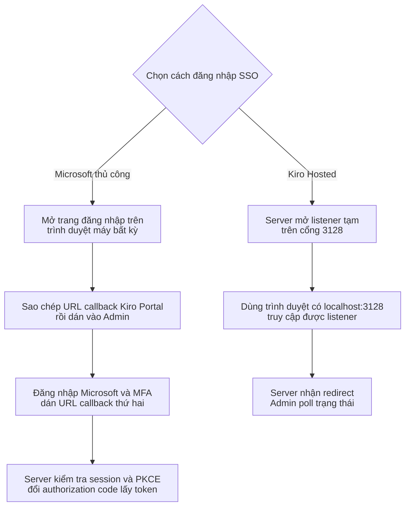
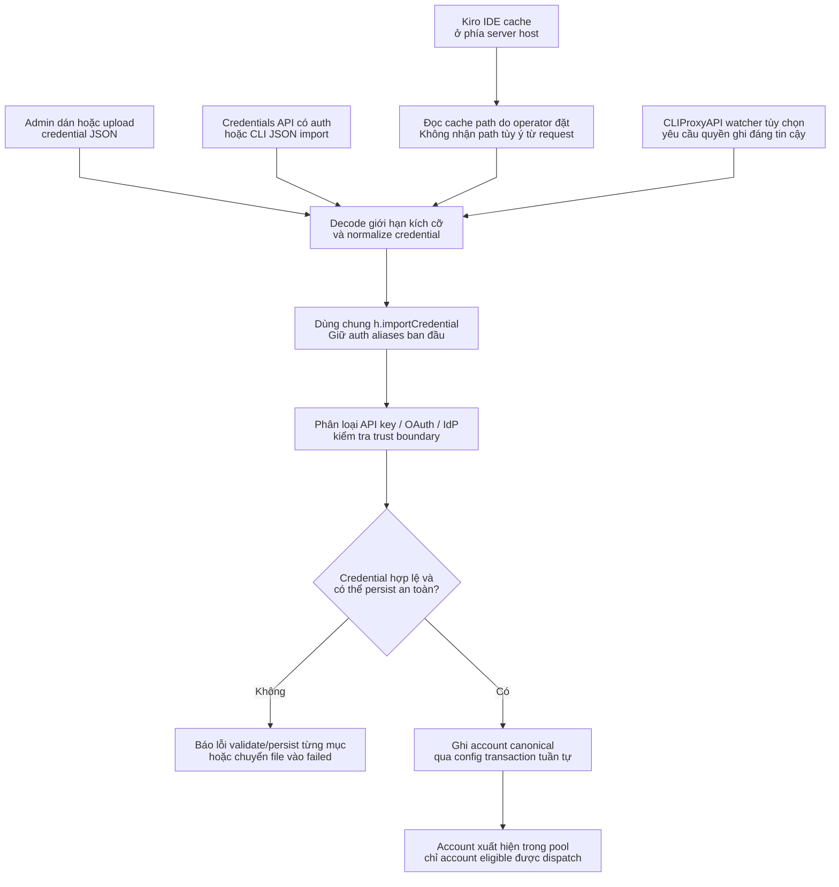
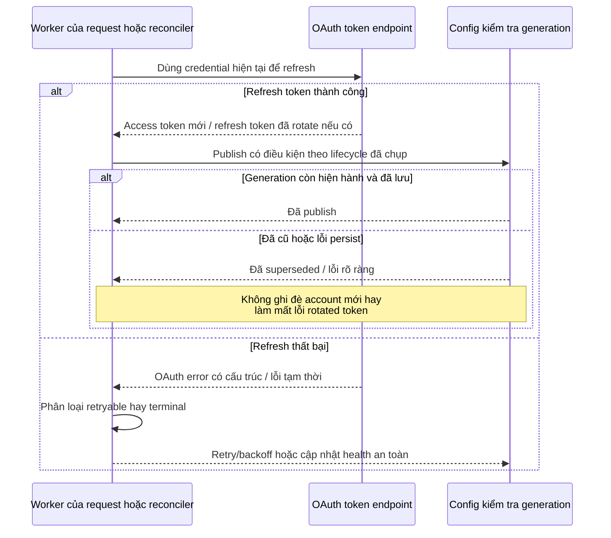

# Authentication, import credential và an toàn refresh

> **Ngôn ngữ:** [English](../authentication.md) · [Tiếng Việt](../vi/authentication.md) · [简体中文](../zh-CN/authentication.md)

> **Snapshot:** [`63d4e2bb4375`](https://github.com/trankien84/Kiro-Go/commit/63d4e2bb4375d85aed46e72d1d7c5df25138fa41). Import credential, refresh OAuth và chọn provider account là **ba thao tác khác nhau**. Import thành công không đảm bảo credential luôn đủ điều kiện routing.

## 1. Các loại authentication và nguồn gốc credential

| Loại credential | Ranh giới quan trọng / hành vi |
| --- | --- |
| AWS Builder ID và IAM Identity Center | OAuth/SSO với refresh token, xử lý account/profile region |
| Microsoft Entra ID / Enterprise SSO | Đăng nhập tương tác qua trình duyệt hoặc import được xác thực; kiểm tra danh tính và token endpoint riêng của Microsoft |
| Generic `external_idp` | Không được tự gán nhãn Microsoft chỉ vì cùng chuỗi auth method `external_idp` |
| Kiro API Key | Key `ksk_...` dùng Kiro CLI runtime và `tokentype: API_KEY`, **không** dùng OAuth refresh hay `profileArn` |
| Kiro IDE local cache | Đọc credential của IDE đã login ở phía server, bắt buộc validate/refresh trước khi persist |

Các chính sách tenant Microsoft 365 như MFA và Conditional Access là lý do headless password grant không phải lối đăng nhập Enterprise SSO thông thường. Bộ classifier dựa trên bằng chứng identity/upstream phù hợp, không đoán từ một field chung.

**Mã nguồn:** [`auth/microsoft_sso.go`](../../../auth/microsoft_sso.go), [`auth/oidc.go`](../../../auth/oidc.go), [`auth/kiro_sso.go`](../../../auth/kiro_sso.go), [`config/account_credentials.go`](../../../config/account_credentials.go), [`proxy/handler.go`](../../../proxy/handler.go). **Kiểm thử:** [`auth/microsoft_sso_test.go`](../../../auth/microsoft_sso_test.go), [`proxy/microsoft_lifecycle_test.go`](../../../proxy/microsoft_lifecycle_test.go).

## 2. Hai luồng SSO trên trình duyệt và nơi nhận callback

Kiro-Go có **hai cách đăng nhập khác nhau**. Cả hai đều dùng cổng redirect cố định `http://localhost:3128`, nhưng chỉ một cách cần tiến trình lắng nghe cổng này.

| Luồng | Lựa chọn trên Admin / API | Cách nhận callback | Có cần tunnel khi dùng máy từ xa? |
| --- | --- | --- | --- |
| **Microsoft Enterprise SSO thủ công** | Microsoft Enterprise SSO; `/admin/api/auth/microsoft-sso/start`, `/complete`, `/select-profile`, `/cancel` | Trình duyệt chuyển tới localhost và có thể báo không kết nối được. **Người dùng sao chép nguyên URL dán vào Admin hai lần** (bước Kiro Portal và bước Microsoft). Backend không mở listener `3128` cho luồng này. | **Không.** Dùng trình duyệt trên máy cá nhân; không cần public cổng callback hay SSH tunnel. |
| **Kiro Hosted SSO có listener** | Kiro Hosted SSO; `/admin/api/auth/kiro-sso/start`, `/poll`, `/select-profile`, `/cancel` | Backend mở listener HTTP tạm thời ở `3128`, tự nhận redirect và Admin poll trạng thái. | Thường phải mở trình duyệt ngay trên máy host chạy server, hoặc chủ động cấu hình tunnel/network phù hợp. `localhost` của máy cá nhân không tự trỏ tới VPS. |

**Cách dùng Microsoft thủ công:** Trong Admin, bắt đầu đăng nhập và mở URL Kiro được trả về. Sau khi đăng nhập Kiro Portal, sao chép **nguyên** `http://localhost:3128/signin/callback?...` trên thanh địa chỉ, kể cả khi trình duyệt báo không kết nối được localhost, rồi dán vào Admin. Tiếp tục với URL đăng nhập Microsoft mà Admin cung cấp, hoàn tất MFA nếu được yêu cầu. Sau đó sao chép **nguyên** `http://localhost:3128/oauth/callback?...` và dán lần thứ hai. Backend kiểm tra `state`, PKCE, đổi code lấy token và có thể yêu cầu chọn Kiro profile. Không chia sẻ URL callback vì chúng chứa dữ liệu đăng nhập tạm thời. Phiên có hạn **10 phút**; hết hạn phải bắt đầu lại.

**Vì sao Compose vẫn có cổng 3128?** File Compose giữ `127.0.0.1:3128:3128` cùng `KIRO_SSO_CALLBACK_BIND=0.0.0.0` để phục vụ **Kiro Hosted SSO**, không phải Microsoft thủ công. Host chỉ publish loopback nhưng listener bind toàn interface **bên trong container** có thể bị container khác cùng mạng truy cập trong lúc đăng nhập. Hãy cô lập mạng Docker hoặc dùng luồng thủ công. Không xóa cấu hình này khi còn cần luồng Hosted.

**Mã nguồn:** [`auth/microsoft_sso.go`](../../../auth/microsoft_sso.go), [`auth/kiro_sso.go`](../../../auth/kiro_sso.go), [`proxy/handler.go`](../../../proxy/handler.go), [`docker-compose.yml`](../../../docker-compose.yml). **Kiểm thử:** [`auth/microsoft_sso_test.go`](../../../auth/microsoft_sso_test.go), [`auth/kiro_sso_test.go`](../../../auth/kiro_sso_test.go), [`proxy/microsoft_handler_test.go`](../../../proxy/microsoft_handler_test.go).

## 3. Mọi đường import đều dùng chung classifier

**Các đường import và trust boundary**

1. Form JSON/file upload trong admin, API import có xác thực, IDE cache và filesystem watcher chỉ là các **điểm nhận dữ liệu**; chúng không có classifier riêng. Tất cả về `h.importCredential` để chuẩn hóa auth method/provider và validate.
2. IDE cache được đọc **phía server** theo đường dẫn mặc định hoặc `KIRO_IDE_CACHE`. `path` cũ trong request body bị **cố ý bỏ qua** nhằm ngăn đọc file tùy ý. Với Docker phải mount host cache vào container nếu muốn import.
3. Watcher có thể import credential **không cần gọi admin HTTP API**; vì vậy có quyền ghi `data/imports` tương đương được đưa account mới vào hệ thống. Không chia sẻ thư mục này cho user kém tin cậy. Bare binary mặc định tắt watcher, Compose đi kèm bật nó.
4. Parse JSON thành công chưa có nghĩa account được dùng inference. Credential phải phân loại/persist trước, sau đó pool, model và health gate mới quyết định dispatch.

**Ví dụ:** JSON `external_idp` chung thiếu bằng chứng Microsoft không được ép qua refresh path Microsoft chỉ vì có token endpoint. Mọi entrypoint dùng chung classifier để kết quả không lệch nhau.

`POST /admin/api/auth/credentials`, `POST /admin/api/auth/import-cli-json`, IDE-cache import và drop-folder watcher đều vào `h.importCredential`. Alias `snake_case`/`camelCase` được normalize trước canonical classification. Trust assumption đối với admin/UI và filesystem watcher **không giống nhau**.

**Mã nguồn:** [`proxy/handler.go`](../../../proxy/handler.go) (`apiImportCredentials`, `importCredential`, `apiImportCliJson`, `apiImportIdeCache`), [`proxy/cli_json_import.go`](../../../proxy/cli_json_import.go), [`proxy/import_watcher.go`](../../../proxy/import_watcher.go). **Kiểm thử:** [`proxy/import_credentials_test.go`](../../../proxy/import_credentials_test.go), [`proxy/cli_json_import_test.go`](../../../proxy/cli_json_import_test.go), [`proxy/import_watcher_test.go`](../../../proxy/import_watcher_test.go).

### IDE cache: cố ý vô hiệu hóa `path` từ request

`/admin/api/auth/import-ide-cache` có thể vẫn parse body để tương thích input cũ, nhưng **`body.path` không có tác dụng**. Server chỉ đọc `KIRO_IDE_CACHE` hoặc mặc định `~/.aws/sso/cache/kiro-auth-token.json`. `readIdeCacheCredential` giới hạn file **1 MiB** và yêu cầu refresh material dùng được; client không được dùng endpoint này để đọc đường dẫn bất kỳ. Đây là **security boundary**, không phải API còn thiếu. Không đưa lại ví dụ `-d '{"path":"..."}'` theo cách khiến người đọc hiểu nhầm client có thể chọn đường dẫn file trên server.

**Mã nguồn:** [`proxy/handler.go`](../../../proxy/handler.go) (`apiImportIdeCache`), [`proxy/ide_cache_import.go`](../../../proxy/ide_cache_import.go). **Kiểm thử:** [`proxy/ide_cache_import_test.go`](../../../proxy/ide_cache_import_test.go).

### Ranh giới bảo mật của drop-folder watcher

`KIRO_IMPORT_WATCH` tắt ở bare executable nhưng **bật trong `docker-compose.yml`**. File `CLIProxyAPI_*.json` nằm tại `data/imports/` có thể được import mà không cần admin password. Vì vậy ai ghi được vào đó có thể tạo account; không mount thư mục với trust rộng hơn config account. Nếu thư mục sync/share kém tin cậy, hãy tắt watcher. File đã xử lý/lỗi chuyển vào thư mục con tương ứng; thông tin lỗi cần giới hạn kích thước và tránh rò secret.

**Mã nguồn:** [`docker-compose.yml`](../../../docker-compose.yml), [`proxy/import_watcher.go`](../../../proxy/import_watcher.go).

## 4. Lỗi refresh OAuth không chỉ có một loại ban

Refresh error được phân thành **retryable**, **credential-terminal** và **configuration-terminal**. `OAuthTokenEndpointError` giữ error code chuẩn tách khỏi lời mô tả; không được suy chính sách chỉ từ HTTP 400 hoặc prose. Rotated refresh token rất nhạy cảm: nếu IdP đã rotate thành công nhưng persist local thất bại, không được âm thầm bỏ token mới.

**Mã nguồn:** [`auth/refresh_failure.go`](../../../auth/refresh_failure.go), [`auth/refresh_persistence_recovery.go`](../../../auth/refresh_persistence_recovery.go), [`auth/refresh_context.go`](../../../auth/refresh_context.go), [`proxy/account_reconciler.go`](../../../proxy/account_reconciler.go). **Kiểm thử:** [`auth/refresh_failure_test.go`](../../../auth/refresh_failure_test.go), [`auth/refresh_lifecycle_test.go`](../../../auth/refresh_lifecycle_test.go).

### Đọc sequence refresh

Worker bất đồng bộ dùng snapshot credential hiện tại để gọi token endpoint. Provider có thể trả **rotated refresh token**, khiến token cũ không còn dùng được. Mọi bước persist phải kiểm tra generation và báo rõ lỗi sau rotation. Token thuộc lifecycle gốc; không được ghi vào account thay thế dù string ID trùng nhau.

Code dùng structured failure disposition thay vì coi mọi HTTP 400 là credential hỏng vĩnh viễn. Lỗi mạng/rate-limit có thể retry; invalid credential và sai client config đòi hành động xử lý khác nhau.

## 5. Dò lại region cho Kiro API Key

Region reprobe chỉ dành cho một số lỗi xác thực **Kiro API Key** và có giới hạn lần thử; không chạy cho mọi provider hoặc mọi lỗi. Các candidate region phải được validate. Probe thành công ở REST/control plane **chưa đủ** để persist region runtime mới: phải retry thành công trên Kiro runtime thực tế. Nếu retry thất bại, khôi phục region trước đó. Sau khi đã emit output cho client thì không reprobe/replay original request nhằm tránh trùng kết quả.

**Mã nguồn:** [`proxy/kiro_api.go`](../../../proxy/kiro_api.go) (`reprobeApiKeyRegion`), [`config/account_lifecycle_generation.go`](../../../config/account_lifecycle_generation.go), [`proxy/kiro.go`](../../../proxy/kiro.go). **Kiểm thử:** [`proxy/kiro_apikey_region_test.go`](../../../proxy/kiro_apikey_region_test.go).

## 6. Diagnostics chỉ đọc và an toàn vận hành

- Xem dữ liệu trong `data/` và các cache mount là secret; bảo vệ file permissions và Docker volume.
- Không log JWT, access/refresh token, toàn bộ `Authorization` header hoặc file CLI JSON có credential thật.
- Import account không vượt qua các gate model, capability và routing; xem [Provider routing](provider-routing.md).
- Request refresh đang chạy phải bị loại nếu lifecycle đã đổi; xem [Account lifecycle](account-lifecycle.md).
