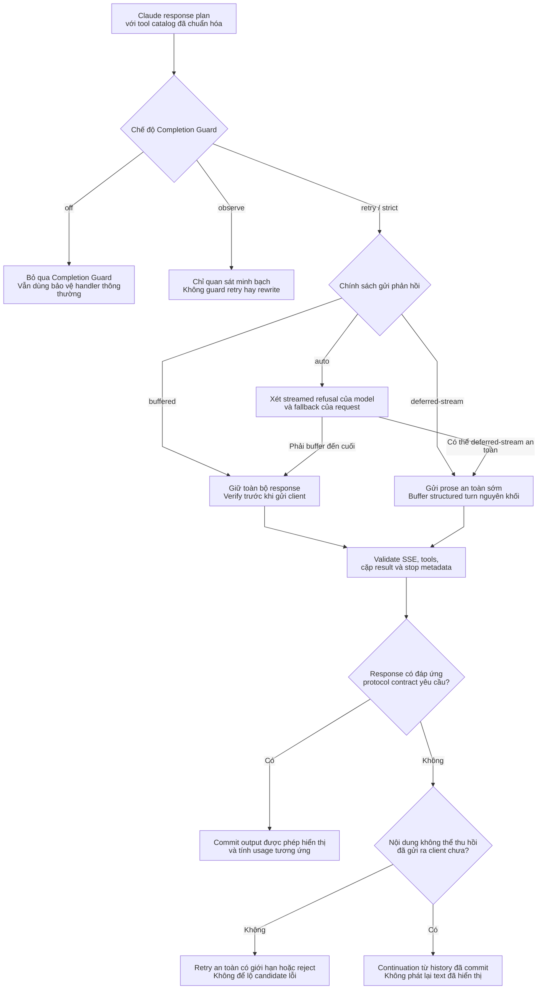
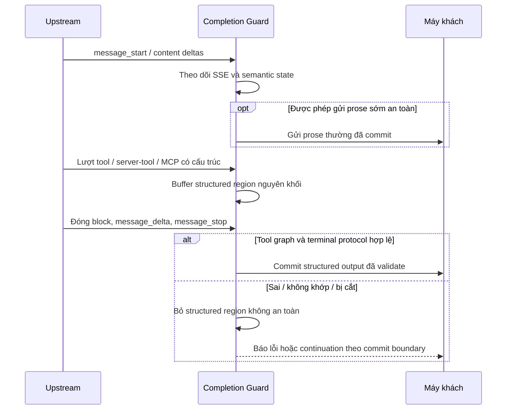
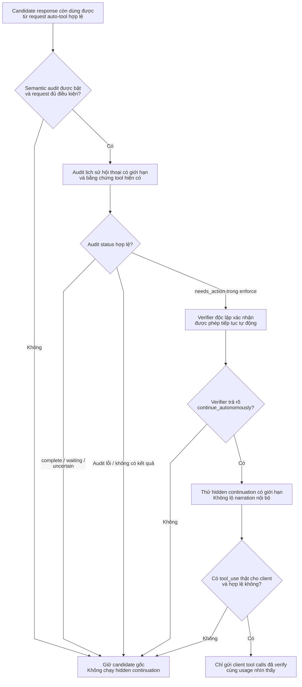

# Completion Guard: kiểm tra protocol, phát phản hồi và semantic audit

> **Ngôn ngữ:** [English](../completion-guard.md) · [Tiếng Việt](../vi/completion-guard.md) · [简体中文](../zh-CN/completion-guard.md)

> **Snapshot:** [`63d4e2bb4375`](https://github.com/trankien84/Kiro-Go/commit/63d4e2bb4375d85aed46e72d1d7c5df25138fa41). Đây là cơ chế bảo vệ **Claude Messages response**, không phải validator dùng chung cho mọi endpoint. Những heuristic deterministic completion-action/confidence đã bị loại bỏ; không được xem là tính năng đang chạy.

## 1. Mỗi chế độ guard có hợp đồng riêng

| `KIRO_AGENT_COMPLETION_GUARD` | Hành vi |
| --- | --- |
| `off` | Tắt Completion Guard, nhưng validation thông thường ở handler/transport vẫn áp dụng |
| `observe` | Quan sát minh bạch với một upstream attempt; **không** dùng guard để validate/retry/rewrite hay semantic audit |
| `retry` | Validation/recovery path của guard; retry hay reject tùy request và commit boundary |
| `strict` (mặc định) | Kiểm tra protocol nghiêm ngặt và recovery có giới hạn khi structured output hỏng/chưa hoàn tất |

`KIRO_AGENT_COMPLETION_DELIVERY` gồm `auto` (mặc định), `buffered`, `deferred-stream`. `KIRO_AGENT_COMPLETION_GUARD_MAX_RETRIES` mặc định `2` (giới hạn `0..4` trong plan). Retry budget không có nghĩa **mọi lỗi đều retry an toàn**. `KIRO_AGENT_COMPLETION_GUARD_MAX_BUFFER_BYTES` là giới hạn **accounting** dữ liệu giữ lại, không phải hard cap cho Go heap.

**Mã nguồn:** [`proxy/agent_completion_guard.go`](../../../proxy/agent_completion_guard.go) (`completionGuardModeFromEnv`, `completionGuardDeliveryModeFromEnv`, `buildAgentCompletionGuardPlanForModelWithCatalogAndCapabilities`), [`proxy/agent_completion_guard_budget.go`](../../../proxy/agent_completion_guard_budget.go). **Kiểm thử:** [`proxy/agent_completion_guard_test.go`](../../../proxy/agent_completion_guard_test.go), [`proxy/agent_completion_guard_long_term_regression_test.go`](../../../proxy/agent_completion_guard_long_term_regression_test.go).

## 2. Quyết định validation và delivery

**Các nhánh delivery**

1. `off` bỏ qua Completion Guard, nhưng request/transport checks thông thường vẫn chạy. `observe` chỉ quan sát qua một attempt; **không** âm thầm enforce tool validation, replay hoặc semantic audit.
2. `buffered` giữ toàn bộ candidate cho đến khi có thể kiểm tra trường terminal và structured content. `deferred-stream` có thể gửi text thường sớm, nhưng giữ cả một structured turn (client/server tool, MCP, mixed turn) như một đơn vị cho đến khi validation xong.
3. Với `auto`, guard xét model capability và `fallbacks`. Nếu streamed refusal có thể khiến text đã gửi trước đó trở nên không hợp lệ, phải buffer đến cuối dù deferred-stream có vẻ hấp dẫn.
4. Khi response không hợp lệ, recovery dựa trên **commit boundary**. Trước khi gửi dữ liệu không thể thu hồi, có thể retry/reject trong giới hạn. Sau khi commit, chỉ continuation dựa trên lịch sử đã thấy mới tránh được lặp output.

**Ví dụ:** Response sinh prose trước rồi có `tool_use` JSON lỗi. Text đã gửi không thể rút lại; structured tool turn phải được giữ nguyên khối và recovery không được replay prefix đã hiển thị.

`deferred-stream` **không** có nghĩa trì hoãn toàn bộ text; nó chỉ giữ cấu trúc không thể gửi dở. Streamed refusal capability hay `fallbacks` có thể buộc buffer toàn lượt vì byte đã phát không thể rollback. Non-stream request dùng buffering để verify.

**Mã nguồn:** [`proxy/agent_completion_guard_capabilities.go`](../../../proxy/agent_completion_guard_capabilities.go), [`proxy/agent_completion_guard_tool_state.go`](../../../proxy/agent_completion_guard_tool_state.go), [`proxy/agent_completion_guard_tool_protocol.go`](../../../proxy/agent_completion_guard_tool_protocol.go), [`proxy/agent_completion_guard_projection.go`](../../../proxy/agent_completion_guard_projection.go).

## 3. Kiểm tra cấu trúc protocol

Guard không chỉ xem assistant có sinh text hay không. Tùy request và tool catalog, validator kiểm tra: lifecycle SSE đầy đủ; thứ tự/đóng content block; `tool id`, name, JSON arguments, required schema fields, reference identity; `tool_choice`; cặp server-tool call/result; MCP và Tool Search/deferred; thinking/signature, compaction/fallback boundary; stop reason và terminal metadata. Field protocol mới/chưa biết **không** cho phép âm thầm rewrite thành một tool turn thiếu semantics.

**Mã nguồn:** [`proxy/agent_completion_guard_catalog.go`](../../../proxy/agent_completion_guard_catalog.go), [`proxy/agent_completion_guard_tool_protocol.go`](../../../proxy/agent_completion_guard_tool_protocol.go), [`proxy/agent_completion_guard_tool_reference.go`](../../../proxy/agent_completion_guard_tool_reference.go), [`proxy/agent_completion_guard_tool_state.go`](../../../proxy/agent_completion_guard_tool_state.go). **Kiểm thử:** [`proxy/agent_completion_guard_tool_protocol_test.go`](../../../proxy/agent_completion_guard_tool_protocol_test.go), [`proxy/agent_completion_guard_official_protocol_fixture_test.go`](../../../proxy/agent_completion_guard_official_protocol_fixture_test.go).

### Đọc sequence kiểm tra protocol

Messages stream là một lifecycle giao thức có thứ tự, không phải tập text delta rời rạc. Guard theo dõi `message_start`, mở/đóng content block, loại delta được phép, `message_delta`, `message_stop`, và trạng thái client/server/MCP tools. Tool call có JSON sai, tool-result reference không resolve được, block index trùng hoặc terminal metadata mâu thuẫn không được coi là completed tool turn hợp lệ.

**Deferred streaming** xử lý tình huống prose thường trước đó có thể đã đến client nhưng structured region phía sau phải commit nguyên khối. Nếu validation cuối phát hiện tool result hỏng, guard bỏ region chưa commit thay vì xuất nửa lời gọi tool. Model có streamed refusal capability có thể cần buffer toàn câu trả lời vì text đã gửi không thể thu lại.

## 4. Semantic completion audit không phải chấm confidence bằng heuristic

`KIRO_AGENT_COMPLETION_AUDIT` nhận `off` (mặc định), `observe`, `enforce`. Audit chỉ có ý nghĩa với request đủ điều kiện, dùng auto tool-choice và có tools đã khai báo; structural `observe` sẽ tắt audit. Candidate được phân loại `complete`, `waiting_for_user`, `needs_action`, `uncertain`. **Chỉ** kết quả `needs_action` hợp lệ trong `enforce` mới yêu cầu verifier độc lập. Verifier phải trả rõ `continue_autonomously`; `do_not_continue`, output không hợp lệ hoặc thiếu bằng chứng không cho phép hành động tự động.

**Vì sao audit cần hai quyết định độc lập?**

Audit chỉ được xét khi tính năng bật và request phù hợp. Các trạng thái `complete`, `waiting_for_user`, `uncertain` không cho phép tự tiếp tục. Ngay cả `needs_action` trong `enforce` cũng phải qua **verifier độc lập** để xác nhận phần việc còn thiếu đã được user cho phép, không cần credential mới, sự đồng ý, làm rõ hoặc quyết định khác.

Verifier trả `do_not_continue`, lỗi output hay unavailable thì giữ **response gốc còn dùng được**. Nếu continuation được chấp thuận, narration nội bộ vẫn không trở thành câu trả lời công khai: chỉ client-visible tool calls hợp lệ được đưa ra, cộng usage chỉ cho phần output thực sự hiện với client. Protocol guard và semantic audit là **hai cơ chế khác nhau**, không phải confidence threshold.

**Quan trọng:** audit, verifier hoặc continuation có thể thất bại. Không thay câu trả lời gốc bằng lời thuật nội bộ hay fabricated tool call. Cả nhánh stream và buffered đều phân biệt text nội bộ với `tool_use` thật; usage của hidden attempt không phải client-visible output usage.

**Mã nguồn:** [`proxy/agent_completion_guard.go`](../../../proxy/agent_completion_guard.go) (`completionGuardAuditRequiresVerification`, `completionGuardAuditContinuationApproved`), [`proxy/agent_completion_guard_visibility.go`](../../../proxy/agent_completion_guard_visibility.go). **Kiểm thử:** [`proxy/agent_completion_guard_contract_test.go`](../../../proxy/agent_completion_guard_contract_test.go), [`proxy/agent_completion_guard_visibility_test.go`](../../../proxy/agent_completion_guard_visibility_test.go).

## 5. Bất biến khi recovery

**Trước commit:** retry có thể an toàn với lỗi upstream/semantic thuộc loại retryable, còn ngân sách, và chưa có state hay side effect bên ngoài khiến replay nguy hiểm. **Sau commit:** replay request mới sẽ phát trùng output; continuation chỉ dùng semantic state đã commit và hiển thị. Thinking chưa hoàn tất và hidden attempt đã bị loại không được tự đưa vào lịch sử client như text bình thường. Xem [streaming/recovery](streaming-recovery.md) cho EventStream transport rules ở tầng thấp.
