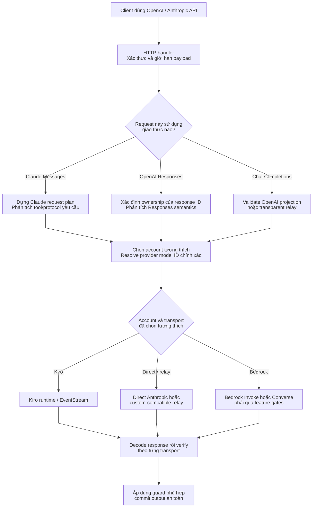
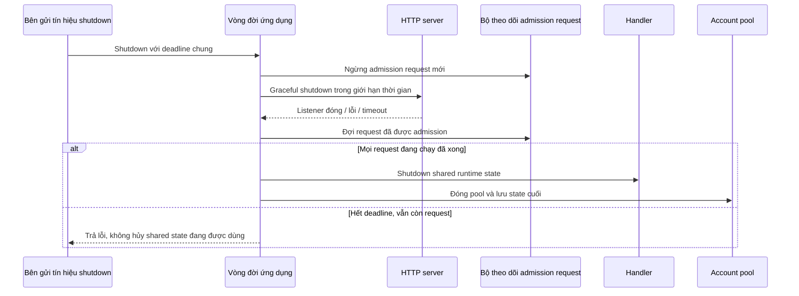

# Tổng quan kiến trúc

> **Ngôn ngữ:** [English](../overview.md) · [Tiếng Việt](../vi/overview.md) · [简体中文](../zh-CN/overview.md)

> **Phiên bản source đối chiếu:** `trankien84/Kiro-Go`, commit [`63d4e2bb4375`](https://github.com/trankien84/Kiro-Go/commit/63d4e2bb4375d85aed46e72d1d7c5df25138fa41). Các sơ đồ mô tả implementation tại thời điểm này, **không** có nghĩa là mọi provider đều hỗ trợ mọi endpoint hay tính năng Claude trong tương lai. Không cần dịch vụ hoặc tài khoản bên ngoài để đọc tài liệu.

## Điều hướng

| Chủ đề | Tài liệu | Nội dung |
| --- | --- | --- |
| Chọn account và model | [Provider routing](provider-routing.md) | Điều kiện eligibility, resolve model bất biến, scheduling và Bedrock |
| Vòng đời account | [Account lifecycle](account-lifecycle.md) | Generation, background refresh và lưu config |
| Kiểm tra phản hồi | [Completion Guard](completion-guard.md) | Kiểm tra protocol, commit output và semantic audit |
| API Claude và OpenAI | [Giao thức agent](agent-protocol.md) | Tool/MCP, compatibility và Responses state |
| Kiro streaming | [Streaming và recovery](streaming-recovery.md) | Event framing, stop reason và retry không lặp |
| Đăng nhập và import | [Authentication](authentication.md) | OAuth/SSO, API key và trust boundary |

## 1. Luồng request và ranh giới tin cậy

**Cách đọc sơ đồ**

1. API mà client gọi quyết định **hợp đồng ngữ nghĩa** phải tuân thủ. Claude Messages, OpenAI Responses và Chat Completions có cấu trúc request, lịch sử và trạng thái khác nhau, dù có thể dùng chung một account upstream.
2. Request planner giữ riêng model client yêu cầu và model ID thật phía provider. Các tính năng cần thiết (tool protocol, thinking, JSON output...) được mang theo đến bước chọn account; tên model khớp nhau **chưa đủ** chứng minh có thể chạy.
3. Sau khi chọn account/transport, quy tắc xác minh phản hồi phụ thuộc giao thức. Completion Guard bảo vệ Claude Messages có cấu trúc; Responses có cơ chế sở hữu state và sự kiện streaming riêng. Nút cuối trong sơ đồ đại diện các bước kiểm tra **phù hợp**, không phải một guard bắt buộc áp dụng cho mọi API.

**Ví dụ:** Request Claude chứa lịch sử MCP server-tool có thể buộc phải đi qua một transport Messages chuyển tiếp minh bạch. Một account Kiro có model cùng tên vẫn có thể không tương thích. Nếu không có candidate nào giữ trọn ngữ nghĩa, hệ thống phải trả lỗi rõ ràng thay vì âm thầm bỏ metadata của tool.

Đây là **sơ đồ khái niệm**, không phải call stack chính xác: Completion Guard thuộc nhánh Claude Messages, còn OpenAI Responses xử lý state ownership, projection và sự kiện streaming riêng. Nút chọn account không hàm ý cả ba API đều dùng được mọi transport. Output cũng không phải lúc nào cũng buffered; xem [deferred streaming](completion-guard.md).

**Các điểm đối chiếu source:** [`proxy/handler.go`](../../../proxy/handler.go), [`proxy/claude_request_plan.go`](../../../proxy/claude_request_plan.go), [`proxy/claude_transport_requirements.go`](../../../proxy/claude_transport_requirements.go), [`proxy/responses_handler.go`](../../../proxy/responses_handler.go), [`proxy/openai_projection.go`](../../../proxy/openai_projection.go), [`proxy/agent_completion_guard.go`](../../../proxy/agent_completion_guard.go).

## 2. Vòng đời ứng dụng và graceful shutdown

`application_lifecycle.go` tạo `requestTracker` (`enter`, `leave`, `startDrain`, `wait`) và `application.shutdown`. Shutdown dùng **một deadline tổng**, chia một phần cho HTTP shutdown, phần còn lại cho drain và cleanup. Một stream dài không có quyền giữ ứng dụng mở vô thời hạn. Trong `main.go`, `WriteTimeout=0` cố ý cho phép SSE kéo dài lúc hoạt động bình thường; điều đó **khác** deadline khi shutdown.

**Implementation:** [`application_lifecycle.go`](../../../application_lifecycle.go), [`main.go`](../../../main.go). **Regression test:** [`application_lifecycle_test.go`](../../../application_lifecycle_test.go).

### Vì sao thứ tự shutdown quan trọng?

Khi nhận tín hiệu shutdown, ứng dụng **ngừng nhận request mới** trước để chúng không xen vào lúc tài nguyên đang được thu hồi. Request đã được admission vẫn cần Handler/AccountPool hoạt động cho đến khi kết thúc. HTTP server được yêu cầu dừng với một phần thời gian giới hạn; sau đó tracker đợi các request đang chạy hoàn tất. Chỉ khi an toàn mới shutdown Handler, đóng pool và ghi thống kê cuối cùng. Nếu hết deadline mà còn request, phá hủy shared state lúc này dễ gây sai dữ liệu, nên shutdown trả lỗi thay vì tiếp tục teardown.

`WriteTimeout=0` trong vận hành SSE thông thường chỉ loại bỏ giới hạn write-timeout cố định của HTTP, **không** vô hiệu hóa deadline dành riêng cho graceful shutdown.

## 3. Ba câu hỏi phải phân biệt

1. **Eligibility:** account có credential hợp lệ, không bị chặn, đủ quota và hỗ trợ model cùng giao thức request hay không?
2. **Projection fidelity:** transport được chọn có giữ nguyên các trường quan trọng (ID tool, lịch sử, thinking, JSON format, metadata do provider sở hữu...) trực tiếp hoặc qua adapter đã hỗ trợ không?
3. **Commit response:** kết quả có an toàn để gửi ra client chưa, hay phải giữ lại, retry, continuation hoặc từ chối?

Có endpoint OpenAI-compatible **không đồng nghĩa** với hỗ trợ đầy đủ Anthropic Messages hay Responses native. Đặc biệt, Direct Anthropic **không phải** transport `/v1/responses` native trong handler hiện tại. Xem [giao thức agent](agent-protocol.md).

**Implementation:** [`proxy/provider_registry.go`](../../../proxy/provider_registry.go), [`proxy/projection_fidelity.go`](../../../proxy/projection_fidelity.go), [`proxy/claude_transport_requirements.go`](../../../proxy/claude_transport_requirements.go), [`proxy/responses_handler.go`](../../../proxy/responses_handler.go).

## 4. Quy tắc bảo trì tài liệu

- Mọi thay đổi kiến trúc phải truy được đến implementation **và regression test phù hợp**. Có file test không đồng nghĩa test đã chạy thành công.
- Sơ đồ phản ánh đúng snapshot source. Khi routing hoặc capability thay đổi, phải cập nhật cả sơ đồ lẫn giải thích.
- Không trình bày `observe` như chế độ tự sửa response; heuristic completion-action đã bỏ cũng không được mô tả như logic hiện hành.
- Sau khi output đã commit, không vẽ fallback thành việc phát lại nguyên request từ đầu.
- Không đưa credential thật, cached token, account ID riêng hay nội dung model nhạy cảm vào sơ đồ.

## Hướng dẫn viết và kiểm tra sơ đồ

**Ưu tiên node đầy đủ ý nghĩa thay vì giới hạn ký tự cứng.** Flowchart dùng nhãn nhiều dòng để thể hiện hành động và điều kiện quan trọng. Cấu hình riêng từng sơ đồ yêu cầu nhãn SVG (`htmlLabels: false`) nhằm giảm lỗi đo kích thước/cắt chữ ở một số bản preview VS Code/JetBrains. `wrappingWidth: 270`, `minNodeWidth: 220`, `nodeSpacing` và `rankSpacing` giúp node thoáng hơn khi renderer có hỗ trợ, nhưng bản Mermaid cũ có thể bỏ qua một số option.

Đừng ép CSS `width` cố định cho hình chữ nhật: kích cỡ khung có thể tăng trong khi vị trí đường nối không được cập nhật. Thay vào đó, viết nhãn 2–3 dòng bằng ` `, tăng khoảng cách node và tách sơ đồ quá rối thành những luồng riêng.

**Bắt buộc khi review:** kiểm tra parse rồi **render thực tế** trên VS Code Markdown Preview và GitHub. Ở độ rộng desktop thông thường, xác nhận không mất chữ, nội dung quyết định nằm trọn hình thoi, mũi tên không che nhau và các bước quan trọng vẫn hiểu được. Parser hợp lệ chưa đủ để kết luận bố cục đúng.
