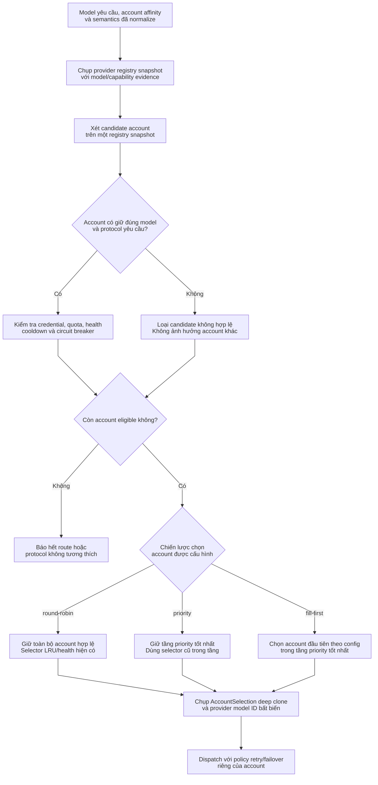
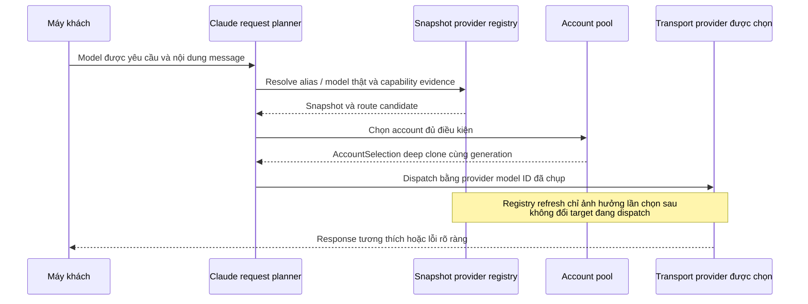

# Định tuyến model theo provider và lập lịch account

> **Ngôn ngữ:** [English](../provider-routing.md) · [Tiếng Việt](../vi/provider-routing.md) · [简体中文](../zh-CN/provider-routing.md)

> **Snapshot:** [`63d4e2bb4375`](https://github.com/trankien84/Kiro-Go/commit/63d4e2bb4375d85aed46e72d1d7c5df25138fa41). Model registry, account scheduler và protocol planner là những tầng riêng. Tài liệu trình bày hợp đồng giữa các tầng, không giả định mọi API dùng chung một thuật toán routing.

## 1. Các bước quyết định route

**Diễn giải từng bước**

1. Request đi vào cùng model ID **do client yêu cầu** và thông tin affinity nếu có. Registry lưu **bằng chứng** về model/capability đã discovery trên từng lifecycle account; chỉ có public alias không đủ để xác định upstream model thật.
2. Bộ lọc candidate xét hai việc độc lập: **protocol compatibility** (transport có thể biểu diễn request đúng nghĩa không?) và **operational availability** (credential, quota, health, cooldown, circuit breaker hiện có cho phép dispatch không?). Một account không phù hợp chỉ bị loại ở phạm vi thích hợp, không biến thành global model ban.
3. Chỉ tập account **đã đủ điều kiện** mới qua scheduler: `round-robin` giữ các candidate cho selector LRU/health hiện có; `priority` chỉ giữ tầng có priority hiệu dụng nhỏ nhất; `fill-first` chọn account đầu tiên của tầng đó theo thứ tự pool/config. Khi chọn xong, request giữ snapshot `AccountSelection` và provider model ID chính xác.
4. Lỗi phát sinh **sau khi dispatch** được handler phân loại và áp dụng quy tắc retry riêng có giới hạn. **Scheduler không phải cơ chế tự động retry mọi lỗi.**

**Ví dụ:** A và B có priority 10; C có 20. Khi cả ba đều khỏe, `priority` cho A/B được selector hiện tại phân phối, còn `fill-first` chọn account hợp lệ đầu tiên giữa A/B. Nếu A đang cooldown, B có thể được chọn; priority không bao giờ vượt qua rào chắn cooldown hoặc protocol.

Đây là **sơ đồ logic tổng hợp** từ request planner, registry và pool selector, không khẳng định các filter chạy đúng thứ tự hình vẽ trong mọi nhánh code. Chính sách retry/failover sau dispatch thuộc lớp xử lý lỗi riêng. Scheduler tuyệt đối không đưa lại candidate đã bị eligibility gate loại bỏ.

**Mã nguồn:** [`proxy/claude_request_plan.go`](../../../proxy/claude_request_plan.go), [`proxy/claude_transport_requirements.go`](../../../proxy/claude_transport_requirements.go) (`nextCompatibleClaudeCandidate`), [`proxy/provider_registry.go`](../../../proxy/provider_registry.go), [`pool/account.go`](../../../pool/account.go), [`pool/account_scheduler.go`](../../../pool/account_scheduler.go).

## 2. Ba chiến lược scheduling

| Strategy | Cách chọn | Điểm dễ nhầm |
| --- | --- | --- |
| `round-robin` (mặc định) | Giữ nguyên tập account đã eligible | Selector cũ còn xét LRU/health; không cam kết chia tải chính xác đều nhau |
| `priority` | Giữ tầng priority **tốt nhất trong các account eligible** | Số nhỏ hơn ưu tiên hơn; trong cùng tầng vẫn dùng selector hiện có |
| `fill-first` | Chọn **account đầu tiên theo thứ tự pool/config** trong tầng tốt nhất | Không round-robin trong tầng; đổi thứ tự account sẽ đổi lựa chọn ưu tiên |

Priority không đặt hoặc không dương được quy về giá trị hiệu dụng `100`. `fill-first` vẫn tuân thủ quota, health, cooldown và có thể chuyển sang account hợp lệ khác nếu account đầu tiên không còn đủ điều kiện. Admin đổi thứ tự/priority bằng cơ chế kiểm tra trạng thái đã quan sát để tránh ghi đè sửa đổi đồng thời.

**Mã nguồn:** [`config/account_selection.go`](../../../config/account_selection.go) (`NormalizeAccountSelectionStrategy`, `EffectiveAccountPriority`), [`pool/account_scheduler.go`](../../../pool/account_scheduler.go) (`applyAccountSelectionStrategy`), [`config/account_routing_admin.go`](../../../config/account_routing_admin.go). **Kiểm thử:** [`pool/account_scheduler_test.go`](../../../pool/account_scheduler_test.go), [`config/account_routing_admin_test.go`](../../../config/account_routing_admin_test.go).

## 3. Model evidence bất biến và affinity khi dispatch

`proxy/provider_registry.go` tách riêng **requested model ID** của client, **provider model ID** (được xem như giá trị opaque) và **public model ID**. Provider ID chính xác không được đưa qua bước rewrite alias dành cho client. Nếu fallback không phân biệt hoa/thường gây nhập nhằng, hệ thống phải từ chối đoán. Snapshot bất biến giữ nguyên target đã chọn ngay cả khi registry cập nhật; lifecycle guard bảo vệ runtime state theo account.

Một model do provider quảng bá chưa chắc hỗ trợ **tính năng Claude cụ thể**. Chẳng hạn, `output_config.format` cho structured JSON trong Kiro đòi hỏi `AdditionalModelRequestFieldsSchema` **live của đúng account/model đã chọn** phải khai báo trường đó. Bằng chứng từ account khác không được dùng thay thế.

**Mã nguồn:** [`proxy/provider_registry.go`](../../../proxy/provider_registry.go) (`providerRouteIndex.resolve`, `buildAccountRoutes`, `resolveCandidateProviderRoute`), [`proxy/provider_runtime_state.go`](../../../proxy/provider_runtime_state.go), [`pool/account_selection.go`](../../../pool/account_selection.go), [`proxy/claude_kiro_structured_output.go`](../../../proxy/claude_kiro_structured_output.go). **Kiểm thử:** [`proxy/provider_registry_phase_test.go`](../../../proxy/provider_registry_phase_test.go), [`proxy/claude_kiro_structured_output_test.go`](../../../proxy/claude_kiro_structured_output_test.go).

### Vì sao registry refresh không được đổi route đang chạy?

Registry phản ánh model/capability tại một thời điểm; khi dispatch, candidate đã giữ generation và **provider model ID chính xác**. Một background discovery có thể cập nhật danh sách model công khai ngay sau đó, nhưng chỉ request **tiếp theo** mới nhìn thấy registry mới. Request đang chạy không bị diễn giải lại alias giữa chừng hoặc nhận nhầm capability từ account khác.

**Ví dụ alias nhập nhằng:** Hai provider ID khác nhau cùng chuẩn hóa về một key không phân biệt hoa/thường thì fallback lookup phải từ chối đoán tùy tiện. Tương tự, structured JSON của Kiro phải được chính schema model live của account đã chọn cho phép.

## 4. Cô lập theo provider, model và lifecycle

Runtime state thuộc account cùng generation của nó: model snapshot, dữ liệu discovery, dấu cooldown/denial và trạng thái publication không được dùng lẫn giữa credential hay generation không liên quan. Phân biệt:

- **Transport failure:** socket hỏng hoặc EventStream bị cắt chưa đủ chứng minh credential sai. Xem [streaming/recovery](streaming-recovery.md).
- **Credential/account failure:** có thể cần refresh, quarantine hoặc reconciliation theo phân loại lỗi.
- **Model/permission failure:** chỉ ảnh hưởng model/capability cụ thể, không mặc định làm hỏng toàn bộ model của account.
- **`Retry-After`/throttling:** có thể kích hoạt cooldown mà không đổi policy routing được lưu.

**Mã nguồn:** [`proxy/provider_runtime_state.go`](../../../proxy/provider_runtime_state.go), [`proxy/account_failover.go`](../../../proxy/account_failover.go), [`pool/account.go`](../../../pool/account.go).

## 5. Bedrock không phải một Claude transport đồng nhất

Bedrock *Invoke* và *Converse* có bộ tính năng giao thức khác nhau. Compatibility phải xét API operation đang dùng, tính năng được hỗ trợ, target foundation/inference-profile đã discovery và khả năng thực thi request thật. Bedrock discovery và region/cache cũng phải theo đúng lifecycle, không để kết quả cũ ghi đè account mới. Một thành công khi discovery ở control plane không tự động chứng minh data plane có thể thực thi mọi đặc tính Messages.

**Mã nguồn:** [`proxy/bedrock_discovery_hardening.go`](../../../proxy/bedrock_discovery_hardening.go), [`proxy/bedrock_discovery.go`](../../../proxy/bedrock_discovery.go), [`proxy/bedrock_region.go`](../../../proxy/bedrock_region.go), [`proxy/claude_transport_requirements.go`](../../../proxy/claude_transport_requirements.go). **Kiểm thử:** [`proxy/bedrock_discovery_context_hardening_test.go`](../../../proxy/bedrock_discovery_context_hardening_test.go), [`proxy/bedrock_region_context_test.go`](../../../proxy/bedrock_region_context_test.go).

Xem thêm [giao thức agent](agent-protocol.md) để đối chiếu khả năng của từng transport.
