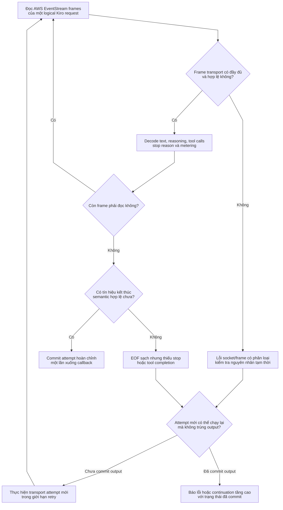
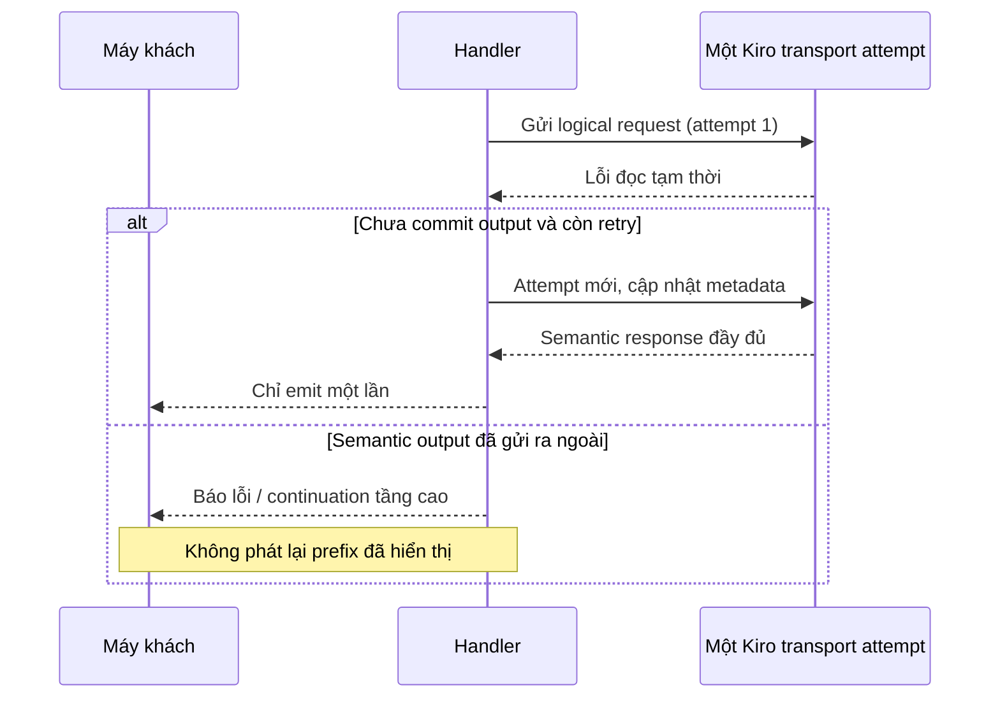

# Độ toàn vẹn streaming, giải mã text và recovery

> **Ngôn ngữ:** [English](../streaming-recovery.md) · [Tiếng Việt](../vi/streaming-recovery.md) · [简体中文](../zh-CN/streaming-recovery.md)

> **Snapshot:** [`63d4e2bb4375`](https://github.com/trankien84/Kiro-Go/commit/63d4e2bb4375d85aed46e72d1d7c5df25138fa41). Retry ở tầng transport và continuation của Completion Guard có ranh giới commit khác nhau. EOF không đồng nghĩa đã có câu trả lời hoàn chỉnh.

## 1. Đọc transport và kiểm tra toàn vẹn

AWS EventStream của Kiro được parse thành callback mang ngữ nghĩa: text assistant/reasoning, tool-use, stop reason, metering và context. Transport phân biệt lỗi kết nối/đọc tạm thời, frame chưa đủ và socket đóng bình thường nhưng **thiếu dấu hiệu kết thúc câu trả lời**. `stopReason` thật hoặc tool call đã giao có thể là bằng chứng kết thúc; chỉ có text/reasoning thì chưa đủ.

**Luồng lỗi và điều kiện retry**

1. Một logical invocation Kiro có thể thực hiện nhiều HTTP attempt, nhưng có giới hạn (`kiroTransportMaxAttempts=3`). Mỗi attempt được kiểm tra EventStream frame riêng, sau đó mới xét text/tool/stop theo ngữ nghĩa.
2. **Transport hoàn tất không có nghĩa câu trả lời hoàn tất.** EOF sạch nhưng có text mà không có tín hiệu terminal cần thiết vẫn là truncated response, không phải một lượt assistant thành công.
3. Trước retry, recovery kiểm tra attempt có phát ra callback không thể rollback chưa: text, reasoning/signature, tool-use hay callback báo lỗi. Nếu dữ liệu đã đến client, replay request từ đầu có thể sinh trùng text hoặc thực thi tool lần nữa.
4. Caller ở tầng cao có thể giữ output trong private buffer, xóa được phần chưa commit và retry an toàn. Caller streaming trực tiếp cần coi việc phát callback ngữ nghĩa là ranh giới không replay.

**Ví dụ:** Upstream gửi `"abc"` rồi EventStream bị cắt. Nếu `"abc"` đã đến client, replay toàn bộ có thể sinh `"abcabc"` hoặc lặp tool call. Cách đúng là báo lỗi incomplete hoặc tạo continuation có kiểm soát từ lịch sử đã commit, **không** blind retry.

Số attempt transport tối đa là `3`, **khác** giới hạn retry của Completion Guard. HTTP attempt mới vẫn giữ identity logical invocation và cập nhật attempt metadata. Không được quy mọi lỗi mạng thành credential invalid hay account ban. TCP đóng thành công mà thiếu terminal signal cũng không chứng minh response hoàn tất.

**Mã nguồn:** [`proxy/stream_integrity.go`](../../../proxy/stream_integrity.go) (`classifyStreamIntegrity`), [`proxy/kiro_transport_recovery.go`](../../../proxy/kiro_transport_recovery.go) (`callKiroAPIContextWithRecovery`), [`proxy/kiro.go`](../../../proxy/kiro.go). **Kiểm thử:** [`proxy/stream_integrity_test.go`](../../../proxy/stream_integrity_test.go), [`proxy/kiro_transport_recovery_test.go`](../../../proxy/kiro_transport_recovery_test.go).

## 2. Ranh giới tuyệt đối không replay

Callback ngữ nghĩa có thể tạo ranh giới retry chặt hơn raw HTTP bytes: text, thinking/signature, tool-use hay callback lỗi có thể đã được bàn giao. Một số caller tầng cao buffer callback và hỗ trợ `resetForRetry` an toàn; caller streaming không được phát lại request khi đã emit nội dung có ý nghĩa. Completion Guard có thể tiếp tục từ **committed history**, nhưng đó là thao tác khác với replay original prompt.

**Mã nguồn:** [`proxy/kiro_transport_recovery.go`](../../../proxy/kiro_transport_recovery.go) (`kiroAttemptCallbacks`, `replaySafe`, `resetForRetry`), [`proxy/agent_completion_guard.go`](../../../proxy/agent_completion_guard.go).

### Đọc sequence retry như thế nào?

Transport có thể mở **HTTP attempt mới** trong cùng logical request và tăng metadata theo attempt. Điều kiện quyết định không phải chỉ là socket từng nhận byte hay chưa, mà là callback có **được commit ra ngoài** chưa. Buffer có thể discard toàn bộ output sẽ có cửa sổ retry rộng hơn streaming trực tiếp. Nếu client đã thấy nội dung, retry từ đầu có nguy cơ phát text trùng hoặc chạy lại hành động tool.

Transport retry xử lý lỗi socket/EventStream; Completion Guard recovery xử lý **continuation** từ những gì đã hiển thị khi replay không còn an toàn. Cả hai cơ chế đều không đảm bảo cứu được mọi loại lỗi.

## 3. Giải mã chunk: text lặp không có nghĩa là replay

| Chế độ | Hợp đồng đầu vào | Cách xuất text |
| --- | --- | --- |
| `delta` (mặc định) | Mỗi event chứa text mới | Xuất nguyên chunk, kể cả trùng chunk trước |
| `cumulative` | Event chứa toàn bộ prefix đang lớn dần | Chỉ xuất phần suffix mới; snapshot giống hệt sẽ không xuất thêm |
| `legacy` (tùy chọn) | Heuristic overlap cũ | Có thể làm mất ký tự lặp hợp lệ; **không khuyến nghị** trừ khi upstream cũ thực sự cần |

Nếu chế độ `cumulative` nhận chunk không chứa prefix trước, decoder xuất nguyên chunk hiện tại và chuyển sang `delta` thay vì tự đoán overlap. Assistant và reasoning dùng hai biến độc lập: `KIRO_ASSISTANT_CHUNK_MODE`, `KIRO_REASONING_CHUNK_MODE`, mặc định đều là `delta`.

**Mã nguồn:** [`proxy/stream_text_decoder.go`](../../../proxy/stream_text_decoder.go) (`Push`, `legacyNormalizeChunk`). **Kiểm thử:** [`proxy/stream_text_decoder_test.go`](../../../proxy/stream_text_decoder_test.go).

## 4. Hủy request, usage và diagnostics

- Khi client hủy request, cancellation phải đi xuyên qua Kiro request context và cả thời gian retry backoff; không để upstream chạy mồ côi.
- Attempt nội bộ thất bại không được cộng lặp text, tool call hay usage hiển thị cho client. Thống kê từng transport attempt khác với thời điểm semantic output commit.
- Diagnostic flags là tùy chọn; raw SSE/chunk log có thể lộ nội dung nhạy cảm và không nên bật tùy tiện.
- Idle/progress watchdog cho stream dài khác với HTTP write timeout áp lên toàn bộ stream.

**Mã nguồn:** [`proxy/kiro_transport_recovery.go`](../../../proxy/kiro_transport_recovery.go), [`proxy/http_idle_watchdog.go`](../../../proxy/http_idle_watchdog.go), [`diagnostics/flags.go`](../../../diagnostics/flags.go), [`main.go`](../../../main.go). **Kiểm thử:** [`proxy/http_idle_watchdog_test.go`](../../../proxy/http_idle_watchdog_test.go), [`proxy/stream_integrity_paths_test.go`](../../../proxy/stream_integrity_paths_test.go).

Xem [Completion Guard](completion-guard.md) để hiểu việc xác minh nguyên lượt structured tool và semantic audit/continuation ở tầng cao.
