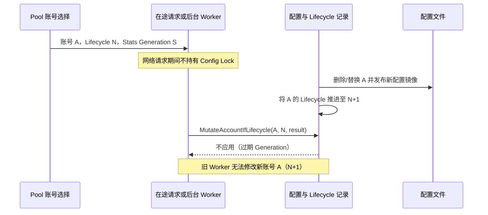
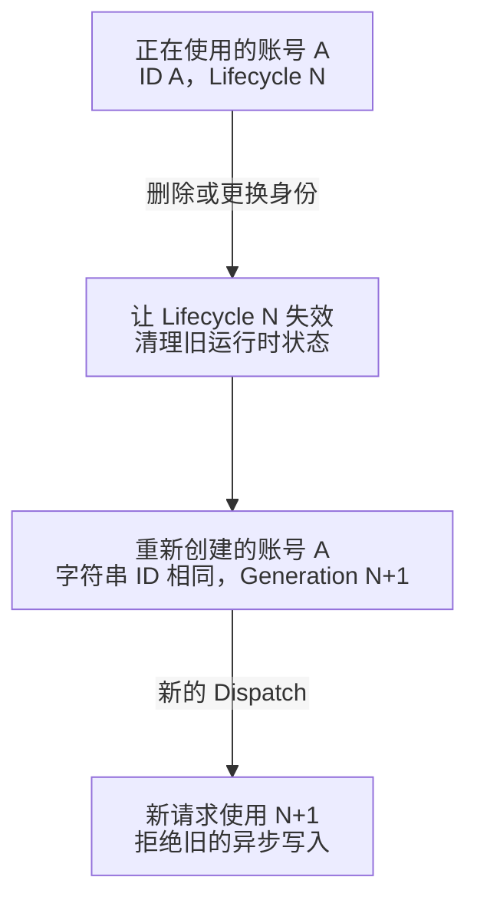
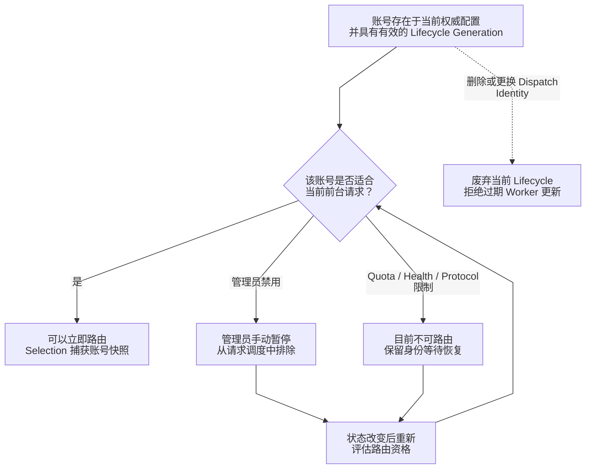
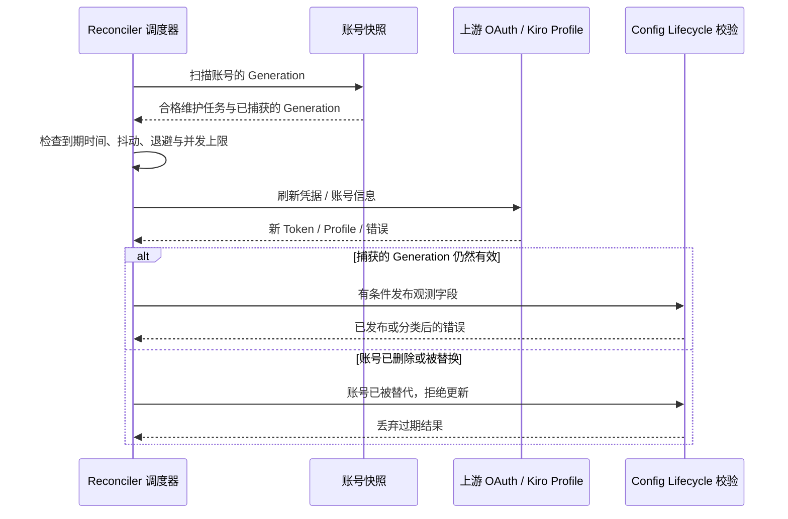
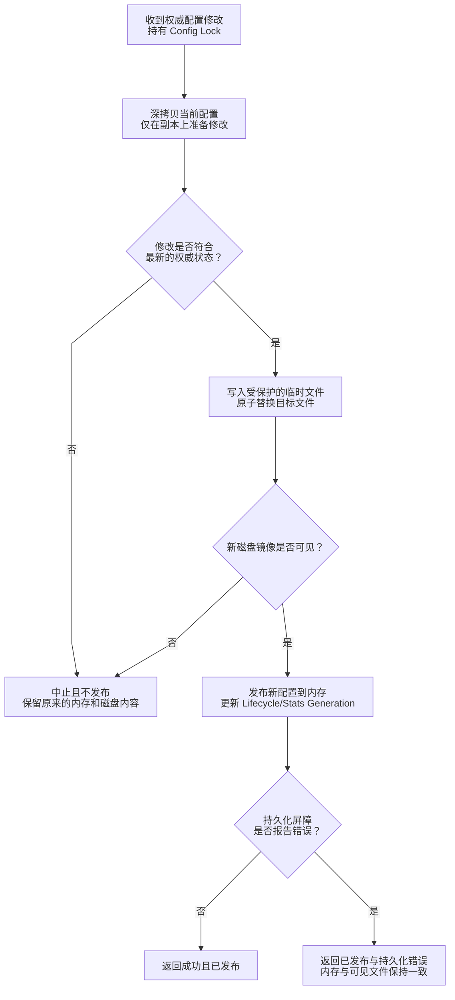

# 账号生命周期、后台协调与持久化状态

> **语言：** [English](../account-lifecycle.md) · [Tiếng Việt](../vi/account-lifecycle.md) · [简体中文](../zh-CN/account-lifecycle.md)

> **基准：** [`63d4e2bb4375`](https://github.com/trankien84/Kiro-Go/commit/63d4e2bb4375d85aed46e72d1d7c5df25138fa41)。账号的 **lifecycle identity** 不等于字符串形式的账号 ID；允许前台路由也不等于允许后台维护凭据。

## 1. 账号身份与 Generation Fencing

Pool 持有选择锁时，会捕获不可变的 `AccountSelection`：账号的深拷贝、`LifecycleGeneration`，以及独立的 `StatsGeneration`。删除后重建账号或替换 Dispatch Identity 会令旧 lifecycle 失效；普通统计、quota、enablement 变化不一定产生新的 lifecycle。Worker 修改当前权威配置前，必须检查最初捕获的 generation。

这是一个**防止并发竞争的示例**，并非每次请求都要删除账号。Generation Fence 只在**当前进程内**约束并发 Worker，不能当成全局持久化、跨进程的分布式 Fencing Token。

**源代码：** [`config/account_lifecycle_generation.go`](../../../config/account_lifecycle_generation.go) (`markAccountLifecycleDeletedLocked`, `accountDispatchIdentityChanged`, `MutateAccount...IfLifecycle`), [`config/config_transaction.go`](../../../config/config_transaction.go), [`pool/account_selection.go`](../../../pool/account_selection.go). **测试：** [`config/account_dispatch_lifecycle_test.go`](../../../config/account_dispatch_lifecycle_test.go), [`pool/account_selection_lifecycle_test.go`](../../../pool/account_selection_lifecycle_test.go).

## 2. Lifecycle 与可路由状态是两回事

Lifecycle Identity 和账号此刻能否被选中，是**两个独立维度**：

**为什么需要两种 Generation？**

- `LifecycleGeneration` 保护账号及上游凭据的**逻辑身份**。删除账号 A 后用相同字符串 ID 重建 A，旧 Worker 不能更新新账号。
- `StatsGeneration` 独立保护统计数据的收集与重置；排队已久的计数任务不能恢复旧 Counter，也不能写入新的统计 Epoch。
- 执行中的请求持有 `AccountSelection` 快照，而不是指向实时配置的可变指针。它可以使用快照完成请求，但只有 generation 一致时才能提交副作用。

**示例：** Worker W 在 generation 7 开始刷新账号 A。管理员删除 A，并创建 generation 8 的新账号 A。W 返回后执行 `MutateAccountIfLifecycle(A, 7, ...)` 会被拒绝，因此新 A 的 Token 与 Health 不会被旧结果覆盖。这是**进程内保护**，而不是分布式持久标识。

**Lifecycle 与 Routability 独立变化**

账号被添加或导入时产生 lifecycle；删除或改变其**Dispatch Identity** 时，这个 lifecycle 结束。而 Routability 会反复根据请求重新计算：管理员暂停、cooldown、quota 不足或模型不兼容，都可能让账号暂时不可用，**不必改变 lifecycle**。重新启用账号不会让已 Retired 的 generation 复活。

**示例：** 如果一个 OAuth 账号仅由管理员手动禁用，且没有 Provider 故障导致的 Ban Reason，它可能仍可以进行后台凭据维护，但**不能**用于前台推理请求。凭据已失效或 Provider 返回终止性故障的账号，也不能简单当成手动暂停。

第一张图展示删除/替换 Dispatch Identity 如何废弃 generation。相同字符串 ID 的新账号意味着新 lifecycle，而不是恢复旧身份。第二张图展示一个存活 lifecycle 内的**路由判断条件**，包括凭据、quota、health、circuit state 和协议能力。条件改变本身并不一定废弃账号身份。

这些是运行时**推导出的可路由状态**，不是 `config.Account` 中存储的字面枚举。Paused 账号仍可能满足后台维护条件；已 Retired 的账号不会直接转回 Eligible。

**源代码：** [`pool/account.go`](../../../pool/account.go), [`pool/account_credential_eligibility.go`](../../../pool/account_credential_eligibility.go), [`proxy/account_reconciler.go`](../../../proxy/account_reconciler.go) (`accountSupportsCredentialMaintenance`).

## 3. 后台维护与过期结果丢弃

`proxy/account_reconciler.go` 为 Credential 与 Account Info 维护设置不同的执行通道，并限制 Concurrency，使用 Jitter 和 Backoff；它**不是**每次请求都同步刷新所有账号。`accountSupportsCredentialMaintenance` 会区分管理员禁用和 Provider 故障禁用。维护好 Token 不代表立即允许路由请求。请求路径也可能触发刷新，但所有 Writer 都要验证 Lifecycle Ownership。

**源代码：** [`proxy/account_reconciler.go`](../../../proxy/account_reconciler.go), [`proxy/account_info_reconcile.go`](../../../proxy/account_info_reconcile.go), [`auth/refresh_context.go`](../../../auth/refresh_context.go), [`auth/refresh_failure.go`](../../../auth/refresh_failure.go), [`proxy/token_refresh_reconciliation.go`](../../../proxy/token_refresh_reconciliation.go). **测试：** [`proxy/account_reconciler_fencing_test.go`](../../../proxy/account_reconciler_fencing_test.go), [`auth/refresh_lifecycle_test.go`](../../../auth/refresh_lifecycle_test.go).

### 如何理解 Reconciler Sequence？

调度器依据账号**生命周期**工作，不能只依赖字符串 ID。它取得快照后判断 Credential Refresh 和 Account Info Refresh 是否到期。这些操作可能访问网络并进入 Backoff，因此整个调用过程不能始终占用 Config 锁。返回时，带 Generation 条件的 Publication 会比较 Worker 的旧身份与当前账号。若管理员期间删除/替换了账号，过期结果不得覆盖新账号的 Token、Quota、Ban 或 Stats。

管理员暂停与 Provider 的终止性故障有不同的维护策略。成功刷新 Token **不意味着自动重新启用账号**。错误的 disposition 决定是否适合再次尝试；参见 [身份认证](authentication.md)。

## 4. 配置的事务式发布

权威配置采用 Copy-on-Write：先 Clone 当前 `Config`，在副本上执行修改，序列化并替换磁盘文件，**确认新文件已经可见后**才发布新的内存对象。如果替换文件后发生 Durability Barrier 错误，仍可能需要同步发布新内存对象，避免内存与已可见的磁盘文件不一致。因此 `published=true, err!=nil` 是有意义的结果，**不能**当作已经回滚。

**事务流程说明**

1. 持有配置锁时，先在深拷贝上试运行 Mutation；验证失败不能修改当前权威对象。
2. 使用受保护的临时文件写入并原子替换目标文件。如果新文件并未成功可见，进程继续使用旧内存配置。
3. 新文件可见后，发布 staged config，并调整 Lifecycle/Stats Generation。若之后的持久化屏障失败，即使 Mutation 已经发布也可能返回错误；调用方要根据 `published` 标记区分。

**示例：** 目标文件替换成功后，磁盘同步操作报告失败。如果只回滚内存，就会与磁盘上新文件不一致。因此事务保留新的内存镜像，并返回**已发布但发生错误**。这不是跨多个进程的数据库事务。

Unix/Windows 的 Private File Helper 强制限制访问权限，**不提供**多个 Kiro-Go 进程共同写入同一配置文件时的隔离保证。Pool/Config 的统计 Generation 也阻止较晚返回的 Worker 复活已重置的计数。

**源代码：** [`config/config_transaction.go`](../../../config/config_transaction.go), [`config/config_file_write.go`](../../../config/config_file_write.go), [`config/account_stats_generation.go`](../../../config/account_stats_generation.go), [`internal/privatefile/security_unix.go`](../../../internal/privatefile/security_unix.go), [`internal/privatefile/security_windows.go`](../../../internal/privatefile/security_windows.go). **测试：** [`config/config_file_security_test.go`](../../../config/config_file_security_test.go), [`config/account_stats_generation_test.go`](../../../config/account_stats_generation_test.go), [`internal/privatefile/security_windows_test.go`](../../../internal/privatefile/security_windows_test.go).

## 5. 运行时注意事项

- 异步 Mutation 不能只凭字符串 ID 授权，必须检查捕获时的 Lifecycle Generation。
- 上游 OAuth Refresh 成功，不代表 Token 一定已经本地持久化；必须显式处理 rotated refresh token 的保存失败，详见 [身份认证](authentication.md)。
- 已被判定 Superseded 的 Worker 不得封禁、刷新、重置或修改替换后的新账号。
- `fill-first` 的账号排序/优先级更新是带有 Optimistic Concurrency 检查的管理操作，不是内存中的 UI 排序。参见 [Provider 路由](provider-routing.md)。
