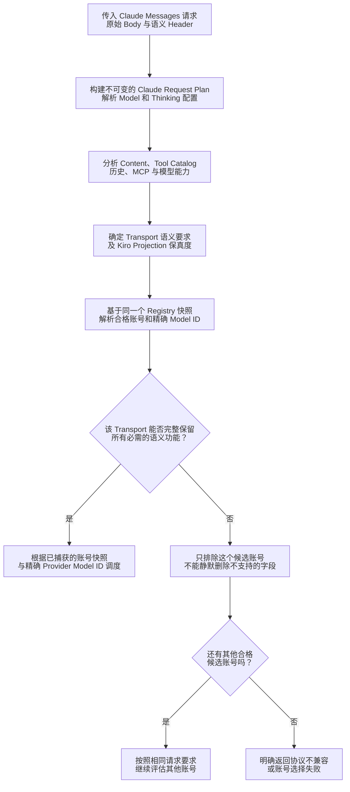
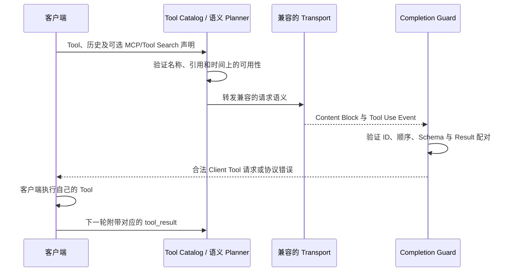
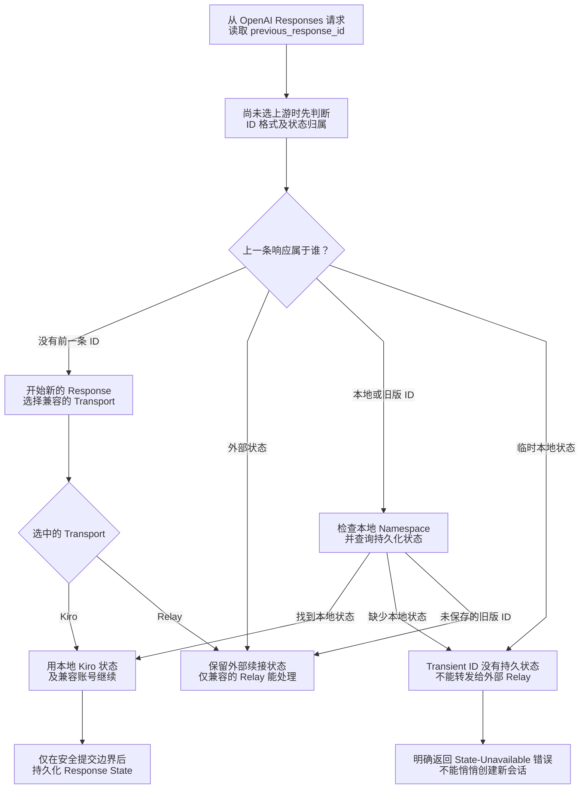

# Agent 协议保真与 Transport 需求

> **语言：** [English](../agent-protocol.md) · [Tiếng Việt](../vi/agent-protocol.md) · [简体中文](../zh-CN/agent-protocol.md)

> **基准：** [`63d4e2bb4375`](https://github.com/trankien84/Kiro-Go/commit/63d4e2bb4375d85aed46e72d1d7c5df25138fa41)。一个 JSON 请求能通过语法校验，并不代表 Provider 可以**按原有语义**执行它。本文区分 **Claude Messages 的语义路由**与具有不同 Transport 支持范围的 **OpenAI Responses 路由**。

## 1. 选择 Claude Transport 前先分析语义

**Planner 与候选账号选择流程**

1. 对输入的 Wire Request **统一规范化一次**，包括工具声明、历史 Tool Identity、模型 Alias、Thinking 配置、Beta Header 以及具有协议意义的字段。生成的 `claudeRequestPlan` 是后续路由和转换的共同依据。
2. 根据请求**实际使用的功能**构建 Transport Requirements，而不是一看到 Beta Header 就认定需要对应功能。必须区分精确保留、受支持的 Emulation 和不兼容的 Projection。
3. 将需求与不可变 Registry 中的账号/模型能力证据进行匹配。Kiro-native、Direct Anthropic、Custom Relay、Bedrock Invoke 和 Converse 即使提供名称相似的 Claude 模型，也不能互相无条件替代。
4. Dispatch 前排除不兼容的 Candidate。没有能够保留必需语义的账号时，应明确返回错误；不能为了让 Adapter 接收 Payload 而偷偷丢掉 MCP、Signed Thinking 或 Structured Output 字段。

**示例：** Client 自己执行的 `tool_use` 与 Provider 负责执行的 MCP Connector 完全不同。能透传前者，不代表 Kiro-native 或 Bedrock 必然能处理后者。

`claudeRequestPlan` 汇集解析后的 Request、Requested/Resolved Model、Reasoning/Capabilities、规范化 Semantic Request、Content Inventory、Kiro Projection、Tool Catalog 和 Transport Requirements。Provider Router 必须复用这些结果，而不是让各 Adapter 独立重新解释。需要透明转发时保留原始数据；不能无声丢弃不支持的协议语义。

**源代码：** [`proxy/claude_request_plan.go`](../../../proxy/claude_request_plan.go), [`proxy/claude_request_semantics.go`](../../../proxy/claude_request_semantics.go), [`proxy/claude_content_inventory.go`](../../../proxy/claude_content_inventory.go), [`proxy/claude_transport_requirements.go`](../../../proxy/claude_transport_requirements.go), [`proxy/claude_kiro_projection.go`](../../../proxy/claude_kiro_projection.go). **测试：** [`proxy/claude_request_plan_test.go`](../../../proxy/claude_request_plan_test.go), [`proxy/claude_semantic_transport_regression_test.go`](../../../proxy/claude_semantic_transport_regression_test.go).

## 2. Capability 矩阵：按需判断，不做普遍保证

| Claude Planner 中的 Transport | 可用于 Claude Messages？ | 兼容条件 |
| --- | --- | --- |
| `kiro_native` | 视情况而定 | Kiro Projection Fidelity、所选 Model Schema 与 Tool/Protocol 要求 |
| `custom_api_relay` | 视情况而定 | Relay 透明转发能力；部分 Forwarded Continuation 会被排除 |
| `direct_anthropic` | 视情况而定 | Anthropic Messages 语义和 Deployment/Model Capability |
| `bedrock_invoke` | 视情况而定 | Invoke Adapter 支持的请求及 Beta/Protocol 语义 |
| `bedrock_converse` | 视情况而定 | Converse Adapter 的独立功能集合 |
| `unsupported` | 否 | 未知/无效账号类型或不支持的 Transport |

此表**不是**宣称任一 Transport 都支持全部 Server Tools、MCP、Tool Search、JSON Output、Signed Thinking 或未来 Beta。必须针对**请求 + 模型 + 账号 + 实际 Transport**判断。`claudeAccountCompatibleWithRequirements` 会拒绝未知账号类型、排除部分 Forwarded Continuation 下的 Custom Relay，并在 Projection 丢失必要语义时拒绝 Kiro。

**源代码：** [`proxy/claude_transport_requirements.go`](../../../proxy/claude_transport_requirements.go) (`claudeTransportKindForAccount`, `claudeAccountCompatibleWithRequirements`, `nextCompatibleClaudeCandidate`), [`proxy/claude_model_capabilities.go`](../../../proxy/claude_model_capabilities.go). **测试：** [`proxy/claude_transport_requirements_test.go`](../../../proxy/claude_transport_requirements_test.go), [`proxy/model_protocol_contract_regression_test.go`](../../../proxy/model_protocol_contract_regression_test.go).

## 3. Tool 的执行归属、延迟可用性与引用标识

Client Tool 仍由**客户端**执行；Kiro-Go 不会因此成为 GitHub Copilot、VS Code 或任意 MCP Tool 的本地执行器。Provider 自有的 Server Tool 和 MCP Connector 则有单独的协议状态。Content/History Analyzer 必须区分客户端 `tool_use`/`tool_result` 与 `server_tool_use`、`mcp_tool_use`、`mcp_tool_result`、Tool Catalog 声明、`defer_loading` 及动态发现的 Member。无法在 Kiro/Bedrock 表达的特性，应转到兼容的透明 Transport 或明确失败。

Tool 可能已声明但尚未**可用**（`defer_loading`）。Tool Search 和 MCP Member Loading 必须保持引用身份一致并满足时间顺序。后续 Turn 新增的 Tool 不能追溯到更早的 Turn 使用。未知的 Server-side Tool 语义不可擅自改写成普通 Client Tool。

**源代码：** [`proxy/claude_inline_tool_history.go`](../../../proxy/claude_inline_tool_history.go), [`proxy/claude_mcp_member_history.go`](../../../proxy/claude_mcp_member_history.go), [`proxy/claude_native_toolset_history.go`](../../../proxy/claude_native_toolset_history.go), [`proxy/agent_completion_guard_catalog.go`](../../../proxy/agent_completion_guard_catalog.go), [`proxy/agent_completion_guard_tool_reference.go`](../../../proxy/agent_completion_guard_tool_reference.go). **测试：** [`proxy/claude_mcp_tool_search_reference_test.go`](../../../proxy/claude_mcp_tool_search_reference_test.go), [`proxy/claude_temporal_tool_identity_test.go`](../../../proxy/claude_temporal_tool_identity_test.go), [`proxy/claude_inline_tools_protocol_test.go`](../../../proxy/claude_inline_tools_protocol_test.go).

### 阅读 Tool History Sequence

Client 提交 Tool 声明和对话历史。Planner 不仅检查 Catalog 中是否存在某个名称，还要检查**该 Tool 在哪个 Turn 开始可用**。后续才加载的 Inline Tool 或 Deferred MCP Member，不能被视为较早轮次已经可执行。Guard 还会验证返回的 `tool_use` ID/Input，以及 Client 下一轮提交的 `tool_result` 是否能正确配对。

本地工具（例如 VS Code/Copilot Tool）由 Client 执行。相比之下，Provider 自有的 `server_tool_use` 和 MCP Connector Event 有不同的执行主体和状态归属；强行映射为普通 Client Tool 会改变谁执行任务、谁拥有结果。不支持此语义的 Transport 必须排除或替换为兼容的透明路径。

## 4. Thinking、Signature 与 Structured Output

- **Reasoning：** Kiro 基于 Schema 的 Reasoning Capability 与 Direct Anthropic/Model Capability 独立；显式请求了不支持的 Thinking 配置必须进行校验，而非推测支持。
- **Thinking Signature：** Provider 发出的 Signature 只能跨兼容的透明/原生 Transport 保留。Kiro 本地续接使用由 Proxy 自己拥有的 Provenance Signature，不能将其冒充为 Anthropic 的原生签名。
- **Structured JSON Output：** `output_config.format` 是生成约束。只有**当前选中账号的最新 Live Model Schema**明确提供字段支持时，才允许 Kiro Projection。
- **Protocol Metadata：** Citation、Stop Detail、Fallback Boundary、Container State、MCP 与 Server Tool Metadata 可能影响语义，必须原样保留或明确拒绝，不能无声转换成纯文本。

**源代码：** [`proxy/reasoning.go`](../../../proxy/reasoning.go), [`proxy/thinking_signature.go`](../../../proxy/thinking_signature.go), [`proxy/claude_kiro_structured_output.go`](../../../proxy/claude_kiro_structured_output.go), [`proxy/claude_transport_requirements.go`](../../../proxy/claude_transport_requirements.go). **测试：** [`proxy/thinking_signature_test.go`](../../../proxy/thinking_signature_test.go), [`proxy/claude_kiro_structured_output_test.go`](../../../proxy/claude_kiro_structured_output_test.go).

## 5. OpenAI Responses 有独立的 State Ownership

`/v1/responses` 必须在选择 Transport 前分类 `previous_response_id`：无历史 ID、External ID、Transient Local ID、带 Namespace 的 Local ID，以及含糊的历史 ID。`store=false` 的 Transient Local ID **绝不能**当成外部服务器拥有的有效 State 转发。Local State 丢失或不可用时，应返回错误，而不是悄悄创建新会话。

**按 `previous_response_id` 的归属处理**

- **没有 ID：** 全新请求，可选择任何兼容的 Transport。
- **External ID：** 不应假定本地 Store 拥有它，所选 Relay 必须能够处理对应上游状态。
- **当前 Instance 的 Local ID：** 加载本地状态；缺少记录是错误，不能自动开始新会话。
- **Transient Local（`store=false`）：** 没有持久状态，不能转给 External Relay 冒充有效续接。
- **Historical/Ambiguous ID：** 若本地精确查找命中，则由本地拥有；未命中可按旧行为保持 External，以兼容历史 Relay。带外部 Namespace 的 ID 也不自动归当前实例所有。

**示例：** Client 把 Kiro-Go 在 `store=false` 时生成的 Response ID 再次放进 `previous_response_id`。由于该状态未持久化，返回 State-Unavailable 错误可以保护对话一致性。盲目转发到其他上游，可能产生误导性的续接结果。

图示简化了 Instance Namespace 的解析：**外部 Namespace** 可以属于 External，但**匹配本地 Namespace 却找不到状态**不能回退为 External。当前 Direct Anthropic 和 Bedrock **不是**原生 Responses Transport；Kiro OAuth/API Key 与兼容的 Custom Relay 有各自的限制。

**Tool Choice 边界：** `auto`、`none` 可在其他检查通过时使用 Kiro Adapter。`required` 或指定函数需要实验性的 `KIRO_NATIVE_TOOL_CHOICE=always`；Passthrough-only 的形状不能由 Kiro 翻译。对于 `parallel_tool_calls=false`，Kiro 没有原生 Serial Tool 开关；本地 Adapter 会缓冲整个 Candidate，只有最多一个 Tool Call 时才提交。

**源代码：** [`proxy/responses_state_routing.go`](../../../proxy/responses_state_routing.go) (`classifyResponseID`, `resolveResponseStateOwnershipByClass`), [`proxy/responses_handler.go`](../../../proxy/responses_handler.go), [`proxy/responses_store.go`](../../../proxy/responses_store.go), [`proxy/openai_projection.go`](../../../proxy/openai_projection.go). **测试：** [`proxy/responses_state_routing_phase_test.go`](../../../proxy/responses_state_routing_phase_test.go), [`proxy/responses_state_commit_phase_test.go`](../../../proxy/responses_state_commit_phase_test.go), [`proxy/openai_projection_boundary_test.go`](../../../proxy/openai_projection_boundary_test.go).

## 6. Web Search 等 Provider 自有功能

Kiro 的原生 `web_search` Adapter 使用专门的 Kiro MCP 集成；这**不证明**任意外部 MCP Connector 或 Server Tool 都能投射到 Kiro。Model/Transport Gate 依旧有效。

**源代码：** [`proxy/websearch.go`](../../../proxy/websearch.go), [`proxy/websearch_loop.go`](../../../proxy/websearch_loop.go), [`proxy/claude_transport_requirements.go`](../../../proxy/claude_transport_requirements.go). **测试：** [`proxy/websearch_test.go`](../../../proxy/websearch_test.go), [`proxy/websearch_loop_test.go`](../../../proxy/websearch_loop_test.go).
