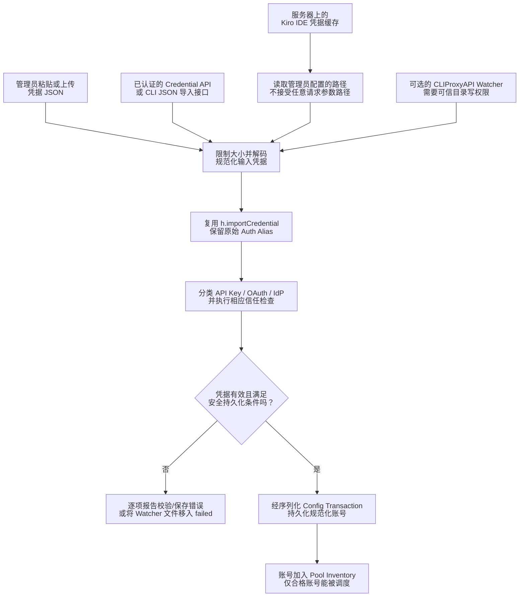
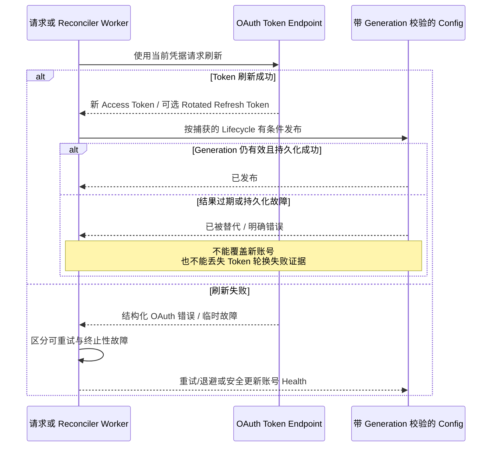

# 身份认证、凭据导入与安全刷新

> **语言：** [English](../authentication.md) · [Tiếng Việt](../vi/authentication.md) · [简体中文](../zh-CN/authentication.md)

> **基准：** [`63d4e2bb4375`](https://github.com/trankien84/Kiro-Go/commit/63d4e2bb4375d85aed46e72d1d7c5df25138fa41)。凭据导入、OAuth Refresh 和 Provider Account Selection 是**不同操作**。导入成功不代表账号永远可以参与路由。

## 1. 认证方式与凭据来源

| 凭据类别 | 关键边界 / 行为 |
| --- | --- |
| AWS Builder ID 与 IAM Identity Center | OAuth/SSO 凭据，支持 Token Refresh、Account/Profile Region 处理 |
| Microsoft Entra ID / Enterprise SSO | 浏览器交互登录或经校验的凭据导入，并对 Microsoft 身份及 Token Endpoint 进行专门检查 |
| 通用 `external_idp` | 即使共用 `external_idp` Auth Method，也不能仅凭这个字符串认定是 Microsoft |
| Kiro API Key | `ksk_...` 凭据采用 Kiro CLI Runtime 和 `tokentype: API_KEY`，**不使用** OAuth Refresh 或 `profileArn` |
| Kiro IDE 本地缓存 | 服务端读取 IDE 已登录的凭据，持久化前必须校验/刷新 |

Microsoft 365 Tenant 往往启用 MFA 与 Conditional Access，因此 Headless Password Grant 不是标准的 Enterprise SSO 登录路径。分类应依据真实的 Identity/Upstream 证据，不能只靠通用字段猜测。

**源代码：** [`auth/microsoft_sso.go`](../../../auth/microsoft_sso.go), [`auth/oidc.go`](../../../auth/oidc.go), [`auth/kiro_sso.go`](../../../auth/kiro_sso.go), [`config/account_credentials.go`](../../../config/account_credentials.go), [`proxy/handler.go`](../../../proxy/handler.go). **测试：** [`auth/microsoft_sso_test.go`](../../../auth/microsoft_sso_test.go), [`proxy/microsoft_lifecycle_test.go`](../../../proxy/microsoft_lifecycle_test.go).

## 2. 所有凭据导入入口复用一个 Classifier

**各导入路径与信任边界**

1. 管理界面的 JSON 表单/上传、认证后的 Import API、IDE Cache 与可选的文件夹 Watcher 都只是**数据入口**，不是独立的分类器。最终统一调用 `h.importCredential` 完成标准 Auth Method/Provider 分类与验证。
2. IDE 缓存由**服务端**使用默认路径或 `KIRO_IDE_CACHE` 读取。请求体中旧的 `path` 参数被**有意忽略**，防止通过 API 读取任意文件。Docker 需要正确挂载 Host Cache 才能读取到缓存。
3. Watcher 无需管理员发起 HTTP 请求即可导入凭据。因此拥有 `data/imports` 写权限，就相当于拥有提交新账号导入的能力；不能与低信任用户共享。独立运行程序默认关闭 Watcher，仓库中的 Compose 配置默认启用。
4. JSON 解码成功并不代表账号可以执行推理。凭据必须先分类、持久化，然后由普通的 Pool/Model/Health Gate 决定是否 Dispatch。

**示例：** 通用 `external_idp` JSON 若没有明确的 Microsoft 身份证据，不得只因存在 Token Endpoint 就强制走 Microsoft Refresh。各个入口必须使用相同 Classifier，避免得出不一致的结果。

`POST /admin/api/auth/credentials`、`POST /admin/api/auth/import-cli-json`、IDE Cache Import 和 Drop-Folder Watcher 都会汇聚到 `h.importCredential`。输入中的 `snake_case`/`camelCase` Alias 会在标准分类之前规范化。Admin/UI 和 File Watcher **有不同的信任前提**。

**源代码：** [`proxy/handler.go`](../../../proxy/handler.go) (`apiImportCredentials`, `importCredential`, `apiImportCliJson`, `apiImportIdeCache`), [`proxy/cli_json_import.go`](../../../proxy/cli_json_import.go), [`proxy/import_watcher.go`](../../../proxy/import_watcher.go). **测试：** [`proxy/import_credentials_test.go`](../../../proxy/import_credentials_test.go), [`proxy/cli_json_import_test.go`](../../../proxy/cli_json_import_test.go), [`proxy/import_watcher_test.go`](../../../proxy/import_watcher_test.go).

### IDE Cache：故意忽略请求里的 `path`

`/admin/api/auth/import-ide-cache` 可能为了兼容旧客户端仍然解析请求体，但**不会使用 `body.path`**。服务端仅通过 `KIRO_IDE_CACHE` 或默认 `~/.aws/sso/cache/kiro-auth-token.json` 定位文件。`readIdeCacheCredential` 限制文件最大 **1 MiB**，并要求可用的 Refresh Material。客户端不能用此端点读取任意路径。这是**安全限制**而非功能缺失。不要再使用 `-d '{"path":"..."}'` 作为可由客户端指定服务端文件路径的示例，以免误导读者。

**源代码：** [`proxy/handler.go`](../../../proxy/handler.go) (`apiImportIdeCache`), [`proxy/ide_cache_import.go`](../../../proxy/ide_cache_import.go). **测试：** [`proxy/ide_cache_import_test.go`](../../../proxy/ide_cache_import_test.go).

### Drop-Folder Watcher 的安全边界

`KIRO_IMPORT_WATCH` 在独立可执行文件中默认关闭，但**仓库自带的 `docker-compose.yml` 会启用它**。放在 `data/imports/` 的 `CLIProxyAPI_*.json` 可在没有管理员密码的 HTTP 调用下导入，因此目录写权限相当于账号创建能力。不要把它挂载到比账号配置更宽松的共享目录；若目录由不可信用户或同步服务管理，应关闭 Watcher。已处理和失败的文件移入各自子目录；错误内容必须限制长度并避免泄露 Secret。

**源代码：** [`docker-compose.yml`](../../../docker-compose.yml), [`proxy/import_watcher.go`](../../../proxy/import_watcher.go).

## 3. OAuth Refresh 失败不等于同一种 Ban

Refresh Failure 分为 **retryable**、**credential-terminal** 和 **configuration-terminal**。结构化的 `OAuthTokenEndpointError` 将标准错误码与人类可读描述分开保存；不能仅凭 HTTP 400 或错误文字决定重试策略。尤其是 Rotated Refresh Token：如果 IdP 已成功轮换，而本地持久化失败，新 Token 不能被静默丢弃。

**源代码：** [`auth/refresh_failure.go`](../../../auth/refresh_failure.go), [`auth/refresh_persistence_recovery.go`](../../../auth/refresh_persistence_recovery.go), [`auth/refresh_context.go`](../../../auth/refresh_context.go), [`proxy/account_reconciler.go`](../../../proxy/account_reconciler.go). **测试：** [`auth/refresh_failure_test.go`](../../../auth/refresh_failure_test.go), [`auth/refresh_lifecycle_test.go`](../../../auth/refresh_lifecycle_test.go).

### 如何理解刷新时序？

异步 Worker 使用当前凭据快照访问 Token Endpoint。Provider 可能返回 **Rotated Refresh Token**，此时旧 Token 可能已失效。因此保存时必须检查 Generation，并显式反馈轮换后的持久化错误。Token 属于原账号 Lifecycle，即使新账号恰好复用了相同字符串 ID，也不能被写进替换账号。

代码使用结构化 OAuth Failure Disposition，而不是把任何 HTTP 400 都当成永久无效凭据。可重试的网络/限流问题、无效凭据和无效客户端配置需要不同的运维处理。

## 4. Kiro API Key Region 重新探测

Region Reprobe 只用于符合条件的 **Kiro API Key** 认证失败，并且有明确的重试边界；不是所有 Provider 或异常都会触发。候选 Region 先经过合法性校验。仅在 REST/Control Plane 探测成功**不足以**将新 Region 持久化；必须在实际 Kiro Runtime 上重试成功才允许提交。否则恢复旧 Region。若已向 Client 输出内容，则禁止重探和重放，以免重复可见结果。

**源代码：** [`proxy/kiro_api.go`](../../../proxy/kiro_api.go) (`reprobeApiKeyRegion`), [`config/account_lifecycle_generation.go`](../../../config/account_lifecycle_generation.go), [`proxy/kiro.go`](../../../proxy/kiro.go). **测试：** [`proxy/kiro_apikey_region_test.go`](../../../proxy/kiro_apikey_region_test.go).

## 5. 只读诊断与运维安全

- 将 `data/` 下的文件和挂载的 Cache 视为 Secret，严格限制文件权限与 Docker Volume 的访问范围。
- 不记录 JWT、Access/Refresh Token、完整 `Authorization` Header 或包含真实凭据的 CLI JSON 示例。
- 导入账号不能绕过 Model/Capability/Routing Eligibility；参见 [Provider 路由](provider-routing.md)。
- 账号替换后，在途的刷新结果若不再拥有当前 Lifecycle，就必须丢弃；参见 [账号生命周期](account-lifecycle.md)。
