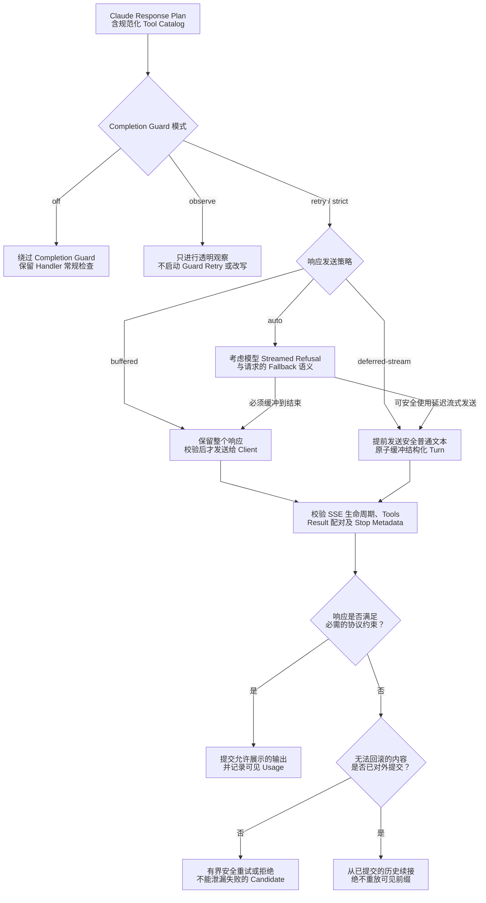
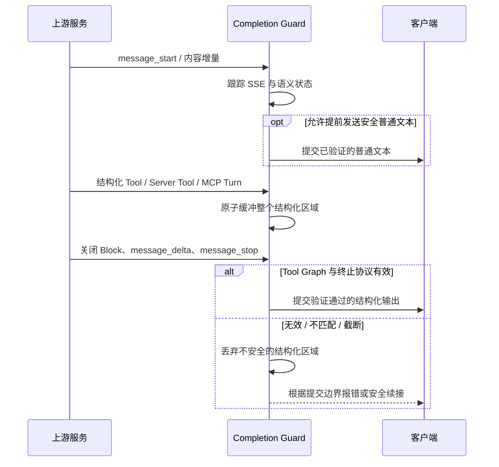
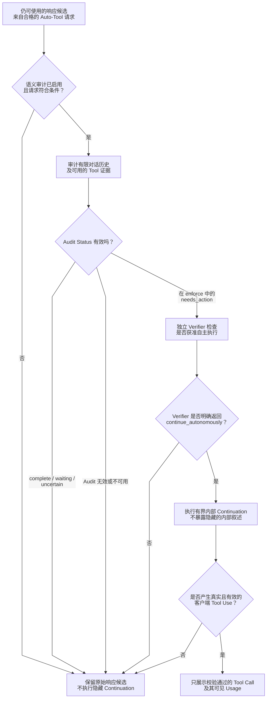

# Completion Guard：协议安全、响应发送与语义审计

> **语言：** [English](../completion-guard.md) · [Tiếng Việt](../vi/completion-guard.md) · [简体中文](../zh-CN/completion-guard.md)

> **基准：** [`63d4e2bb4375`](https://github.com/trankien84/Kiro-Go/commit/63d4e2bb4375d85aed46e72d1d7c5df25138fa41)。这是针对 **Claude Messages 响应**的 Guard，**不是**所有端点共用的输出校验器。中间版本曾使用的 Deterministic Completion-Action/Confidence Heuristic 已被删除，不能描述为当前功能。

## 1. 每种 Guard 模式的行为不同

| `KIRO_AGENT_COMPLETION_GUARD` | 实际行为 |
| --- | --- |
| `off` | 禁用 Completion Guard；Handler 和 Transport 的常规检查仍然有效 |
| `observe` | 仅透明观察；只进行一次 Upstream Attempt，**不**由 Guard 强制校验/重试/改写或运行语义审计 |
| `retry` | 启用 Guard 的校验与恢复路径；是否重试或拒绝取决于 Request 和 Commit Boundary |
| `strict`（默认） | 严格检查结构化协议，对无效/未完成的输出进行有界恢复 |

`KIRO_AGENT_COMPLETION_DELIVERY` 支持 `auto`（默认）、`buffered`、`deferred-stream`。`KIRO_AGENT_COMPLETION_GUARD_MAX_RETRIES` 默认为 `2`（有效范围 `0..4`）。重试预算**并不意味着任何失败都能安全重试**。`KIRO_AGENT_COMPLETION_GUARD_MAX_BUFFER_BYTES` 是保留数据的**计量约束**，不是 Go Heap 的硬上限。

**源代码：** [`proxy/agent_completion_guard.go`](../../../proxy/agent_completion_guard.go) (`completionGuardModeFromEnv`, `completionGuardDeliveryModeFromEnv`, `buildAgentCompletionGuardPlanForModelWithCatalogAndCapabilities`), [`proxy/agent_completion_guard_budget.go`](../../../proxy/agent_completion_guard_budget.go). **测试：** [`proxy/agent_completion_guard_test.go`](../../../proxy/agent_completion_guard_test.go), [`proxy/agent_completion_guard_long_term_regression_test.go`](../../../proxy/agent_completion_guard_long_term_regression_test.go).

## 2. 校验与发送策略

**各 Delivery 分支的含义**

1. `off` 关闭 Completion Guard，但常规 Request/Transport 校验仍会执行。`observe` 只进行单次透明观察，**不会**偷偷启动 Tool Validation、Replay 或 Semantic Audit。
2. `buffered` 会保留整个 Candidate，直到终止字段和结构化内容都完成验证。`deferred-stream` 可以提前发送安全的普通文本，但会把一个完整的结构化 Turn（Client Tool、Server Tool、MCP 或混合 Turn）作为原子单元暂存，验证通过后才提交。
3. `auto` 会检查模型能力与 `fallbacks`。如果 Streamed Refusal 可能使已经发出的文本失效，即使 Deferred Streaming 看起来可行，也必须选择整段缓冲。
4. 对于无效响应，恢复方式取决于**提交边界**。在外部尚未看到不可回滚的内容之前，可以有界重试或拒绝；一旦内容已提交，只能依据已对外提交的历史构造续接，不能重新输出可见前缀。

**示例：** 响应先生成普通文字，然后输出格式错误的 `tool_use` JSON。之前发出的文字无法撤回，因此结构化 Tool Turn 必须整体缓冲；Recovery 不能假装 Client 没看见前缀而从头重放。

`deferred-stream` **不代表完全暂停输出**，只是将不能安全分片发送的结构化部分留到完成验证之后。模型具有 Streamed Refusal 能力或请求携带 `fallbacks` 时，可能强制整段 Buffer；Non-stream Request 则以 Buffer 方式进行验证。

**源代码：** [`proxy/agent_completion_guard_capabilities.go`](../../../proxy/agent_completion_guard_capabilities.go), [`proxy/agent_completion_guard_tool_state.go`](../../../proxy/agent_completion_guard_tool_state.go), [`proxy/agent_completion_guard_tool_protocol.go`](../../../proxy/agent_completion_guard_tool_protocol.go), [`proxy/agent_completion_guard_projection.go`](../../../proxy/agent_completion_guard_projection.go).

## 3. 结构化协议校验

Guard 不只是检查 Assistant 有没有输出文字。依照实际 Request 和 Tool Catalog，它会验证：完整的 SSE Lifecycle；Content Block 的顺序及关闭状态；Tool `id`、名称、JSON 参数、Schema 必需字段与引用身份；`tool_choice`；Server Tool Call/Result 配对；MCP、Tool Search、Deferred 声明；Thinking/Signature、Compaction/Fallback Boundary，以及 Terminal Stop Metadata。未知或未来的协议字段**不允许**被静默改造成不完整的普通 Tool Turn。

**源代码：** [`proxy/agent_completion_guard_catalog.go`](../../../proxy/agent_completion_guard_catalog.go), [`proxy/agent_completion_guard_tool_protocol.go`](../../../proxy/agent_completion_guard_tool_protocol.go), [`proxy/agent_completion_guard_tool_reference.go`](../../../proxy/agent_completion_guard_tool_reference.go), [`proxy/agent_completion_guard_tool_state.go`](../../../proxy/agent_completion_guard_tool_state.go). **测试：** [`proxy/agent_completion_guard_tool_protocol_test.go`](../../../proxy/agent_completion_guard_tool_protocol_test.go), [`proxy/agent_completion_guard_official_protocol_fixture_test.go`](../../../proxy/agent_completion_guard_official_protocol_fixture_test.go).

### 理解结构校验的时序

Messages Stream 是具有顺序要求的协议生命周期，不是任意文本增量的集合。Guard 跟踪 `message_start`、Content Block 的打开/关闭、允许的 Delta 类型、`message_delta`、`message_stop`，以及 Client/Server/MCP Tool 的状态。JSON 参数错误、Tool Result 引用无法解析、Block Index 重复或 Terminal Metadata 冲突，都不能视为有效的 Tool Turn。

**Deferred Streaming** 用于已经发送了安全普通文本、但后续结构化 Turn 必须整体提交的场景。末尾发现 Tool Result 损坏时，Guard 应丢弃未提交的结构化区域，而非泄露半个动作。具备 Streamed Refusal 能力的模型可能需要整段缓冲，因为 Client 已收到的文本不能撤回。

## 4. Semantic Completion Audit 不是 Confidence 打分

`KIRO_AGENT_COMPLETION_AUDIT` 有 `off`（默认）、`observe` 和 `enforce`。Audit 只在满足条件、声明了 Tools 且采用 Auto Tool Choice 的请求中有意义；结构化 Guard 的 `observe` 会关闭它。Candidate 会被分成 `complete`、`waiting_for_user`、`needs_action` 或 `uncertain`。**只有**在 `enforce` 模式下有效的 `needs_action` 才会请求独立 Verifier。Verifier 必须明确返回 `continue_autonomously`；`do_not_continue`、无效输出或证据不足都不能授权自动行动。

**为什么要做两次独立判断？**

只有启用 Audit 且请求满足条件时才会进行第一轮判断。`complete`、`waiting_for_user`、`uncertain` 均不能触发自主续接。即使判定为 `needs_action`，在 `enforce` 模式下仍必须经过**独立 Verifier**，确认遗漏的工作已经获得用户授权，且不需要新的凭据、同意、澄清或用户决策。

Verifier 返回 `do_not_continue`、结果不合法或不可用时，保留**仍可使用的原始响应**。若批准 Continuation，其内部叙述也不会变成公开回答；只有经过校验、真实面向 Client 的 Tool Call 可以提交，并且只统计实际可见输出的 Usage。协议 Guard 与语义 Audit 是**两条不同的保护链**，不是简单的 Confidence 阈值。

**重要：** Audit、Verifier 或 Continuation 都可能失败。不能用内部叙述或伪造的 Tool Call 替换原始可用响应。Streaming 和 Buffered 路径都要区分内部文本与真实的 `tool_use`；隐藏 Attempt 的 Usage 不应算作客户端可见输出。

**源代码：** [`proxy/agent_completion_guard.go`](../../../proxy/agent_completion_guard.go) (`completionGuardAuditRequiresVerification`, `completionGuardAuditContinuationApproved`), [`proxy/agent_completion_guard_visibility.go`](../../../proxy/agent_completion_guard_visibility.go). **测试：** [`proxy/agent_completion_guard_contract_test.go`](../../../proxy/agent_completion_guard_contract_test.go), [`proxy/agent_completion_guard_visibility_test.go`](../../../proxy/agent_completion_guard_visibility_test.go).

## 5. Recovery 的不变约束

**提交前：** 只要错误可重试、预算尚在，且不存在已经对外提交的状态或不可逆副作用，Retry 才可能安全。**提交后：** 从头 Replay 会重复输出，Continuation 只能以已提交的可见语义状态为依据。未完成 Thinking 和被拒绝的隐藏 Attempt 不能直接混入普通 Client History。底层 EventStream 传输规则参见 [流完整性与恢复](streaming-recovery.md)。
