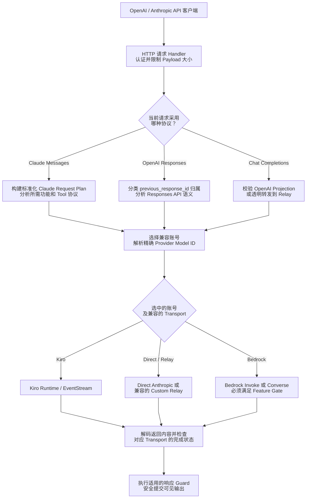
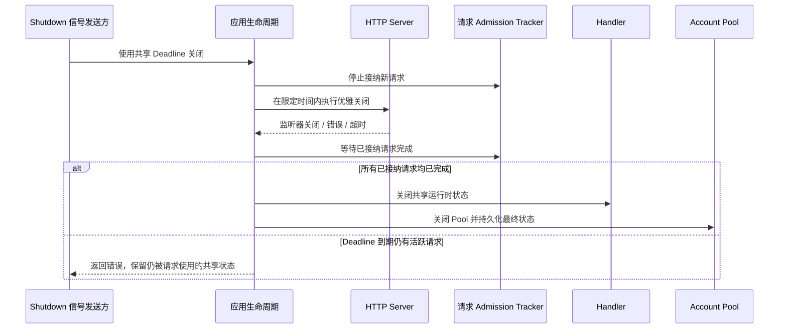

# 架构总览

> **语言：** [English](../overview.md) · [Tiếng Việt](../vi/overview.md) · [简体中文](../zh-CN/overview.md)

> **实现基准：** `trankien84/Kiro-Go`，提交 [`63d4e2bb4375`](https://github.com/trankien84/Kiro-Go/commit/63d4e2bb4375d85aed46e72d1d7c5df25138fa41)。图示仅描述此版本的实际实现，**不代表**所有 Provider 都支持全部端点或未来的 Claude 功能。阅读本文不需要外部账号或服务。

## 文档导航

| 主题 | 详细文档 | 主要内容 |
| --- | --- | --- |
| 账号与模型路由 | [Provider 路由](provider-routing.md) | 可用性判断、不可变模型解析、调度和 Bedrock |
| 凭据与运行时归属 | [账号生命周期](account-lifecycle.md) | Generation、后台刷新及配置持久化 |
| 响应安全 | [Completion Guard](completion-guard.md) | 协议校验、输出提交及语义审计 |
| Claude / OpenAI 接口 | [Agent 协议](agent-protocol.md) | Tool/MCP 语义、兼容性与 Responses 状态 |
| Kiro 流式传输 | [流完整性与恢复](streaming-recovery.md) | 帧解析、终止信号与防重复重试 |
| 登录及导入 | [身份认证](authentication.md) | OAuth/SSO、API Key 和信任边界 |
| 配置与故障排查 | [配置参考](../../configuration.zh-CN.md)、[故障排查](../../troubleshooting.zh-CN.md) | 环境变量、SSO 和请求异常 |

## 1. 请求处理链路与信任边界

**如何阅读该图**

1. Client 采用的 API 决定必须满足哪一种**语义协议**。Claude Messages、OpenAI Responses 与 Chat Completions 的请求格式及状态模型并不相同，即使部分账号可用于多个端点。
2. Planner 区分调用方请求的模型名称和 Provider 实际的 model ID。选择账号时必须保留工具协议、thinking、JSON 格式等必要特性，而不能只按展示名称匹配模型。
3. 选定账号及 transport 后，按**相应协议**校验返回结果。例如 Completion Guard 负责 Claude Messages 的结构化响应；Responses 则有独立的状态归属和事件规则。图中最后一个节点表示适用的检查，不表示所有 API 都由同一个 Guard 处理。

**示例：** 带有 MCP server-tool 历史的 Claude 请求可能需要透明转发的 Messages transport。即使 Kiro 账号存在同名模型，也未必能保持这些语义。若找不到兼容账号，应该明确返回不兼容错误，而不是悄悄丢弃工具元数据。

这是一张**概念架构图**，不是精确的函数调用栈。Completion Guard 属于 Claude Messages 路径；OpenAI Responses 有独立的 state ownership、projection 和 streaming 检查。账号选择节点不保证三种 API 都支持所有 transport；输出也并非总要全部缓冲，参见 [延迟流式发送](completion-guard.md)。

**代码定位：** [`proxy/handler.go`](../../../proxy/handler.go), [`proxy/claude_request_plan.go`](../../../proxy/claude_request_plan.go), [`proxy/claude_transport_requirements.go`](../../../proxy/claude_transport_requirements.go), [`proxy/responses_handler.go`](../../../proxy/responses_handler.go), [`proxy/openai_projection.go`](../../../proxy/openai_projection.go), [`proxy/agent_completion_guard.go`](../../../proxy/agent_completion_guard.go).

## 2. 应用生命周期与优雅关闭

`application_lifecycle.go` 实现了 `requestTracker`（`enter`、`leave`、`startDrain`、`wait`）及 `application.shutdown`。关闭过程共享**一个总 deadline**：一部分用于 HTTP shutdown，其余时间用于等待请求结束和清理。长时间运行的 stream 不能无限占用关闭时间。`main.go` 的 `WriteTimeout=0` 是为了让正常运行时的 SSE 能持续输出，**不等于**取消 shutdown deadline。

**实现：** [`application_lifecycle.go`](../../../application_lifecycle.go), [`main.go`](../../../main.go). **回归测试：** [`application_lifecycle_test.go`](../../../application_lifecycle_test.go).

### 为什么必须按这个顺序关闭？

收到关闭信号后，首先**停止接收新请求**，避免新请求与资源释放并发。已被接纳的请求仍需要 Handler 和 AccountPool 提供服务。HTTP listener 在限定时间内关闭，之后 admission tracker 等待正在执行的请求完成。确认安全后，才清理 Handler、关闭 pool 并持久化最终统计。如果 deadline 用尽时仍有请求在运行，强制销毁共享状态可能造成数据不一致，因此返回错误而不是继续拆除资源。

正常运行时 `WriteTimeout=0` 仅表示不会对整个 SSE 生成过程设置固定写入时限，**不能**绕过优雅关闭的总 deadline。

## 3. 必须区分的三个判断

1. **账号可用性（eligibility）：** 凭据是否有效、是否被封禁、quota 是否足够、请求的模型和协议是否受支持？
2. **转换保真度（projection fidelity）：** 所选 transport 能否直接或通过受支持的 adapter 保留 tool ID、历史、thinking、JSON 约束和 Provider 自有元数据？
3. **响应提交（commit）：** 输出现在是否可以安全发送给 Client？还是必须缓冲、重试、续接或拒绝？

OpenAI-compatible 端点并**不保证**支持完整 Anthropic Messages 或原生 Responses 语义。特别是当前 handler 中，**Direct Anthropic 账号不是原生 `/v1/responses` transport**。详见 [Agent 协议](agent-protocol.md)。

**实现：** [`proxy/provider_registry.go`](../../../proxy/provider_registry.go), [`proxy/projection_fidelity.go`](../../../proxy/projection_fidelity.go), [`proxy/claude_transport_requirements.go`](../../../proxy/claude_transport_requirements.go), [`proxy/responses_handler.go`](../../../proxy/responses_handler.go).

## 4. 文档维护约定

- 架构变化必须能追溯到代码实现以及**对应的回归测试**；存在测试文件并不表示已运行通过。
- 图示对应上面的源码基准。修改路由或 capability 规则时，图和说明须同步更新。
- 不得将 `observe` 描述成强制修复响应，也不得把已经删除的 completion-action heuristic 当作现有逻辑。
- 一旦输出已经提交，就不能把 fallback 画成重新执行整个原始请求。
- 图中不要使用真实凭据、缓存 Token、私人账号 ID 或敏感模型输出。

## Mermaid 图表编写与预览要求

**优先保证节点信息完整、易读，不要机械限制字符数。** 本文 Flowchart 使用多行标签描述动作和关键条件。每张图设置 `htmlLabels: false`，尽量避开部分 VS Code/JetBrains 预览器的 HTML `foreignObject` 文本测量与裁剪问题。支持这些选项的渲染器会参考 `wrappingWidth: 270`、`minNodeWidth: 220`、`nodeSpacing` 和 `rankSpacing`；旧版 Mermaid 可能忽略部分参数。

不要直接用 CSS 固定矩形 `width`：节点看起来变宽时，布局引擎未必会重新计算箭头。应使用 ` ` 分成 2～3 行，适当增加间距；复杂的流程拆成多张图。

**必须进行人工预览：** 先检查 Mermaid 语法，再分别在 **VS Code Markdown Preview 和 GitHub Markdown** 实际渲染。普通桌面宽度下，检查节点文字是否完整、菱形判断框是否能容纳问题、箭头是否重叠，以及流程能否快速理解。**解析成功不等于版式正确。**
