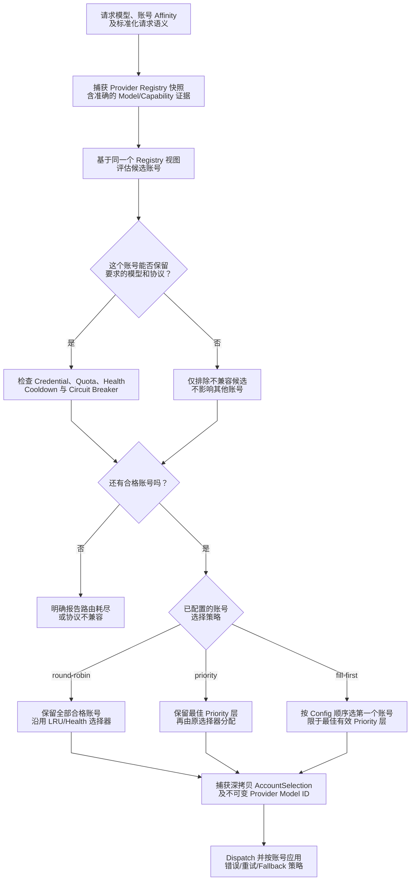
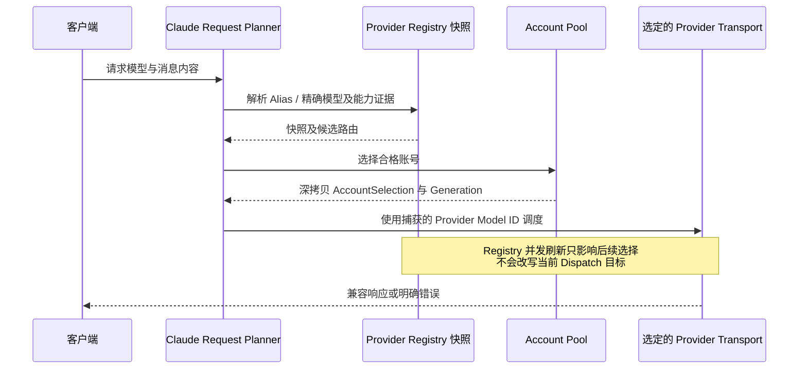

# Provider 模型路由与账号调度

> **语言：** [English](../provider-routing.md) · [Tiếng Việt](../vi/provider-routing.md) · [简体中文](../zh-CN/provider-routing.md)

> **基准：** [`63d4e2bb4375`](https://github.com/trankien84/Kiro-Go/commit/63d4e2bb4375d85aed46e72d1d7c5df25138fa41)。模型 Registry、账号 Scheduler 和协议 Planner 是不同层次。本文解释各层的职责，不假定所有 API 使用同一套 Provider 路由规则。

## 1. 路由决策流程

**逐步理解决策流程**

1. 请求携带调用方**请求的 model ID**及可能存在的账号亲和性。Registry 提供特定账号生命周期内发现的模型和能力**证据**；仅凭 public alias 不能确定真实上游目标。
2. 过滤候选账号时同时考虑两个独立条件：**协议兼容性**（transport 能否完整表达请求）和**运行时可用性**（凭据、quota、health、cooldown、circuit breaker 是否允许调度）。不合适的候选只在对应范围被排除，不会自动升级为全局模型禁用。
3. 只有通过筛选的账号才交给 Scheduler：`round-robin` 保留所有候选交由原有 LRU/health 选择器处理；`priority` 只保留有效优先级数值最小的一层；`fill-first` 选择这一层在 pool/config 顺序中的第一个账号。调度结果会保留 `AccountSelection` 深拷贝和精确的 Provider model ID。
4. Dispatch **之后**发生的错误，由 Handler 的错误分类和有界 retry 逻辑处理；**Scheduler 本身不是任意错误的通用重试器。**

**示例：** A、B 的有效 priority 为 10，C 为 20。所有账号正常时，`priority` 允许现有选择器在 A/B 中分配；`fill-first` 选择 A/B 中按配置顺序排列的第一个合格账号。若 A 正在 cooldown，则可以选择 B；priority 不能绕过 cooldown 或协议限制。

这是 request planner、Registry 和 pool selector 的**逻辑组合图**，并不保证所有代码分支严格按图中的先后顺序执行筛选。Dispatch 后的失败处理有独立策略。Scheduler 不能把 eligibility 检查已经排除的账号重新放回候选集。

**源代码：** [`proxy/claude_request_plan.go`](../../../proxy/claude_request_plan.go), [`proxy/claude_transport_requirements.go`](../../../proxy/claude_transport_requirements.go) (`nextCompatibleClaudeCandidate`), [`proxy/provider_registry.go`](../../../proxy/provider_registry.go), [`pool/account.go`](../../../pool/account.go), [`pool/account_scheduler.go`](../../../pool/account_scheduler.go).

## 2. 三种调度策略

| 策略 | 候选行为 | 需要注意 |
| --- | --- | --- |
| `round-robin`（默认） | 不缩小已通过 eligibility 的账号集合 | 原选择器仍考虑 LRU/health；不承诺严格平均分流 |
| `priority` | 保留**当前合格账号中**优先级最高的一层 | 数值越小优先级越高；同层由现有选择器分配 |
| `fill-first` | 选择最优先级层中 **pool/config 顺序的第一个账号** | 同层不做轮询；调整账号顺序会改变首选目标 |

未设置或小于等于零的 priority 使用有效值 `100`。`fill-first` 仍必须通过 quota、health 和 cooldown 检查；首选账号不再符合条件时可以换用别的合格账号。管理员修改优先级或排序时带有观测状态检查，防止覆盖并发更新。

**源代码：** [`config/account_selection.go`](../../../config/account_selection.go) (`NormalizeAccountSelectionStrategy`, `EffectiveAccountPriority`), [`pool/account_scheduler.go`](../../../pool/account_scheduler.go) (`applyAccountSelectionStrategy`), [`config/account_routing_admin.go`](../../../config/account_routing_admin.go). **测试：** [`pool/account_scheduler_test.go`](../../../pool/account_scheduler_test.go), [`config/account_routing_admin_test.go`](../../../config/account_routing_admin_test.go).

## 3. 不可变模型证据与 Dispatch 亲和性

`proxy/provider_registry.go` 区分 Client 的 **requested model ID**、Provider 自有的 **opaque model ID** 与对外暴露的 **public model ID**。精确 Provider ID 不能再次经过面向 Client 的 alias 改写。大小写不敏感的 fallback 查找如果存在歧义，就不能任意猜测。不可变 Registry 快照使正在 Dispatch 的请求不受并发 Registry 刷新的影响；lifecycle 检查隔离账号运行时状态。

Provider 宣布支持某个模型，并不代表它能满足**特定 Claude 特性**。例如 Kiro 的 structured JSON `output_config.format` 必须由**当前选中的 Kiro 账号及模型**的 live `AdditionalModelRequestFieldsSchema` 明确支持，不能借用其他账号的能力证据。

**源代码：** [`proxy/provider_registry.go`](../../../proxy/provider_registry.go) (`providerRouteIndex.resolve`, `buildAccountRoutes`, `resolveCandidateProviderRoute`), [`proxy/provider_runtime_state.go`](../../../proxy/provider_runtime_state.go), [`pool/account_selection.go`](../../../pool/account_selection.go), [`proxy/claude_kiro_structured_output.go`](../../../proxy/claude_kiro_structured_output.go). **测试：** [`proxy/provider_registry_phase_test.go`](../../../proxy/provider_registry_phase_test.go), [`proxy/claude_kiro_structured_output_test.go`](../../../proxy/claude_kiro_structured_output_test.go).

### Registry 刷新为什么不能改变正在执行的请求？

Registry 是特定时点的账号/模型能力快照。候选账号一旦选中，请求就固定其 generation 和**精确 Provider model ID**。即使后台 discovery 立刻更新公开模型集合，新的数据也仅影响后续请求；已开始的 Dispatch 不会在中途重新解释 alias，更不会误用别的账号所宣告的 capability。

**歧义示例：** 两个不同 Provider ID 规范化成同一个大小写不敏感 key 时，fallback lookup 不能任意挑选其一。Kiro structured JSON 也必须由**选中账号的 live schema**提供支持证据。

## 4. Provider、模型与 Lifecycle 隔离

Provider runtime state 按账号及生命周期隔离。模型快照、发现结果、denial/cooldown 标记与路由发布状态，不得在无关凭据或过期 generation 之间共用。尤其需要区分：

- **Transport failure：** Socket 断开或 EventStream 截断，不足以认定凭据无效。参见 [流完整性与恢复](streaming-recovery.md)。
- **Credential/account failure：** 可能需要按错误分类进行刷新、隔离或 reconciliation。
- **Model/permission failure：** 可以只禁止某个模型或 capability，不能据此认定该账号所有模型都不可用。
- **`Retry-After` / throttling：** 可以触发 cooldown，而不需要改变已配置的路由策略。

**源代码：** [`proxy/provider_runtime_state.go`](../../../proxy/provider_runtime_state.go), [`proxy/account_failover.go`](../../../proxy/account_failover.go), [`pool/account.go`](../../../pool/account.go).

## 5. Bedrock 并不是一种完全统一的 Claude Transport

Bedrock *Invoke* 和 *Converse* 的协议能力不同。选择时必须考虑具体操作、受支持的特性、discovery 得到的 foundation/inference-profile 目标以及实际可调用性。Bedrock 的 discovery、region 和 cache 也要按 lifecycle 隔离，避免旧结果覆盖新账号。Control plane 的发现成功，并不能证明 Data plane 支持所有 Messages 功能。

**源代码：** [`proxy/bedrock_discovery_hardening.go`](../../../proxy/bedrock_discovery_hardening.go), [`proxy/bedrock_discovery.go`](../../../proxy/bedrock_discovery.go), [`proxy/bedrock_region.go`](../../../proxy/bedrock_region.go), [`proxy/claude_transport_requirements.go`](../../../proxy/claude_transport_requirements.go). **测试：** [`proxy/bedrock_discovery_context_hardening_test.go`](../../../proxy/bedrock_discovery_context_hardening_test.go), [`proxy/bedrock_region_context_test.go`](../../../proxy/bedrock_region_context_test.go).

请结合 [Agent 协议](agent-protocol.md) 查看各 transport 的兼容性边界。
