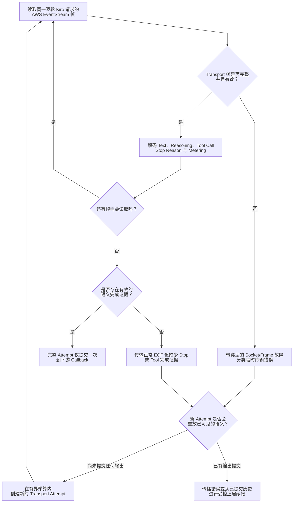
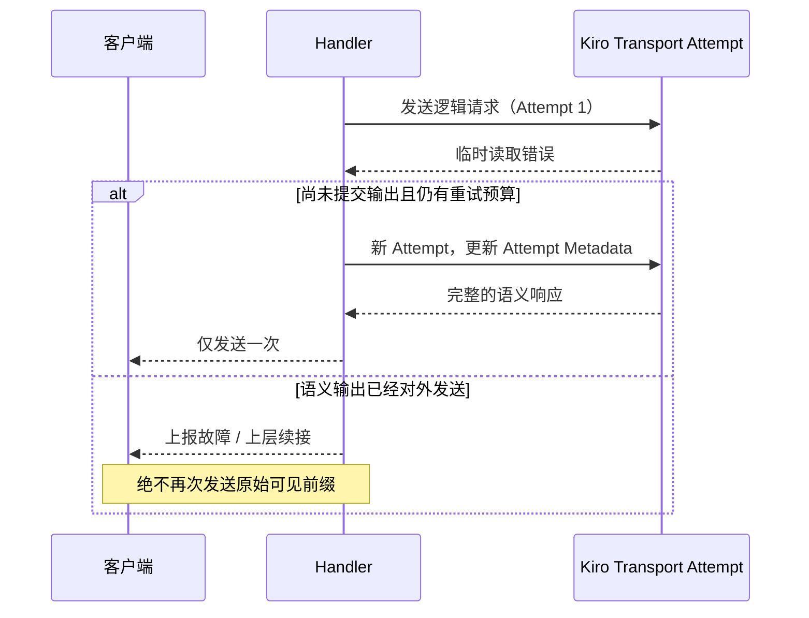

# 流完整性、文本解码与恢复

> **语言：** [English](../streaming-recovery.md) · [Tiếng Việt](../vi/streaming-recovery.md) · [简体中文](../zh-CN/streaming-recovery.md)

> **基准：** [`63d4e2bb4375`](https://github.com/trankien84/Kiro-Go/commit/63d4e2bb4375d85aed46e72d1d7c5df25138fa41)。Transport Retry 与 Completion Guard 的语义续接有**不同的提交边界**。收到 EOF 并不代表答案已完成。

## 1. 读取 Transport 并验证完整性

Kiro 的 AWS EventStream 被解析为具有语义的回调：assistant/reasoning 文本、tool-use 状态、stop reason、metering 与 context 信号。传输层会区分临时连接/读取错误、不完整的帧，以及网络正常 EOF 但缺少**语义结束证据**的情况。真正的 `stopReason` 或已经传递的 tool call 可以构成结束证据；仅有文字或 reasoning 不够。

**失败与重试流程**

1. 一次逻辑上的 Kiro 请求允许多次 HTTP attempt，但不能无限重试（`kiroTransportMaxAttempts=3`）。每个 attempt 先独立解析 AWS EventStream 帧，再检查文本、工具与结束信号的语义。
2. **传输完成不等于回答完成。** 即使 Socket 正常 EOF，若输出了文本但缺少必需的 terminal evidence，仍属于 truncated response，不能标记为成功。
3. 重试前，需要确认是否已发出无法回滚的语义回调：文本、reasoning/signature、tool use 或错误回调。只要内容已经对 Client 可见，重放完整请求就可能重复文字或工具执行。
4. 如果上层调用方在私有缓冲区中保留事件，能够在最终 commit 前丢弃它们，则可以安全 reset/retry；实时 streaming 调用方必须将已发出的语义回调视为不可重放边界。

**示例：** Provider 先输出 `"abc"`，随后 EventStream 截断。如果 Client 已看到 `"abc"`，盲目重放可能得到 `"abcabc"` 或重复 tool call。正确做法是报告不完整结果，或从已提交的历史执行受控 continuation，而不是从头重试。

Transport 的 `3` 次 attempt 限额**不同于** Completion Guard 的重试预算。每次 HTTP attempt 可以更新元数据，但仍属于同一 logical invocation。不要把所有网络异常判定为凭据失效并封禁账号；TCP 正常关闭但缺少语义终止信号，也不代表成功。

**源代码：** [`proxy/stream_integrity.go`](../../../proxy/stream_integrity.go) (`classifyStreamIntegrity`), [`proxy/kiro_transport_recovery.go`](../../../proxy/kiro_transport_recovery.go) (`callKiroAPIContextWithRecovery`), [`proxy/kiro.go`](../../../proxy/kiro.go). **测试：** [`proxy/stream_integrity_test.go`](../../../proxy/stream_integrity_test.go), [`proxy/kiro_transport_recovery_test.go`](../../../proxy/kiro_transport_recovery_test.go).

## 2. 不可重放的准确边界

语义回调往往比原始 HTTP 字节更早构成不可重放边界：文本、thinking/signature、tool-use 或错误回调可能已经交付。部分上层调用方会缓冲回调，并提供安全的 `resetForRetry`；实时 streaming 则应在发出语义输出后禁止重放。Completion Guard 可以基于**已经提交的历史**进行 continuation，但这与再次执行原始 Prompt 是不同操作。

**源代码：** [`proxy/kiro_transport_recovery.go`](../../../proxy/kiro_transport_recovery.go) (`kiroAttemptCallbacks`, `replaySafe`, `resetForRetry`), [`proxy/agent_completion_guard.go`](../../../proxy/agent_completion_guard.go).

### 如何理解 Retry Sequence？

传输层可以为同一**逻辑请求**建立新的 HTTP attempt，并更新 attempt 级元数据。关键判断不仅是 Socket 是否收到字节，而是语义回调是否已经**对外提交**。能完全丢弃缓冲事件的上层调用方，安全重试窗口通常比实时流式响应更大。一旦 Client 已接收内容，从头运行请求就可能重复文本或 Tool 的副作用。

Transport Retry 处理底层连接与 EventStream 完整性问题；Completion Guard Recovery 则可能根据可见的 committed history 构造**续接请求**。两者既不等价，也无法保证恢复任何故障。

## 3. 文本 Chunk 解码：重复文字不等于重放

| 模式 | 输入约定 | 输出行为 |
| --- | --- | --- |
| `delta`（默认） | 每个事件都是新增文本 | 原样输出 Chunk，即使与上一 Chunk 完全相同 |
| `cumulative` | 每个事件包含不断增长的完整前缀 | 只输出新增加的后缀；相同快照不重复输出 |
| `legacy`（可选） | 旧版 overlap heuristic | 可能误删真实的重复字符；**不建议使用**，除非确定旧上游依赖它 |

`cumulative` 遇到不包含旧前缀的 Chunk 时，会原样输出当前 Chunk 并切换到 `delta`，不会猜测重叠后缀。Assistant 与 Reasoning 分别由 `KIRO_ASSISTANT_CHUNK_MODE`、`KIRO_REASONING_CHUNK_MODE` 控制，默认都是 `delta`。

**源代码：** [`proxy/stream_text_decoder.go`](../../../proxy/stream_text_decoder.go) (`Push`, `legacyNormalizeChunk`). **测试：** [`proxy/stream_text_decoder_test.go`](../../../proxy/stream_text_decoder_test.go).

## 4. 请求取消、Usage 与诊断

- Client 取消请求会传递到 Kiro request context 和 Retry Backoff，避免上游任务孤立运行。
- 内部失败的 attempt 不得导致文字、tool call 或对 Client 展示的 usage 重复计算；Transport attempt accounting 与语义 commit 是两层不同的记录。
- Diagnostics 默认按需启用；原始 SSE/Chunk 日志可能包含敏感用户内容，不能随意开启。
- 长时间 stream 的 idle/progress watchdog 与对整个 HTTP stream 设置固定 WriteTimeout 不一样。

**源代码：** [`proxy/kiro_transport_recovery.go`](../../../proxy/kiro_transport_recovery.go), [`proxy/http_idle_watchdog.go`](../../../proxy/http_idle_watchdog.go), [`diagnostics/flags.go`](../../../diagnostics/flags.go), [`main.go`](../../../main.go). **测试：** [`proxy/http_idle_watchdog_test.go`](../../../proxy/http_idle_watchdog_test.go), [`proxy/stream_integrity_paths_test.go`](../../../proxy/stream_integrity_paths_test.go).

关于结构化 Tool Turn 的原子校验，以及独立的语义审计/续接策略，请参见 [Completion Guard](completion-guard.md)。
